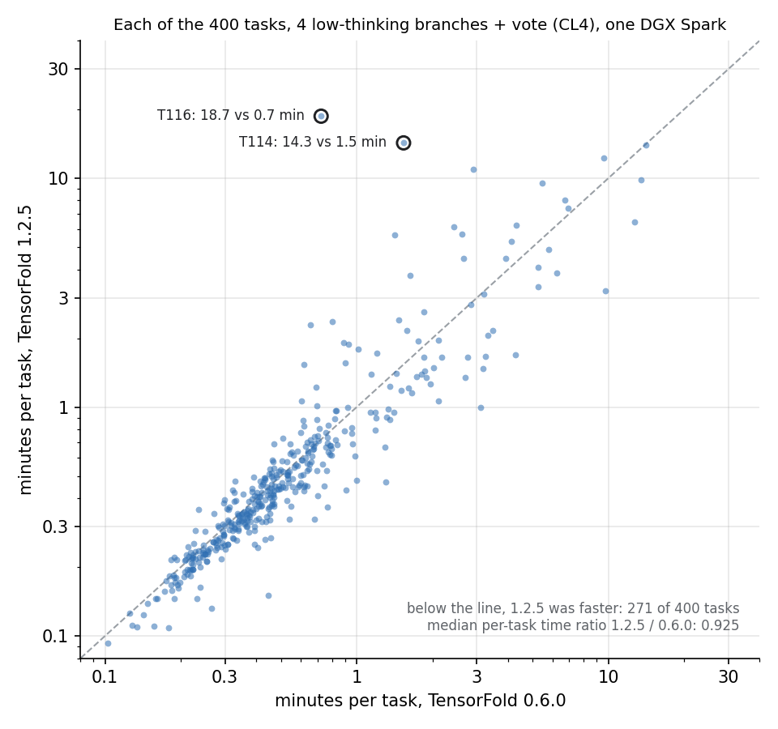
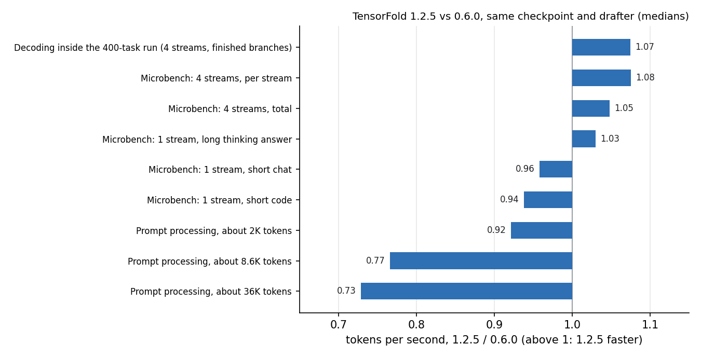

# Part 10: TensorFold 1.2.5 vs 0.6.0 for Qwen3.8-27B on one DGX Spark

Parts 1-9 ran everything on TensorFold 0.6.0, the Python engine (v0.6.0 with the five patches of the MiaAI-Lab recipe, [Part 3](https://github.com/NautilusWu/qwen3.8_study/blob/main/qwen38-spark-speed-comparison-final/README.md)). TensorFold 1.x is a rewritten native engine (Zig/CUDA, no Python). The 27B moved to it in 1.1.0, and each release note compares a version only with the one before it. We found no public comparison of 1.2.x with 0.6.x for the 27B on a DGX Spark.

This part keeps everything from [Part 5](https://github.com/NautilusWu/qwen3.8_study/blob/main/qwen38-spark-model-swap/README.md):
- the machine;
- the checkpoint (NVIDIA NVFP4) and the drafter (DFlash2);
- the 400 private tasks;
- the usage with the most correct answers there: **CL4**, 4 low-thinking branches with an early-stopping vote.

It changes only the engine, from 0.6.0 to **1.2.5**, the latest release on 2026-11-10. Two questions:

1. Does 1.2.5 reach correct answers faster? The measure is **minutes per correct answer**: all time, including wrong answers, divided by the number of correct answers.
2. Does accuracy hold?

## Results on the 400 tasks

| Engine | Correct | Python / C++ / reasoning | Total minutes | Minutes per correct answer |
|---|---|---|---|---|
| TensorFold 1.2.5 | 377/400 | 158/170, 27/30, 192/200 | 378.8 | 1.005 |
| TensorFold 0.6.0 | 373/400 | 154/170, 28/30, 191/200 | 357.3 | 0.958 |
| TensorFold 0.6.0, Part 5's run (October) | 373/400 | 154/170, 28/30, 191/200 | 345.0 | 0.925 |

Both engines in the first two rows ran in this study, in 16 alternating blocks of 50 tasks. The 400 tasks form 8 groups. Both engines ran each group, and which engine went first alternated between groups. The server was restarted before every block.

**The locked test.** It is the only test, and it was written before the run: exact McNemar on the correct answers, and the ratio of minutes per correct answer with a paired bootstrap 95% interval (10,000 resamples). A time ratio above 1 means 1.2.5 is slower.

| Only 1.2.5 / only 0.6.0 correct | p | Accuracy difference (pp) | Time ratio, 1.2.5 / 0.6.0 | Reading under the plan's rules |
|---|---|---|---|---|
| 13 / 9 | 0.52 | +1.0 (-1.25, +3.25) | 1.05 (0.91, 1.22) | no speed difference detected: stay on 0.6.0 |

## What this shows

- **No detectable difference, in accuracy or in minutes per correct answer.** The time interval (0.91 to 1.22) is much wider than the plan expected (about ±6%), so only a large speed difference could have been detected.
- **1.2.5 was faster on most tasks, but not in total.** This was looked at after the results and is not a locked test.
  - 1.2.5 took less time on 271 of 400 tasks, and the median per-task time ratio is 0.925.
  - Its total was still 21.5 minutes longer, because of a few long tasks. T116 took 18.7 minutes against 0.7. T114 took 14.3 against 1.5; there the long run ended in a correct answer, and 0.6.0's quick answer was wrong.
  - These two tasks account for 30.7 minutes. Without them the total time ratio is 0.974.
  - The two engines sample different tokens (no reply was the same), so each task is one draw per engine, and a draw can land on a long branch. One run cannot tell whether 1.2.5 is more prone to such long tasks or whether this was chance.
- **The speed difference depends on the work** (figure below).
  - Decoding with 4 streams is 5-8% faster on 1.2.5: 66.8 against 62.2 tokens/s per finished branch in the run, and 44.7 against 41.5 per stream in the microbench.
  - One stream is within about 6% either way.
  - Prompt processing is slower on 1.2.5, and more so for longer prompts: 0.92x at 2K tokens, 0.77x at 8.6K, 0.73x at 36K (28.7 s against 21.0 s for a 36K-token prompt). 1.2.5 has no FP8 prompt path (it refuses `--prefill-fp8`) and processes prompts with bf16 activations; whether that explains the whole gap was not tested.
- **The first token comes sooner, but a server start takes longer.**
  - Inside the run, the median time to the first token was 0.45 s against 1.07 s.
  - A server start took about 63 s against about 20 s. 1.2.5 measured the cost of its verification window again at every start (about 43 s); in this setup the result stayed inside the container, which was removed after every block.
- **Different outputs, the same accuracy.**
  - With the same seeds and sampling settings, 0 of 400 chosen answers and 0 finished branches had the same text on both engines.
  - 1.2.5 wrote 5.0% more output tokens in total; per task, the median ratio is 1.009.
  - On 3 tasks, none of 1.2.5's 4 branches gave an answer the vote could read (T248, T253, T315), against 0 tasks on 0.6.0. All three count as wrong.
- **Memory:** the lowest available memory during the run was 75.0 GiB on 1.2.5 and 81.0 GiB on 0.6.0, with the same 40 GiB reserve and 80 GB container limit.
- **0.6.0 reproduced Part 5's run, but 3.6% slower.**
  - The same tasks were right and wrong (400 of 400). 385 of 400 chosen answers and 828 finished branches had exactly the same text.
  - The run took 3.6% longer than in October (time ratio 1.036, 95% interval 1.032-1.039). The cause was not investigated.
  - Both engines here ran in the same session, alternating, so this drift does not affect the comparison.

**Practical choice:** with this checkpoint and drafter, stay on 0.6.0, since no gain was measured. 1.2.5 is a working alternative:
- the same checkpoint and drafter, and no Python stack;
- about the same time per correct answer;
- a faster first token with 4 streams;
- slower processing of long prompts (agents, long documents) and a slower start.

TensorFold releases new versions every few days; only 1.2.5 was tested.

## Running TensorFold 1.2.5 with the 27B on one DGX Spark

Everything below was checked on 2026-11-10, on Part 4's 5 public example tasks before the plan was locked, and during the run. The data is in [data/compat_check.json](data/compat_check.json).

- **The release.** We used the official Linux aarch64 archive (48,839,854 bytes; tag `v1.2.5` = commit `8be9c408`). It runs inside the base image of Part 4's TensorFold image (`nvcr.io/nvidia/pytorch` 26.07-py3, by digest), with the extracted archive mounted read-only. Nothing is built and no Python packages are installed.
  - It needs driver R580 or newer (580.178.04 here).
  - The archive comes with a `.sig` file. We found no public key to check it against, so only the sha256 was checked.
- **Flags:** `serve <checkpoint> --drafter <DFlash2> --backend cuda --kv-cache fp8 --precision full --parallel 4 --context 81920 --thinking`, with `TENSORFOLD_MEMORY_RESERVE_GIB=40`. The complete command is in [code/native_engine.py](code/native_engine.py).
  - `--precision full` (bf16 activations on the NVFP4/FP8 weights, the same math as 0.6.0 when decoding) is the only mode 1.2.5 offers for this checkpoint, and `--prefill-fp8` is refused.
  - The DFlash2 drafter has 5 sliding-attention layers and is accepted. Since 1.2.2, DFlash2 drafters that declare a full-attention layer are refused on CUDA.
- **Requests** work as on 0.6.0. `reasoning_effort` takes effect (the engine's statistics show `low`); the documentation also lists `thinking_budget`, which this part did not use.
- **Server status and statistics.**
  - `/health` reports `live.connections` instead of 0.6.0's `busy` and `requests_running`.
  - Each request's statistics include `tokens_per_second` and `time_to_first_token`, but neither engine reports how many draft tokens were accepted per step.
- **Version and network.**
  - `--version` prints only `tensorfold-native 1.2.5`.
  - According to its documentation, `--no-update-check` is accepted only for compatibility: the native engine does not check for updates. We did not pass it.
  - The server process had only local connections, checked after every start and every block.
- **Determinism.**
  - A greedy request repeated, or run alongside other requests, gave the same text.
  - A seeded sampled request gave the same text with the same seed and different text with another seed.

**Speed microbench.** Fixed public prompts, run before the main run (report only). There were 6 rounds alternating the engines, each with a fresh server start as in the main run. All requests were greedy, and the table gives medians.

| Measurement | 0.6.0 | 1.2.5 |
|---|---|---|
| One stream, short chat, no thinking | 41.3 tok/s | 39.6 tok/s |
| One stream, short code, no thinking | 95.8 tok/s | 89.8 tok/s |
| One stream, long thinking answer | 69.5 tok/s | 71.6 tok/s |
| 4 streams at once, per stream | 41.5 tok/s | 44.7 tok/s |
| 4 streams at once, total | 135.4 tok/s | 141.8 tok/s |
| Cold prompt, about 2.1K tokens | 1.40 s (1,524 tok/s) | 1.51 s (1,403 tok/s) |
| Cold prompt, about 8.6K tokens | 4.76 s (1,818 tok/s) | 6.22 s (1,393 tok/s) |
| Cold prompt, about 36K tokens | 20.97 s (1,706 tok/s) | 28.75 s (1,244 tok/s) |

The two engines wrote replies of different lengths to the same prompts (for example 392 against 300 tokens for the short code), so the one-stream speeds are not measured on the same output.

**By group** (CL4, the 400 tasks):

| Group | 1.2.5 correct | 1.2.5 minutes per correct | 0.6.0 correct | 0.6.0 minutes per correct |
|---|---|---|---|---|
| Python coding | 158/170 | 0.853 | 154/170 | 0.693 |
| C++ coding | 27/30 | 0.437 | 28/30 | 0.499 |
| Reasoning | 192/200 | 1.210 | 191/200 | 1.238 |

T116 and T114, the two long tasks, are Python coding tasks: 1.2.5's Python total is 134.7 minutes against 106.8.

## Conditions

- **Machine:** one DGX Spark (GB10, 128 GB), single user, display on throughout (778 of 778 checks, once a minute). Kernel 7.0.0-1019-nvidia, driver 580.178.04, Docker 29.6.2, NVIDIA Container Toolkit 1.20.1.
- **Model and server, both engines:**
  - checkpoint `nvidia/Qwen3.8-27B-NVFP4` @`482ca0f3`, drafter `z-lab/Qwen3.8-27B-DFlash2` @`50307d4c`;
  - FP8 KV cache, a 40 GiB memory reserve;
  - a server container on CPUs 5-9 and 15-19 with 80 GB of memory and the host network;
  - a guard that stops the server below 12 GiB of available memory (it never fired).
- **0.6.0:** Part 4's image `qwen38-tensorfold-repro:0.6.0-trace` (v0.6.0 `c4646171` and the recipe's five patches), FP8 prompt activations, `expandable_segments`, and its kernel cache.
- **1.2.5:** as described above.
- **CL4:** Part 4's runner, unchanged.
  - 4 branches with `reasoning_effort: low`, temperature 0.6, top_p 0.95, top_k 20, seeds 1000-1003, and the early-stopping vote.
  - Output limit 65,536 tokens, context 81,920, at most 40 minutes per task.
  - The same grader as Part 5, in a network-isolated sandbox, pinned to cores 0-4 and 10-14 as since Part 8.
- **Order:**
  - The 400 tasks in their fixed order form 8 groups of 50. Per group, the engine that ran first was 1.2.5, 0.6.0, 0.6.0, 1.2.5, 0.6.0, 1.2.5, 1.2.5, 0.6.0.
  - Before every block: a new server start and the same warm-up request. Before each task, the runner waited until the server was idle; a branch the vote had cancelled could still be finishing, and that wait is not timed.
  - The GPU was free for 5 minutes before the start. The microbench ran first, then the 16 blocks. All blocks completed, with no request errors, no branch at the output limit and no task at the time limit.

## Limitations

- **One run.** Each engine ran each task once. Their outputs differ, so per-task times are single draws, and the time interval is wide.
- **Easy tasks for this usage** (373-377/400). Accuracy differences smaller than about 3-4 percentage points cannot be detected.
- **Only CL4 was compared on the 400 tasks:** 4 streams, low effort, early stopping. One-stream use, deep thinking and agents were not compared. The microbench gives one-stream speeds on a few public prompts only.
- **"Engine" means everything that comes with the version and cannot be set separately:** prompt processing in bf16, the kernels, the scheduler, the sampler and the KV pool. The result cannot say which of them caused what.
- **One version** (1.2.5), with one checkpoint and one drafter.

## Privacy of the task set

The 400 tasks stay private for future model comparisons. Per-task results are published under the same anonymous ids as in Parts 5-7 (T001-T400). The prompts' sha256 is in [PREREGISTRATION.md](PREREGISTRATION.md). Which tasks formed each block follows the private file order, so blocks are given per task (the `block` column) and not as id ranges.

## Files

| Path | Content |
|---|---|
| [PREREGISTRATION.md](PREREGISTRATION.md) | the locked plan (summary), hashes, rules, results, and the compatibility check before it |
| [REPRODUCE.md](REPRODUCE.md) | downloading and checking 1.2.5, a check on Part 4's example tasks, the comparison on your own tasks, the microbench, recomputing the tables |
| [data/summary.csv](data/summary.csv) | the three runs: correct per group, time, tokens, branches, vote outcomes |
| [data/per_task_400/](data/per_task_400/) | per-task results: 1.2.5 and 0.6.0 in this study, 0.6.0 in Part 5's run |
| [data/branches.csv](data/branches.csv) | every branch of both engines: cancelled or finished, tokens, end time, first-token time, speed, graded result, and whether its text equals the other run's |
| [data/blocks.csv](data/blocks.csv) | the 16 blocks in run order: engine, server start time, lowest available memory, duration |
| [data/microbench.csv](data/microbench.csv) | every reply of the speed microbench |
| [data/tests_preregistered.json](data/tests_preregistered.json) | the locked test and the reproduction check, as computed by `code/stats.py` |
| [data/compat_check.json](data/compat_check.json) | the compatibility check on the example tasks, before the lock |
| [figures/](figures/) | figures and the script that draws them |
| [code/](code/) | the 1.2.5 server for Part 4's runner, the alternating-block comparison, the microbench, tables and statistics |
| [scripts/recheck.sh](scripts/recheck.sh) | recompute every table from the published files |

Code: MIT ([LICENSE](LICENSE)).
