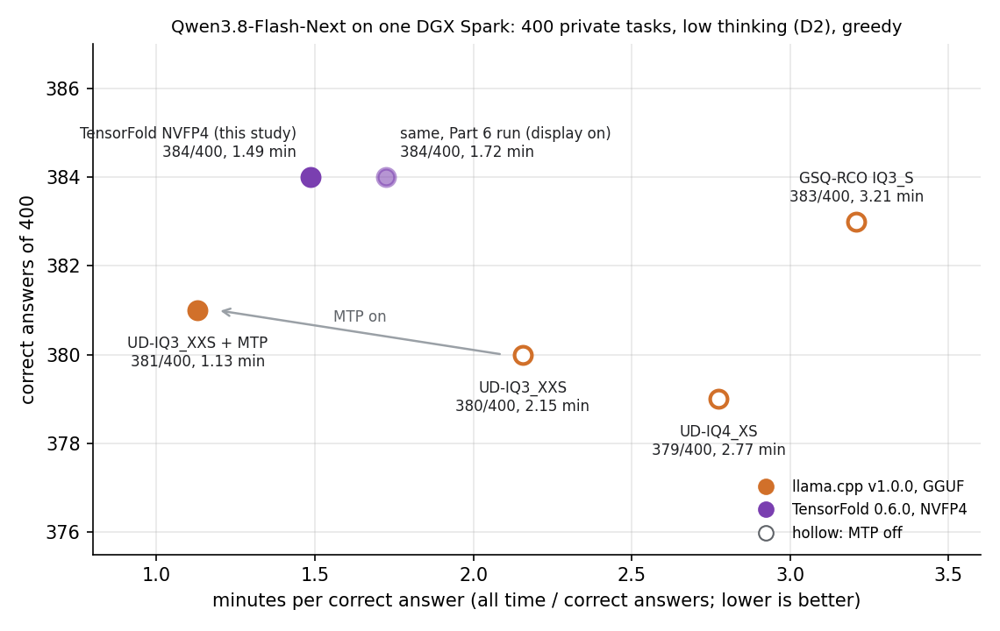
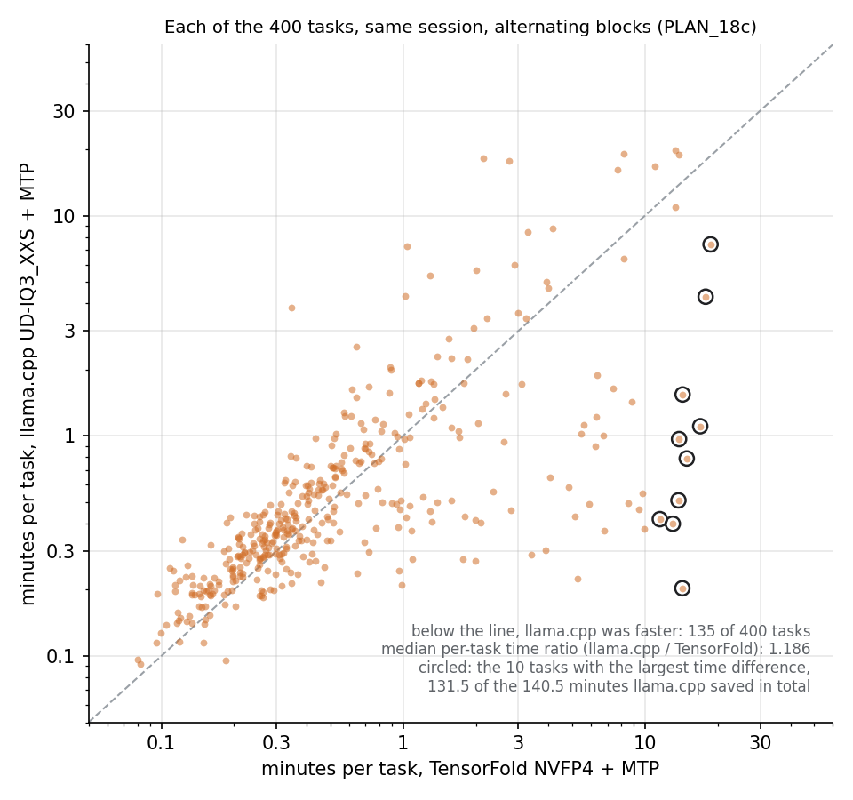
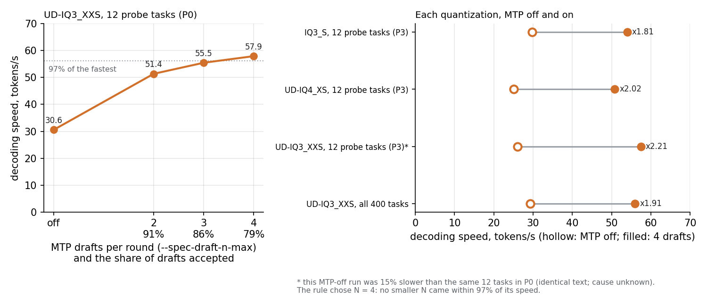

# Part 11: Qwen3.8-Flash-Next as GGUF on llama.cpp, with and without MTP, against TensorFold on one DGX Spark

[Part 6](https://github.com/NautilusWu/qwen3.8_study/blob/main/qwen38-spark-flash-next/README.md) ran Qwen3.8-Flash-Next as an NVFP4 checkpoint on TensorFold 0.6.0. Many people run it as a GGUF file on llama.cpp instead. A post on r/LocalLLM said ISTA-DASLab's GSQ-RCO **IQ3_S** is better than Unsloth's new **UD-IQ4_XS**. The evidence was the poster's own use, on another engine (Strata). Commenters disagreed, and one pointed out that the engine treats the two files differently.

This part has two locked studies, on the 400 private tasks of Parts 5-7 and 10, with low thinking (D2), greedy.

1. **PLAN_18: three GGUF files, one engine.** Only the weight file changes: GSQ-RCO IQ3_S, Unsloth UD-IQ3_XXS (the same file size as IQ3_S, 83.6 GB) and UD-IQ4_XS (93.7 GB), all on the same llama.cpp v1.0.0 build with the same flags and chat template, without MTP.
   - Primary question: accuracy, IQ3_S against each Unsloth file.
   - Secondary: output length and loops, and tool calls on 32 recorded agent turns.
   - Speed is reported only.
2. **PLAN_18c: GGUF + MTP against TensorFold.** PLAN_18's plan said llama.cpp v1.0.0 cannot use Flash Next's MTP head. That was wrong (it has been in llama.cpp since October), so the speed comparison with TensorFold, which always drafts with MTP, was unfair. PLAN_18c adds Unsloth's MTP head to UD-IQ3_XXS and runs it against TensorFold + NVFP4 + MTP in the same session, in alternating blocks.
   - Primary question: **minutes per correct answer**, that is, all time, including wrong answers, divided by the number of correct answers.

## Results on the 400 tasks

| Configuration | Engine | MTP | Correct (Python / C++ / reasoning) | Total minutes | Minutes per correct answer | Output tokens | Hit the 65,536-token limit | Decoding, tokens/s |
|---|---|---|---|---|---|---|---|---|
| GSQ-RCO IQ3_S | llama.cpp v1.0.0 | off | 383/400 (164 / 30 / 189) | 1,229.1 | 3.21 | 2,086,062 | 1 | 28.4 |
| UD-IQ4_XS | llama.cpp v1.0.0 | off | 379/400 (162 / 29 / 188) | 1,051.4 | 2.77 | 1,598,688 | 4 | 25.4 |
| UD-IQ3_XXS | llama.cpp v1.0.0 | off | 380/400 (164 / 29 / 187) | 818.9 | 2.15 | 1,432,914 | 5 | 29.3 |
| **UD-IQ3_XXS + MTP** | llama.cpp v1.0.0 | up to 4 drafts | 381/400 (162 / 29 / 190) | 430.4 | **1.13** | 1,431,344 | 4 | 55.9 |
| TensorFold + NVFP4 | TensorFold 0.6.0 | threshold 0.6, up to 6 drafts | **384/400** (164 / 30 / 190) | 570.8 | 1.49 | 2,052,826 | 5 | (not reported by the engine) |
| same, Part 6's run (October, display on) | TensorFold 0.6.0 | same | 384/400 (164 / 30 / 190) | 661.6 | 1.72 | 2,052,826 | 5 | |

How the rows were run:
- The first three rows are PLAN_18, in alternating blocks.
- The next two are PLAN_18c, in alternating blocks in one session.
- Times between the two studies come from different sessions, so compare them only as a rough guide.

### Locked test 1 (PLAN_18): IQ3_S against the Unsloth files

The test is an exact McNemar test with Holm adjustment over the two primary pairs, plus paired bootstrap 95% intervals (10,000 resamples, seed 2026). A time ratio above 1 means the first file is slower.

| Pair | Only first / only second correct | p | Holm p | Accuracy difference (pp) | Time ratio |
|---|---|---|---|---|---|
| IQ3_S vs UD-IQ4_XS | 15 / 11 | 0.557 | 1.0 | +1.0 (-1.5, +3.5) | 1.157 (0.941, 1.432) |
| IQ3_S vs UD-IQ3_XXS | 12 / 9 | 0.664 | 1.0 | +0.75 (-1.5, +3.0) | 1.489 (1.264, 1.794) |
| UD-IQ4_XS vs UD-IQ3_XXS (reported only) | 13 / 14 | 1.0 | | -0.25 (-2.75, +2.25) | 1.287 (1.013, 1.648) |

**The plan's verdict on the post's claim: no detectable difference.** Neither secondary test separates the files either:

- **Loops:** automatically detected loops were 1, 1 and 1. A loop is a reply that hit the output limit and whose last 8,000 characters compress (zlib) to under 10% of their size. Thresholds of 5% and 15% give the same counts.
- **Tool calls:** malformed calls were 0, 0 and 0.

Tool calls are 32 recorded turns of a coding agent, replayed as recorded. Each turn got three replies: one greedy, two sampled (temperature 1.0, top_p 0.95, top_k 20, seeds 1 and 2), so 96 replies per configuration.

| Configuration | Valid call | Text only | Cut at 8,192 tokens | Malformed |
|---|---|---|---|---|
| GSQ-RCO IQ3_S | 72 | 22 | 2 | 0 |
| UD-IQ4_XS | 74 | 22 | 0 | 0 |
| UD-IQ3_XXS | 73 | 22 | 1 | 0 |
| TensorFold + NVFP4 (reported only) | 71 | 22 | 3 | 0 |

### Locked test 2 (PLAN_18c): UD-IQ3_XXS + MTP against TensorFold + NVFP4 + MTP

| Only GGUF / only TensorFold correct | p | Accuracy difference (pp) | Time ratio, GGUF / TensorFold | Same text |
|---|---|---|---|---|
| 7 / 10 | 0.629 | -0.75 (-2.75, +1.25) | **0.760 (0.599, 0.952)** | 0 of 400 |

The plan's rule: if the interval's upper end is below 1, GGUF + MTP is faster. **Result: by the locked rule, GGUF + MTP is faster (detectable).** No accuracy difference was detected.

## What this shows

- **No difference between IQ3_S and UD-IQ4_XS was detected.**
  - The correct answers were 383 and 379, with 15 tasks only IQ3_S solved and 11 only UD-IQ4_XS solved.
  - Loops and tool-call errors were equal.
  - IQ3_S was the slowest per correct answer. It does not decode more slowly (28.4 against 29.3 tokens/s for UD-IQ3_XXS). It writes more: 1.46 times UD-IQ3_XXS's tokens and 1.31 times UD-IQ4_XS's. Per task, the median ratio is only 1.04, so the extra tokens come from a few long replies. Over 20,000 tokens: IQ3_S 22 replies, UD-IQ4_XS 20, UD-IQ3_XXS 11.

- **MTP roughly doubles llama.cpp's decoding speed with no visible change in accuracy.**
  - Decoding went from 29.3 to 55.9 tokens/s over the 400 tasks, with 83% of drafts accepted.
  - Correct answers: 381 against 380 (9 / 8 only-one-correct, p = 1.0). Total output tokens: 1,431,344 against 1,432,914.
  - The replies are not the same text: only 9 of 400 were identical with and without MTP. The same setting run twice gave identical text (12 of 12 probe tasks, both with and without MTP).
  - TensorFold is different: its drafting returns exactly the tokens it would write without drafts (Part 6).

- **GGUF + MTP was faster by the locked rule, but the difference sits in a few long tasks.**
  This was looked at after the results and is reported only ([figure](figures/per_task_time.png)):
  - Over all 400 tasks, TensorFold produced tokens slightly faster (59.9 against 55.4 tokens/s, including prompt processing). UD-IQ3_XXS + MTP wrote 0.70 times as many tokens.
  - Of the 140.5 minutes saved in total, 131.5 come from the 10 tasks with the largest time difference: TensorFold wrote much longer replies there.
  - On a typical task TensorFold was faster: llama.cpp was faster on only 135 of 400 tasks, and the median per-task time ratio is 1.19.
  - Part of this is systematic. PLAN_18's MTP-off run of the same UD-IQ3_XXS file wrote different text on 391 of 400 tasks, yet it was also short on 8 of those 10 tasks, and its total tokens are almost the same.
  - It is a property of this file on these tasks, not of llama.cpp: IQ3_S and UD-IQ4_XS on the same engine do not share it.
  - Exactly which tasks become long is still noisy. Of the 11 and 12 replies over 20,000 tokens in the two UD-IQ3_XXS runs, only 5 are the same tasks.

- **Practical reading for one Spark.**
  - UD-IQ3_XXS + MTP on llama.cpp gave the fewest minutes per correct answer here (1.13 against 1.49), and it left more memory free (lowest available 48.4 against 35.8 GiB).
  - Its advantage depends on about 10 tasks where it wrote much less. On most tasks TensorFold was faster, and TensorFold's output does not depend on the draft settings.
  - Both reach about the same accuracy (381 and 384 of 400).
  - Without MTP, every GGUF file was slower than TensorFold (different sessions: 2.15-3.21 against 1.49-1.72 minutes per correct answer).

## MTP in llama.cpp

**What is needed:**
- The GGUF files themselves have no MTP layers: each has 1,224 tensors, no `nextn` tensors and no `nextn_predict_layers` key.
- Unsloth publishes the head separately. We used `mtp-Qwen3.8-Flash-Next-Q8_0.gguf` from unsloth/Qwen3.8-Flash-Next-GGUF at commit `f5d175de`: 4,137,429,120 bytes, sha256 `58a47d6a216307e9b97172d5bfdc3436a8994b632f5e436b9bb6edf8951da8d1`.
- This head is self-contained. The `shared` heads Unsloth recommends reuse the main model's weights; we found no code for that in v1.0.0, so we did not use them.
- Unsloth's MTP note says mainline llama.cpp lacks MTP. That is out of date: v1.0.0 has it (commit `c061df198`, "Qwen4Exp: add MTP (#29761)").

**Flags:** `-md <head> --spec-type draft-mtp --spec-draft-n-max N`. The other draft settings stay at their defaults (`--spec-draft-p-min 0`, greedy drafts).

**Choosing N (compatibility check, before the lock).** We ran 12 probe tasks from Part 4's private dev set with D2, the output capped at 8,192 tokens, plus Part 4's 5 public example tasks with 65,536 tokens. The rule, written in advance: take the fastest N, unless a smaller N is within 97% of its speed. **It chose N = 4.**

| UD-IQ3_XXS | Decoding, tokens/s | Drafts accepted | Probe replies identical to MTP off | Examples correct | Example tokens |
|---|---|---|---|---|---|
| MTP off | 30.6 | | | 5/5 | 3,118 |
| N = 2 | 51.4 | 91% | 1 of 12 | 5/5 | 3,154 |
| N = 3 | 55.5 | 86% | 1 of 12 | 5/5 | 14,012 |
| N = 4 | 57.9 | 79% | 0 of 12 | 4/5 | 67,480 |

The fifth example (`ex_five_numbers`) shows how changed text can matter on a loop-prone task:

| Setting | Reply on `ex_five_numbers` |
|---|---|
| MTP off | 1,290 tokens |
| N = 3 | 12,124 tokens |
| N = 4 | ran to the 65,536-token limit without an answer |
| UD-IQ4_XS without MTP (PLAN_18's check) | also looped on this task |

On the 400 tasks, MTP on and off hit the output limit about equally often (4 and 5 replies).

**Each quantization (reported only).** After the main run, each file ran the same 12 probe tasks twice, without MTP and with N = 4, in one session:

| File | Off, tokens/s | N = 4, tokens/s | Speed-up | Drafts accepted | Identical to off | Estimated minutes per correct answer with MTP |
|---|---|---|---|---|---|---|
| GSQ-RCO IQ3_S | 29.8 | 54.0 | 1.81 | 77% | 0 of 12 | 1.77 |
| UD-IQ4_XS | 25.1 | 50.8 | 2.02 | 73% | 0 of 12 | 1.37 |
| UD-IQ3_XXS | 26.0 | 57.4 | 2.21 | 79% | 0 of 12 | 0.98 (measured: 1.13) |

How the estimate was made, and why it is optimistic:
- The estimate is PLAN_18's minutes per correct answer divided by the speed-up. It is an estimate, not a measurement.
- For UD-IQ3_XXS it was 13.5% too optimistic. The MTP-off run in this session was 14-15% slower on every one of the 12 tasks than the same run in the compatibility check, although the text was identical. The cause is unknown; the run with MTP matched the compatibility check within 2%.
- With the speed-up measured on the 400 tasks (55.9 / 29.3 = 1.91) the estimate becomes 1.13, the measured value. So the other two estimates are probably about 15% optimistic too.
- Even so, IQ3_S with MTP (about 1.8) would be slower than TensorFold (1.49).

## Running Flash Next GGUF with llama.cpp on one DGX Spark

- **Build.** llama.cpp v1.0.0 (commit `b1b770d90d94cad9e9ea5b993bdbc383a522fb28`), CUDA 13.0, with `-DGGML_CUDA=ON -DCMAKE_BUILD_TYPE=Release -DCMAKE_CUDA_ARCHITECTURES=121`. CMake turns 121 into 121a. Only `llama-server` was built, and nothing was downloaded during the build (exact command in [REPRODUCE.md](REPRODUCE.md)).
- **Server flags** (the same for every file):

  `-ngl 999 -c 81920 -np 1 -fa on -lm mmap --lazy-mode on --jinja --chat-template-file <template> --reasoning-format deepseek --min-p 0 -t 10 -tb 10`

  The server was pinned to cores 5-9,15-19 (the Cortex-X925 cores TensorFold's container uses) and listened on 127.0.0.1 only. Two flags matter:
  - `-lm mmap --lazy-mode on` reads the n-gram tables from disk as needed. ISTA-DASLab recommends it, and all files used it.
  - `--min-p 0`: llama.cpp's default is 0.05; the model's recommendation is 0. It does not matter for greedy replies.
- **One chat template for all files.** All files used the official `chat_template.jinja` of the NVFP4 checkpoint at commit `7c4f1bc1` (the one Part 6 used), not the template inside each GGUF file.
  - llama.cpp rendered the low-effort, default and tool-calling prompts exactly as Python's jinja2 renders the same template.
  - `reasoning_effort: low` reaches the template: low and default render differently.
- **Turn off the prompt cache for repeatable greedy replies.** By default llama.cpp reuses the previous request's prompt cache. In our smoke test, the same greedy request sent three times gave 727, 864 and 864 tokens; with `"cache_prompt": false` it gave the same 727-token reply every time. Every request in this study sent `"cache_prompt": false`.
- **Loading.**

  | File | First start | Later starts | Lowest available memory |
  |---|---|---|---|
  | IQ3_S | 68 s | 32-66 s | 52.0 GiB |
  | UD-IQ3_XXS | 83 s | 8-40 s | 52.3 GiB |
  | UD-IQ4_XS | 206 s | 98-206 s | 42.8 GiB |
  | UD-IQ3_XXS + MTP | | 16-66 s | 48.4 GiB |

  TensorFold + NVFP4 started in 76-85 s, and its lowest available memory was 35.8 GiB.
- **Wait for the GPU to be released.** A stopped llama-server stays in `nvidia-smi` for a few seconds. In PLAN_18, starting the next server at once failed 8 of 24 times (our runner refuses to start while the GPU shows a process). After that, the runner waits until `nvidia-smi` lists no process (at most 300 s). The waits were 0-1.1 s, and no start failed again.
- **Other checks that passed** (compatibility check):
  - the same token ids on all three files;
  - a repeated greedy request gave the same reply;
  - `--reasoning-budget 1024` stopped thinking at 1,023 tokens, and an answer followed;
  - recorded tool calls were parsed into `tool_calls`;
  - no outside network connections.
- **Prompt processing:** the first token took 9-11 s for a 7,267-token prompt and 30-32 s for 24,322 tokens. The median first token in the main runs was 0.5 s (the prompts are short).

## Conditions

- **Machine:** one DGX Spark (GB10, 128 GB), single user. Kernel 7.0.0-1019-nvidia, driver 580.178.04, Docker 29.6.2, NVIDIA Container Toolkit 1.20.1.
- **Display:** the monitor was off, recorded from X (`xrandr`) once a minute:
  - in PLAN_18c, all 1,265 records;
  - in PLAN_18, 6 of 1,945 records were on, during 2 tasks of UD-IQ4_XS. Removing those 2 tasks changes no conclusion (sensitivity check in [PREREGISTRATION.md](PREREGISTRATION.md)).

  Part 6's TensorFold run had the display on, which likely explains most of the 14% time difference to this study's TensorFold run (in Part 6, switching the display moved the same model's timings by 10-17%). This was not tested separately.
- **Requests:** Part 4's D2 request (`reasoning_effort: low`), greedy, output limit 65,536 tokens, context 81,920, and the same grader in a network-isolated sandbox (pinned to the Cortex-A725 cores). All tasks and the system prompt are in English.
  - The time limit per task was 120 minutes, a safety limit only; no task reached it.
  - Part 6 used 40 minutes. Replies over 40 minutes: UD-IQ4_XS 4, UD-IQ3_XXS 2, none in the other configurations.
- **TensorFold:** exactly Part 6's settings, apart from the time limit:
  - image `qwen38-tensorfold-repro:0.6.0-trace` (`sha256:75d748c5…`);
  - `--parallel 1 --context 81920 --thinking --prefill-fp8 --mtp-confidence 0.6 --mtp-drafts 6`, bf16 KV cache.

  It reproduced Part 6's run exactly: 400 of 400 replies with identical text, 384/400 correct.

## Limitations

- **One run per configuration**, greedy. The PLAN_18c result depends on about 10 long tasks (see above), and a second run of both arms would show how stable it is.
- **PLAN_18's run was interrupted** by the start failures above and completed by a locked fill one day later (see [PREREGISTRATION.md](PREREGISTRATION.md)). The fill broke the planned balance of order and time:
  - IQ3_S: 200 of its 400 tasks ran in the fill;
  - UD-IQ3_XXS: 150 tasks and all its tool-call replies;
  - UD-IQ4_XS: 300 tasks.

  Accuracy does not depend on when a task ran; PLAN_18's time ratios should be read with this in mind.
- **UD-IQ4_XS and the compatibility check:** it failed one compatibility criterion as coded, because one example looped and never answered. It passed the criterion as written in the plan (at least 4 of 5 correct). The user chose to follow the plan's text, after seeing the result.
- **The tasks are fairly easy:** 94.75-96% correct. Differences of about 2.5-3 percentage points or less cannot be told apart.
- **The MTP choices were narrow:**
  - N was chosen on 12 tasks;
  - one MTP head was tried (the self-contained Q8_0);
  - the `shared` heads and `--spec-draft-p-min` were not tried.
- **Engines and settings:** one llama.cpp version (v1.0.0) and one TensorFold version (0.6.0). Strata, the engine in the post, was not tested, and neither were other settings of either engine.
- **The 400 tasks** were written for this study with the help of an AI coding assistant and checked by programs (reference solutions, known wrong answers rejected).

## Privacy of the task set

The 400 tasks stay private for future model comparisons. Their prompts' sha256 is in [PREREGISTRATION.md](PREREGISTRATION.md).

- Per-task results use the same anonymous ids as Parts 5-7 and 10 (T001-T400, in the same order), with category and group.
- The 12 probe tasks come from Part 4's private dev set and are published as P01-P12.
- The recorded agent turns contain our private agent tasks and are not published. Only their labels are ([code/tool_call_labels.py](code/tool_call_labels.py) has the rule).

## Files

| Path | Content |
|---|---|
| [PREREGISTRATION.md](PREREGISTRATION.md) | the three locked plans (PLAN_18, its fill, PLAN_18c), hashes, rules, results and deviations |
| [REPRODUCE.md](REPRODUCE.md) | building llama.cpp, downloads, a check on example tasks, runs with your own tasks, recomputing the tables |
| [data/summary.csv](data/summary.csv) | every configuration: correct, time, tokens, limit hits, loops, speed, memory |
| [data/per_task_400/](data/per_task_400/) | per-task results, one file per configuration |
| [data/same_text.csv](data/same_text.csv) | per task and pair of configurations: identical reply text (1) or not (0) |
| [data/blocks.csv](data/blocks.csv) | every block: position in the order, original run or fill, server startup seconds, GPU-release wait, lowest available memory, failures |
| [data/tests_preregistered.json](data/tests_preregistered.json) | the locked tests as the locked analyses computed them |
| [data/probe/](data/probe/) | the MTP speed probe and the examples of the compatibility check, per request and per run |
| [data/compat_check.json](data/compat_check.json) | both compatibility checks |
| [data/tool_calls.csv](data/tool_calls.csv) | label and token count of every tool-call reply |
| [figures/](figures/) | figures and the script that draws them |
| [code/](code/) | llama.cpp server for Part 4's runner, alternating-block runner, MTP speed probe, tool-call labels, tables, statistics |
| [scripts/recheck.sh](scripts/recheck.sh) | recompute every table and compare with the locked results |

Code: MIT ([LICENSE](LICENSE)).
