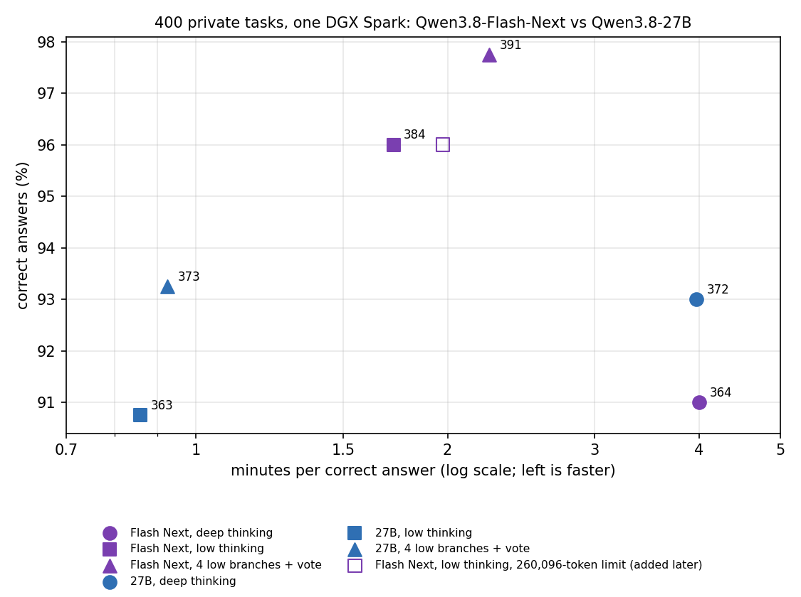
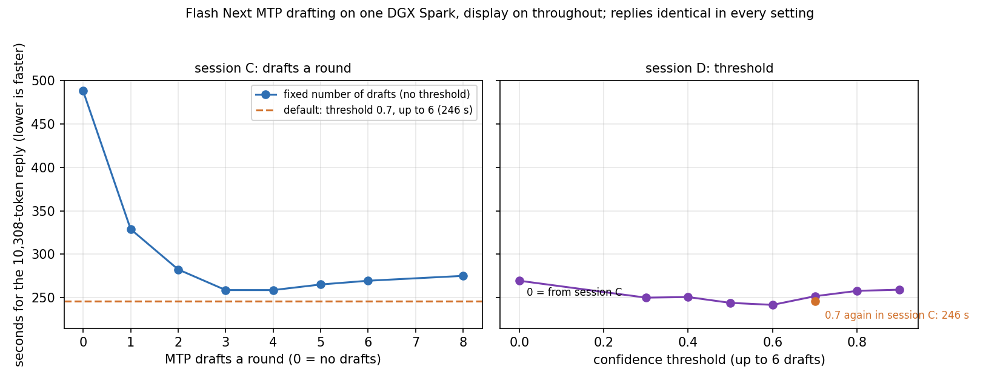

# Part 6: Qwen3.8-Flash-Next vs Qwen3.8-27B on one DGX Spark

[Part 4](https://github.com/NautilusWu/qwen3.8_study/blob/main/qwen38-spark-test-time-strategies/README.md) and [Part 5](https://github.com/NautilusWu/qwen3.8_study/blob/main/qwen38-spark-model-swap/README.md) measured how to use Qwen3.8-27B on one DGX Spark: low thinking, and a vote over four short parallel answers, reach correct answers much faster than the default deep thinking. This part keeps the machine, the engine, the 400 private tasks of Part 5 and the three ways of using the model, and changes the model: **Qwen3.8-Flash-Next**, a 125B mixture-of-experts model (about 6B parameters active per token, plus a 51B n-gram table and its own multi-token-prediction head).

Two questions:

1. Does it fit and run on a single DGX Spark, and what decoding settings make it fastest?
2. Against Qwen3.8-27B, with each model used the same way: how many correct answers, and how many **minutes per correct answer** (all time, including wrong answers, divided by the number of correct answers)?

## Results on the 400 tasks

| Model | Usage | Correct (code / reasoning) | Minutes per correct answer | Hit the 65,536-token limit | No answer |
|---|---|---|---|---|---|
| Flash Next | deep thinking (default) | 364 (176 / 188) | 4.00 | 29 | 29 |
| Flash Next | low thinking | 384 (194 / 190) | 1.72 | 5 | 7 |
| Flash Next | **4 low branches + vote** | **391** (195 / 196) | 2.24 | 4 of 1,600 branches | 1 |
| 27B | deep thinking (default) | 372 (184 / 188) | 3.97 | 17 | 19 |
| 27B | low thinking | 363 (187 / 176) | **0.86** | 0 | 6 |
| 27B | 4 low branches + vote | 373 (182 / 191) | 0.92 | 0 | 0 |

The 27B rows are Part 5's runs ("original"), unchanged.

**Locked comparisons** (same usage, only the model differs; exact McNemar with Holm adjustment over the three pairs; 95% paired bootstrap intervals; a time ratio above 1 means Flash Next is slower):

| Usage | Only Flash Next / only 27B correct | p | Holm p | Accuracy difference (pp) | Time ratio, Flash Next / 27B |
|---|---|---|---|---|---|
| Deep thinking | 15 / 23 | 0.26 | 0.26 | -2.0 (-5.0, +1.0) | 1.01 (0.89, 1.15) |
| Low thinking | 30 / 9 | 0.0011 | **0.0022** | **+5.25** (+2.25, +8.25) | **2.01** (1.60, 2.50) |
| 4 low branches + vote | 21 / 3 | 0.0003 | **0.0009** | **+4.5** (+2.25, +7.0) | **2.43** (2.03, 2.90) |

Reported only, within Flash Next:

| Comparison | Only first / only second correct | p (unadjusted) | Accuracy difference (pp) | Time ratio |
|---|---|---|---|---|
| Deep vs low thinking | 10 / 30 | 0.0022 | -5.0 (-8.0, -2.0) | 2.32 (1.92, 2.85) |
| Low thinking vs vote | 3 / 10 | 0.092 | -1.75 (-3.5, 0.0) | 0.77 (0.67, 0.89) |
| Deep thinking vs vote | 5 / 32 | <0.0001 | -6.75 (-9.75, -4.0) | 1.78 (1.48, 2.19) |

## What this shows

- **With low thinking or a 4-branch vote, Flash Next answers more tasks correctly** (+5.25 and +4.5 percentage points, both detectable after adjustment), **but each correct answer takes about 2-2.4x as long** on this machine. Its vote reached 391 of 400, the most of any configuration in Parts 5 and 6.
- **With deep thinking there is no detectable difference** in accuracy or time between the two models.
- **Deep thinking is Flash Next's weakest setting.** It solved 20 fewer tasks than its own low thinking, in 2.3x the time per correct answer. In 29 of 400 tasks it thought until the 65,536-token limit and never answered (27B: 17).
- **The replies that hit the limit were not about to finish.** Of Flash Next's 29 capped deep-thinking replies, 18 end in the same block of text repeated over and over (`ends_in_repetition` in the data). Most of the others keep re-checking the same edge cases in coding tasks, or write out long lists of numbers by hand in reasoning tasks. A rerun of low thinking with the limit raised to 260,096 tokens and no time limit gave **the same 384 correct answers**; 395 of 400 replies were token for token identical. Of the 5 capped replies, 2 repeated themselves until 260,096 tokens (about an hour each), and 3 stopped between 75,000 and 95,000 tokens without an answer. The limit cost no answers; the loops cost time (758 vs 662 minutes).
- **Practical choice on one Spark:** for the fastest correct answers, 27B with low thinking (0.86 minutes per correct answer). For the most correct answers, if about twice the waiting time is acceptable, Flash Next with low thinking and a 4-branch vote. Flash Next's default (deep) thinking has no advantage here.

## Running Flash Next on one DGX Spark

**Checkpoint.** [local-inference-lab/Qwen3.8-Flash-Next-NVFP4](https://huggingface.co/local-inference-lab/Qwen3.8-Flash-Next-NVFP4) at commit `7c4f1bc1` (105.9 GB; NVFP4 routed experts, MXFP8 attention and DeltaNet layers, NVFP4 n-gram rows, MTP head included): the revision TensorFold 0.6.0 lists as tested. The repository has newer weights since (a later distillation step); they were not used. The BF16 (360 GB) and FP8 (about 173 GiB) releases do not fit in 128 GB.

**Memory.** It fits, with room to spare:

| | |
|---|---|
| Engine's startup estimate | 81.1 GiB with an 81,920-token window, 90.7 GiB with the full 262,144 tokens |
| Lowest available memory during any run | 25.6 GiB ([data/memory.csv](data/memory.csv)) |
| n-gram tables | 26.8 GiB, left in the checkpoint files and memory-mapped; only the rows a reply touches enter the page cache (at most about 26 GiB), and those pages count as available memory |
| KV cache | about 30 KB per token in bf16 (most layers are DeltaNet layers with a fixed-size state): 2.4 GiB at 81,920 tokens, 7.5 GiB at 262,144 |

Part 4's settings for the 27B (a 40 GiB memory reserve at startup and an 80 GB container limit) do not fit; we used TensorFold's default reserve and no container limit, and a guard that stops the server below 3 GiB of available memory. The guard fired once, when another GPU job was started on the same machine (see Limitations). Startup takes about 85-90 s (about 250 s on the first start, which compiles kernels).

**MTP drafting.** Flash Next drafts with its own MTP head (TensorFold does not take a separate draft model for it). Two settings decide how many tokens it drafts per round: the maximum (`--mtp-drafts`) and a confidence threshold (`--mtp-confidence`): a chain stops before a draft the head gives less than that probability. Every setting returns exactly the same tokens (checked on every reply), so only speed changes. Measured on the 5 public example tasks of Part 4, the longest being a 10,308-token deep-thinking reply:

| Setting (display on throughout) | Long reply | Tokens per round | ms per round |
|---|---|---|---|
| No drafts | 488 s (21 tok/s) | 1.00 | 47 |
| Fixed 1 / 2 / 3 / 4 / 6 / 8 drafts | 329 / 283 / 259 / 259 / 270 / 275 s | 1.79 - 3.68 | 57 - 98 |
| Threshold 0.7, up to 6 (TensorFold's default) | 246 s and 252 s (two sessions) | 2.62 | 62-64 |
| Threshold 0.3 / 0.5 / **0.6** / 0.8 / 0.9, up to 6 | 250 / 244 / **242** / 258 / 259 s | 2.35 - 3.36 | 59 - 82 |

- Drafting roughly halves the time of a long reasoning reply (488 to about 245 s).
- A round costs about 47 ms with no drafts, 57 ms with one draft and about 6 ms more for each further draft, while the share of drafts accepted falls as chains get longer; fixed-length drafting is fastest at 3-4 drafts.
- The threshold keeps chains long where the text is predictable and short where it is not; any threshold from 0.3 to 0.9 is within about 7%, and 0.3-0.8 were faster than the best fixed length (259 s). We ran the 400 tasks with 0.6; its edge over the default 0.7 (3-4%) is about the size of the run-to-run spread (the same 0.7 setting took 246 s and 252 s in two sessions).
- **The display state matters:** in earlier sessions where the display was switched on and off during the runs, the same settings ran 10-17% faster or slower. All timings above, and all 400-task Flash Next runs, had the display on throughout.

For orientation: with these settings Flash Next decoded about 40-43 tokens/s on long reasoning, 46-70 on short replies and up to 75 on highly predictable text (counting), against about 93 tokens/s overall for the 27B with DFlash2 on the same low-thinking examples. That is why its time per correct answer is about twice the 27B's even though it reads far fewer weights per token.

## Conditions

- One DGX Spark (GB10, 128 GB), single user, display on throughout the Flash Next runs. TensorFold 0.6.0 (the image of Parts 3-5, `qwen38-tensorfold-repro:0.6.0-trace`), CUDA backend, FP8 prompt activations, bf16 KV cache, `expandable_segments` on. Kernel 7.0.0-1019-nvidia, driver 580.178.04, Docker 29.6.2, NVIDIA Container Toolkit 1.20.1.
- Exactly Part 5's request settings: greedy decoding except the voting branches (temperature 0.6, top_p 0.95, top_k 20, fixed seeds); output limit 65,536, context 81,920, 40 minutes per task; deep thinking = the chat template's default effort, low thinking = `reasoning_effort: low`; the same grader in a network-isolated sandbox.
- What differs from the 27B runs besides the weights: the drafter (Flash Next's own MTP head, threshold 0.6, up to 6 drafts, vs z-lab DFlash2), the KV cache (bf16 vs FP8) and the memory reserve (engine default vs 40 GiB). Drafts are verified exactly and the memory settings only decide what fits, so neither changes which tokens are written; the KV format can.

## Limitations

- One run per configuration and task.
- The 27B runs (Part 5) did not record whether the display stayed on; since the display state can move timings by 10-17%, read the time ratios with that margin. Accuracy is not affected.
- One checkpoint of Flash Next (a community NVFP4 export with quantization-aware distillation), on one engine; other exports, engines or the full-precision model may differ.
- The MTP threshold (0.6) was chosen after a sweep on 5 example tasks (not on the 400 tasks).
- The 400 tasks are fairly easy (91-98% correct), which compresses differences; differences of about 3-4 percentage points or less cannot be told apart.
- Deviations from the plan, all in [PREREGISTRATION.md](PREREGISTRATION.md): the first deep-thinking run stopped after 4 tasks when another GPU job (text-to-speech) started on the machine and the memory guard fired; it was rerun from the start with the same locked code, and the stopped run is not counted. A planned rerun of deep thinking with the 260,096-token limit was stopped after 91 tasks: our runner's deep-thinking method keeps a fixed 65,536-token limit, so those replies were identical to the first run; it is not reported.

## Privacy of the task set

The 400 tasks stay private for future model comparisons. Per-task results are published under the same anonymous ids as in Part 5 (T001-T400, same order in both parts), with their category; the prompts' sha256 is in [PREREGISTRATION.md](PREREGISTRATION.md).

## Files

| Path | Content |
|---|---|
| [PREREGISTRATION.md](PREREGISTRATION.md) | the locked plan and its addendum, hashes, rules, results and deviations |
| [REPRODUCE.md](REPRODUCE.md) | download, compatibility check, runs with your own tasks, MTP sweep, recomputing the tables |
| [data/summary.csv](data/summary.csv) | every configuration: correct, time, limit hits, replies without an answer, replies ending in repetition |
| [data/per_task_400/](data/per_task_400/) | per-task results, one file per configuration (27B files are Part 5's runs) |
| [data/tests_400_preregistered.json](data/tests_400_preregistered.json), [data/tables_400_all_pairs_reported_only.json](data/tables_400_all_pairs_reported_only.json) | the locked tests and all pairs, as computed |
| [data/mtp/mtp_settings.csv](data/mtp/mtp_settings.csv) | every reply of the MTP sweeps (4 sessions; sessions A and B had the display switched during the runs) |
| [data/memory.csv](data/memory.csv) | lowest available memory and n-gram page cache per run |
| [figures/](figures/) | figures and the script that draws them |
| [code/](code/) | Flash Next server for Part 4's runner, runner wrapper, MTP sweep, memory log, statistics |
| [scripts/recheck.sh](scripts/recheck.sh) | recompute the tables from the per-task results |

Code: MIT ([LICENSE](LICENSE)).
