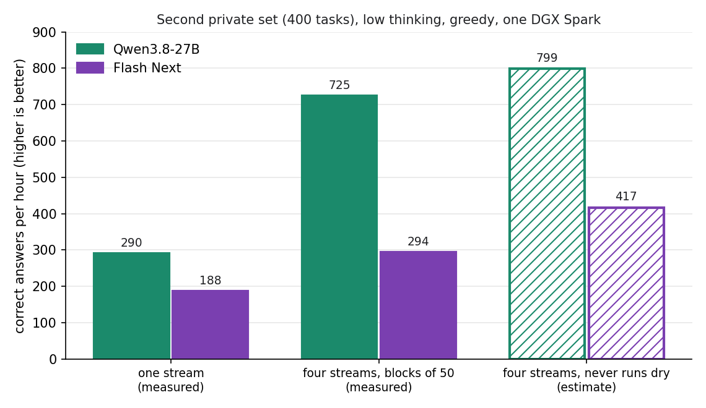
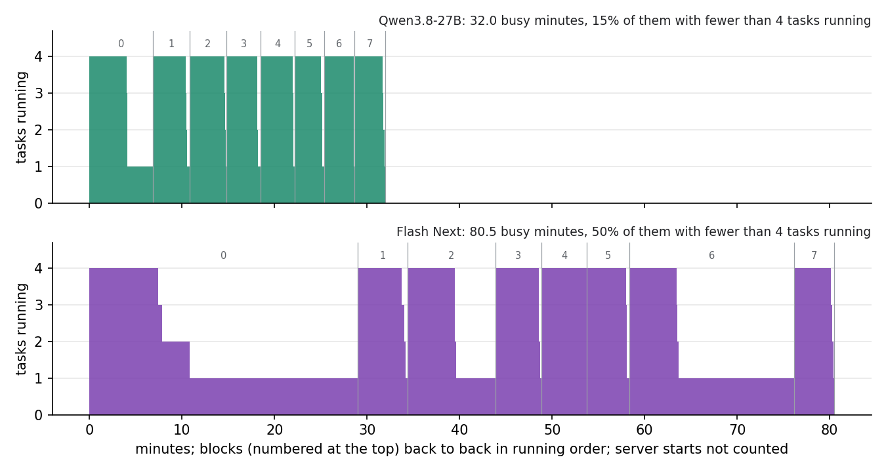
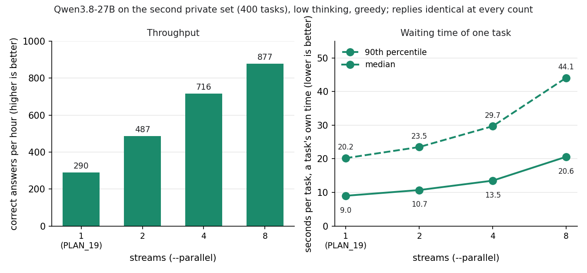
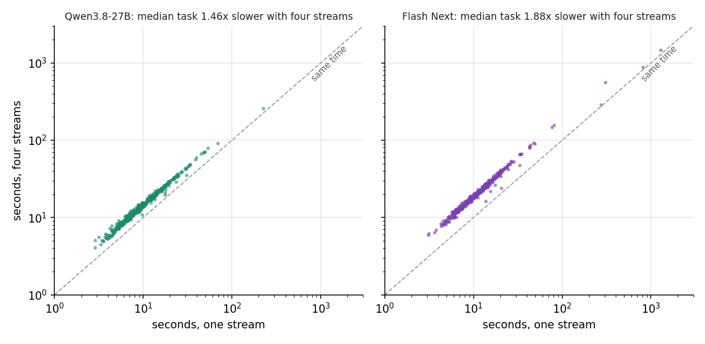

# Part 12: Qwen3.8-27B and Flash Next on a second private task set, one request at a time and up to eight at once, on one DGX Spark

Parts 5-11 used one private set of 400 tasks (here **set T**, ids T001-T400). This part adds a second private set of 400 tasks (**set O**, ids O001-O400). It was written separately, with a different AI coding assistant than set T, and checked the same way.

Three locked studies ran on set O, all with low thinking (D2), greedy, on TensorFold 0.6.0. Blocks of different arms alternated.

1. **PLAN_19: one request at a time** (`--parallel 1`, as in all earlier parts).
   - Qwen3.8-27B against Qwen3.8-Flash-Next: which answers more tasks correctly, and which needs fewer **minutes per correct answer**? Minutes per correct answer is all time, including wrong answers, divided by the number of correct answers.
   - Secondary: is set O easier or harder than set T for each model?
2. **PLAN_20: four requests at once** (`--parallel 4`, four different tasks in flight). Only the concurrency changes.
   - Which model is faster at four streams?
   - How much faster than one stream is each model?
3. **PLAN_21b: the 27B at 2, 4 and 8 streams**, interleaved in the same session. Does 8 beat 4?
   - It was planned for both models (PLAN_21). Flash Next's server rejected requests in the check before the run, so only the 27B ran ([why](#flash-next-at-2-and-8-streams-not-run)).

**Main results:**
- **More streams did not change a single reply.** Both models wrote character-for-character the same text at four streams as with one, 400 of 400 tasks, and so did the 27B at two and eight. So accuracy is the same, and every difference below is speed.
- **Both models gain from four streams, the 27B much more.** The 27B finishes 2.49 times as many tasks per hour (95% interval 2.25-2.68), Flash Next 1.57 times (1.35-2.05).
- **The 27B keeps gaining up to eight streams, with diminishing returns.** Eight streams finished 1.235 times as many tasks per hour as four (1.155-1.287), in the same session. Against one stream (PLAN_19, another session): 1.68 times at two, 2.46 at four, 3.04 at eight. Each task waits longer: at eight streams the median task took 2.25 times as long as alone.
- **The 27B is faster per correct answer, and more so at four streams.** Flash Next needs 1.55 times the 27B's time per correct answer with one stream, and 2.46 times (1.42-3.61) with four.
- **Flash Next answers a few more tasks:** 395/400 against 386/400. That is 13 tasks only Flash Next solved against 4 only the 27B solved, p = 0.049, so just past the threshold: one task changing sides would give p = 0.077.
- **Set T is harder than set O for both models**, by 5.75 points (27B) and 2.75 points (Flash Next). Set O is near the ceiling, so it separates the two models less.
- **Flash Next hit a server error at more than one stream** on TensorFold 0.6.0, for prompts in a narrow length range on a fresh server. That stopped its 2- and 8-stream runs. Its 4-stream run had no errors.

## The second task set (set O)

- **400 English tasks:**

  | Kind | Tasks | Answer |
  |---|---|---|
  | Implementation | 160 (Python 136, C++ 24) | a file or one code block |
  | Debugging | 160 (Python 136, C++ 24) | the fixed file |
  | Program logic | 60 | JSON |
  | Pure logic | 20 | JSON |

- **Grader:** its own grader with hidden test cases (median 147 per coding task). It runs in a network-isolated container (Python 3.11.2, g++ 12.2).
  - It grades a single reply: the answer after the thinking must be the file content or exactly one code block. Anything else is a format error.
  - An empty answer (for example, thinking that runs to the output limit) is also a format error.
- **Checks before any model saw it:**
  - all 400 reference answers pass;
  - all 800 known wrong answers (2 per task) are rejected;
  - no text overlap with the older sets (largest 5-gram Jaccard 0.030), and no shared task families.
  - 24 tasks cover topics similar to older tasks. Both models solved all 24, so leaving them out changes nothing.
- **Private:** like set T, it is kept for future model comparisons. Only ids and results are published.

## Setup (all studies)

| | Qwen3.8-27B | Qwen3.8-Flash-Next |
|---|---|---|
| Checkpoint | `nvidia/Qwen3.8-27B-NVFP4` @ `482ca0f3` | `local-inference-lab/Qwen3.8-Flash-Next-NVFP4` @ `7c4f1bc1` |
| Drafts | `z-lab/Qwen3.8-27B-DFlash2` @ `50307d4c` | its own MTP head: threshold 0.6, up to 6 drafts a round |
| KV cache | FP8 | bf16 |
| Server | [Part 4](https://github.com/NautilusWu/qwen3.8_study/blob/main/qwen38-spark-test-time-strategies/README.md)'s, unchanged | [Part 6](https://github.com/NautilusWu/qwen3.8_study/blob/main/qwen38-spark-flash-next/README.md)'s, unchanged |

**Shared by both models:**
- **Engine:** TensorFold 0.6.0, image `qwen38-tensorfold-repro:0.6.0-trace` (`sha256:75d748c5…`, the same in all 64 starts).
- **Request:** D2 = `reasoning_effort: low`, greedy, output limit 65,536 tokens, context 81,920, 40 minutes per task.
  - System prompt "You are a helpful assistant.".
  - The user message is the task's prompt, unchanged.
- **Order:** the 400 tasks in a fixed shuffled order (seed 2026), cut into 8 groups of 50. Every group ran on both models in ABBA order, with a fresh server for every block. PLAN_20 used the same groups and order as PLAN_19, and PLAN_21b the same groups with its own order (below).
- **Grading:** after all generation, so the grader never competed with a model server. The grading containers were pinned to the GB10's Cortex-A725 cores; the servers ran on the Cortex-X925 cores.

## PLAN_19: one request at a time

| Model | Correct (Python / C++ / JSON) | Total minutes | Minutes per correct answer | Output tokens | Tokens/s, all time | Median seconds per task |
|---|---|---|---|---|---|---|
| Qwen3.8-27B | 386/400 (265 / 46 / 75) | 79.9 | **0.207** | 370,786 | 77.4 | 9.0 |
| Flash Next | **395/400** (271 / 48 / 76) | 126.3 | 0.320 | 464,962 | 61.3 | 10.5 |

**Locked test:** exact McNemar test, plus paired bootstrap 95% intervals (10,000 resamples, seed 2026). A time ratio above 1 means Flash Next is slower.

| Only Flash Next / only 27B correct | p | Accuracy difference (pp) | Time ratio, Flash Next / 27B | Same text |
|---|---|---|---|---|
| 13 / 4 | 0.049 | +2.25 (+0.25, +4.25) | 1.546 (1.092, 2.092) | 0 of 400 |

**The plan's verdict: Flash Next is more accurate (detectable), and slower (detectable).** The accuracy result is fragile: with one task fewer on Flash Next's side (12 / 4), p would be 0.077.

Looked at after the results, reported only:
- **Where the time goes.** Flash Next wrote 1.254 times the 27B's tokens, at 0.792 times its speed, and answered 1.023 times as many tasks: 1.254 / 0.792 / 1.023 = 1.55.
- **A few long tasks make most of the gap.**
  - Flash Next was faster on 129 of 400 tasks, and the median per-task time ratio is 1.154.
  - The 5 tasks with the largest time difference hold 88% of Flash Next's extra time. Without them the ratio is 1.047.
  - The largest: O253, which Flash Next solved after 21.3 minutes and 58,988 tokens (27B: 3.8 minutes); and O372, where Flash Next thought until the 65,536-token limit (13.6 minutes) and gave no answer.
- **Grader results:**
  - 27B: 386 pass, 14 wrong answers.
  - Flash Next: 395 pass, 4 wrong answers, 1 format error (O372).
  - Neither model broke the format rule with extra text. No compile errors, runtime errors or grader timeouts.

### Which set is harder (PLAN_19, secondary)

The two sets are different tasks, so they cannot be paired. The interval resamples each set's tasks independently (10,000 resamples, seed 2026).

The set T results are earlier runs with the same model, server and request:
- 27B: a TensorFold 0.6.0 run whose replies were identical to Part 5's;
- Flash Next: Part 6's run.

| Model | Tasks | Set T | Set O | O − T (pp) | 95% interval |
|---|---|---|---|---|---|
| 27B | all | 363/400 | 386/400 | +5.75 | (+2.5, +9.25) |
| 27B | Python code | 157/170 | 265/272 | +5.07 | (+0.74, +9.71) |
| 27B | C++ code | 30/30 | 46/48 | −4.17 | (−10.42, 0.0) |
| 27B | T: numeric reasoning; O: JSON logic | 176/200 | 75/80 | +5.75 | (−1.5, +12.5) |
| Flash Next | all | 384/400 | 395/400 | +2.75 | (+0.5, +5.0) |
| Flash Next | Python code | 164/170 | 271/272 | +3.16 | (+0.44, +6.32) |
| Flash Next | C++ code | 30/30 | 48/48 | 0.0 | (0.0, 0.0) |
| Flash Next | T: numeric reasoning; O: JSON logic | 190/200 | 76/80 | 0.0 | (−6.0, +5.25) |

**The plan's verdict (overall only): set T is harder for both models (detectable).**
- The difference is in the Python tasks. Set O's Python tasks have more hidden tests than set T's (a median of 147 test cases against 35 assertions), yet both models solved more of them. So the difference does not come from set T's grading being stricter.
- C++ is near the ceiling in both sets, and the reasoning tasks show no detectable difference.
- **Reported only:** Flash Next's lead over the 27B is 5.25 points on set T and 2.25 points on set O. The change, −3.0 points (−6.5, +0.75), is not detectable. Set O separates the two models less because both are near its ceiling.
- **Minutes per correct answer** were about a fifth of set T's: 0.207 against 0.955 (27B) and 0.320 against 1.723 (Flash Next). The median reply was about half as long.
- **Each set has one author**, so this says nothing general about tasks written by either assistant.

## PLAN_20: four requests at once

The only change: the server ran with `--parallel 4`, and four workers took tasks from one queue in the group's order. So four different tasks were always running, until a block's queue ran empty.

**How time is counted (locked).** With four tasks running at once, their own times cannot simply be added up. Each stretch of time is therefore split evenly between the tasks running in it (**shared time**).
- A block's shared times add up to its busy time: from its first request to its last reply, counting only time when at least one task runs.
- **Minutes per correct answer** = all shared time / correct answers.
- At the end of a block, fewer than four tasks may run, and the GPU is not fully used. That time counts too: it is what a batch of 50 tasks costs.
- With one stream, a task's shared time is its own time.

| Model | Streams | Correct | Busy minutes | Minutes per correct answer | Correct per hour |
|---|---|---|---|---|---|
| 27B | 1 | 386/400 | 79.9 | 0.207 | 290 |
| 27B | 4 | 386/400 | 32.0 | **0.083** | **725** |
| Flash Next | 1 | 395/400 | 126.3 | 0.320 | 188 |
| Flash Next | 4 | 395/400 | 80.5 | 0.204 | 294 |

**Locked tests** (paired by task, on shared time, bootstrap 95% intervals):

| Comparison | Time ratio | 95% interval | The plan's verdict |
|---|---|---|---|
| Q1: Flash Next / 27B, both at 4 streams | 2.458 | (1.424, 3.611) | Flash Next slower at 4 streams (detectable) |
| Q2: 27B, 4 streams / 1 stream | 0.401 | (0.373, 0.444) | concurrency raises throughput (detectable): **2.49 times** (2.25-2.68) |
| Q2: Flash Next, 4 streams / 1 stream | 0.637 | (0.488, 0.741) | concurrency raises throughput (detectable): **1.57 times** (1.35-2.05) |

Each interval is a 95% interval, with no correction for three intervals (decided in advance).

**Reported only:**

| | 27B, 1 stream | 27B, 4 streams | Flash Next, 1 stream | Flash Next, 4 streams |
|---|---|---|---|---|
| Speed of one stream, median (tokens/s) | 79.2 | 54.2 (68%) | 64.1 | 34.4 (54%) |
| Total speed over busy time (tokens/s) | 77.4 | 193.4 (2.50x) | 61.3 | 96.3 (1.57x) |
| Total speed while all 4 streams run (tokens/s) | | 213.2 (2.75x) | | 136.4 (2.23x) |
| Same, second estimate (see below) | | 219.0 (2.83x) | | 137.2 (2.24x) |
| Seconds per task: median / 90th percentile | 9.0 / 20.2 | 13.4 / 29.4 | 10.5 / 20.6 | 19.3 / 40.2 |
| A task's own time, median ratio 4 streams / 1 stream | | 1.46 | | 1.88 |
| Busy time with fewer than 4 tasks running | | 15% | | 50% |
| Replies hitting the 65,536-token limit / over 40 minutes | 0 / 0 | 0 / 0 | 1 / 0 | 1 / 0 |

- **The two estimates of the speed while all four streams run.**
  - The first (in the plan) spreads each task's tokens evenly over its own time.
  - The second uses only the tasks that had four tasks running for their whole time (193 for the 27B, 235 for Flash Next): four times their tokens divided by their time. It needs no spreading.
  - The two agree within 3%.
- **Lowest available memory:** 87.5 GiB (27B) and 33.0 GiB (Flash Next) at four streams; 89.4 and 34.5 GiB at one stream.

## PLAN_21b: the 27B at 2, 4 and 8 streams

PLAN_21 was locked to run both models at 2, 4 and 8 streams. Its compatibility check stopped it, because Flash Next's server rejected some requests ([below](#flash-next-at-2-and-8-streams-not-run)). By the plan's rule, nothing was changed to make it run. **PLAN_21b**, locked separately before its first block, ran the 27B alone, with everything else as in PLAN_21.

- **Same session for all stream counts.** Each group of 50 ran at 2, 4 and 8 streams back to back, in a balanced (Williams) order, so every count comes first, second and third, and every pair runs in both orders:

  | Group | 1 | 2 | 3 | 4 | 5 | 6 | 7 | 8 |
  |---|---|---|---|---|---|---|---|---|
  | Order | 2, 4, 8 | 4, 8, 2 | 8, 2, 4 | 8, 4, 2 | 2, 8, 4 | 4, 2, 8 | 2, 4, 8 | 8, 4, 2 |

- 24 blocks, a fresh server with `--parallel N` for each. Shared time as in PLAN_20, with the time split between the N tasks running.
- The 4-stream arm repeats PLAN_20, so 8 against 4 is compared within one session, and the repeat shows how well PLAN_20 reproduces.

| Streams | Correct | Busy minutes | Minutes per correct answer | Correct per hour | Seconds per task: median / 90th percentile |
|---|---|---|---|---|---|
| 1 (PLAN_19) | 386/400 | 79.9 | 0.207 | 290 | 9.0 / 20.2 |
| 2 | 386/400 | 47.5 | 0.123 | 487 | 10.7 / 23.5 |
| 4 | 386/400 | 32.3 | 0.084 | 716 | 13.5 / 29.7 |
| 4 (PLAN_20) | 386/400 | 32.0 | 0.083 | 725 | 13.4 / 29.4 |
| 8 | 386/400 | 26.4 | **0.068** | **877** | 20.6 / 44.1 |

**Locked test** (paired by task, on shared time, bootstrap 95% interval):

| Comparison | Time ratio | 95% interval | The plan's verdict |
|---|---|---|---|
| Q1: 27B, 8 streams / 4 streams | 0.810 | (0.777, 0.866) | 8 streams raise throughput over 4 (detectable): **1.235 times** (1.155-1.287) |

The plan expected 1.2-1.4 times.

**Reported only, as listed in the plan:**

| Comparison | Time ratio | 95% interval | Throughput |
|---|---|---|---|
| 2 streams / 4 streams | 1.464 | (1.344, 1.564) | 0.68 times |
| 2 streams / 1 stream (PLAN_19, another session) | 0.594 | (0.588, 0.604) | 1.68 times |
| 4 streams / 1 stream (PLAN_19) | 0.406 | (0.377, 0.448) | 2.46 times |
| 8 streams / 1 stream (PLAN_19) | 0.329 | (0.294, 0.387) | 3.04 times |
| 4 streams, this run / PLAN_20 | 1.012 | (1.010, 1.014) | 0.99 times |

- **The repeat of PLAN_20:** the replies were identical (400/400), and each block took 0.4-2.0% longer than in PLAN_20. The interval is narrow because both runs wrote the same text, so per-task times move together. It does not measure how much sessions differ in general.
- **Replies:** identical to one stream at 2, 4 and 8 streams, 400/400 each.
- **Per block**, 8 streams were faster than 4 in all 8 blocks: busy time 0.77-0.91 of four streams'.

| | 1 stream | 2 | 4 | 8 |
|---|---|---|---|---|
| Speed of one stream, median (tokens/s) | 79.2 | 67.1 (85%) | 53.6 (68%) | 35.2 (44%) |
| Total speed over busy time (tokens/s) | 77.4 | 130.0 | 191.1 | 234.0 |
| Total speed while all N streams run (tokens/s) | | 132.3 | 210.4 | 277.2 |
| Same, second estimate (tasks with N running their whole time) | | 134.4 (309) | 215.8 (202) | 296.6 (107) |
| Busy time with fewer than N tasks running | | 3.5% | 14.7% | 25.4% |
| A task's own time, median ratio to one stream | | 1.17 | 1.48 | 2.25 |
| Minutes per correct answer, a server that never runs dry (estimate) | 0.207 | 0.121 | 0.076 | 0.058 |
| Lowest available memory (GiB) | 89.4 | 88.2 | 87.4 | 85.6 |

- **Diminishing returns.** Doubling from 4 to 8 streams added 23.5% throughput, while the median task took 1.5 times as long (20.6 against 13.5 seconds). At 8 streams, a quarter of the busy time had fewer than 8 tasks running, at the ends of blocks.
- **Memory** was not the limit: eight streams of the 27B left 85.6 GiB available.

### Flash Next at 2 and 8 streams: not run

- **What happened.** In PLAN_21's check, Flash Next's server answered set O tasks within a second with an error, `MTP context past the cache capacity`: O161 at 8 streams, and O161 together with O001 at 2 streams. The other replies, including Part 4's 5 examples, were identical to earlier runs. The 27B passed every check.
- **The cause** (traced after PLAN_21b, diagnostics only, not part of any test): TensorFold 0.6.0's multi-stream decoder for Flash Next.
  - A stream's caches start at 256 rows. When a request arrives, they grow only if the prompt plus 8 rows does not fit.
  - A stream whose prompt finishes during a round decodes in that same round, before the usual check that grows the caches. Its accepted tokens plus the MTP head's chained drafts can need up to 12 rows beyond the prompt.
  - So a prompt of 245-248 tokens on a fresh 256-row slot overflows. The error then fails every request that is decoding at that moment (O001 above).
  - Used slots keep their grown caches, so it mostly hits the first requests after a server start. One stream (PLAN_19, Part 6) runs on a different code path.
- **Reproduced** with our own filler prompts, on a fresh server at 8 streams: prompts of 246, 247 and 248 tokens were rejected, prompts of 243-245, 249 and 250 tokens were answered. Sent all at once right after the start, the same eight prompts all failed. Reserving 2 × 6 + 2 rows instead of 6 + 2 at admission (one line, in a diagnostic container only) removed every failure and left the replies unchanged.
- **PLAN_20 was not affected:** 0 errors in all 400 tasks, so no fresh slot met a prompt in that range.
- **Not worked around:** a retry or a different warm-up would change the client, so Flash Next has only its 1- and 4-stream results.

## What this shows

- **Concurrency did not change the output.** TensorFold 0.6.0 gave the same greedy replies at `--parallel 4` as at `--parallel 1`, for both models and all 400 tasks, as well as for Part 4's 5 example tasks; for the 27B also at 2 and 8. So here, serving more users at once cost no accuracy, only time per request.

- **Each request gets slower, but the server gets much more done.**
  - With four streams, a single task took 1.46 times as long for the 27B (median) and 1.88 times as long for Flash Next.
  - Throughput went up 2.49 and 1.57 times.
  - The 27B at eight streams: a task took 2.25 times as long, and throughput went up 3.04 times (against one stream in another session).
  - [Per-task times](figures/per_task_latency.png): every one of the 400 tasks took longer with four streams, long tasks about as much as short ones.

- **Why Flash Next gains less: two parts.** Both were looked at after the results, and are reported only.
  1. **Less speed-up even when all four streams run.** Total speed while four tasks run is 2.75 times one stream for the 27B, but 2.23 times for Flash Next. Each Flash Next stream drops to 54% of its single-stream speed, each 27B stream to 68%.
  2. **Long tasks hold up a block.** Two long Flash Next tasks ran alone at the end of their blocks, with three streams idle, for 18.2 and 12.5 minutes:
     - O253: 24.3 minutes at four streams;
     - O372: ran to the token limit.

     Over all blocks, Flash Next had fewer than four tasks running for 50% of its busy time; the 27B for 15%.

  **Per block** (no time sharing needed: one stream's summed task times against four streams' busy time):
  - 27B: 2.03-2.69 times faster, in all 8 blocks.
  - Flash Next: 2.01-2.12 times in the 5 blocks without a long tail, and 1.30, 1.60 and 1.32 in the 3 blocks with one.

  **Possible mechanism (not tested).** Flash Next is a mixture-of-experts model: 512 experts per layer, 10 used per token. With more tokens per step (four streams, each verifying up to 6 MTP drafts), more different experts are read, so a step costs more. The 27B is dense: it reads all its weights every step anyway, so more tokens per step cost little extra. We did not measure this.

- **Two ways to use one Spark** (estimate, reported only):

  | Minutes per correct answer | 27B | Flash Next | Flash Next / 27B |
  |---|---|---|---|
  | One stream (measured) | 0.207 | 0.320 | 1.55 |
  | Four streams, a batch of 50 tasks, then wait (measured) | 0.083 | 0.204 | 2.46 |
  | Four streams on a server that never runs dry (estimate) | 0.075 | 0.144 | 1.92 |

  The last row assumes a queue that always has four tasks waiting, so no stream sits idle. It is all output tokens / the speed while four streams run / correct answers. It was not measured.

- **Practical reading for one Spark.**
  - **Several users or batch jobs:** the 27B with `--parallel 4` gave about 2.5 times Flash Next's correct answers per hour here (725 against 294).
  - **More streams for the 27B:** `--parallel 8` gave 1.235 times the throughput of four streams (877 correct answers per hour), and each task took about 1.5 times as long. Memory was far from the limit; more than 8 streams was not tested.
  - **One user who wants the most correct answers:** Flash Next solved 9 more of 400 tasks, at about 1.5 times the 27B's time per correct answer with one stream.
  - Concurrency does not change this trade: the replies were identical.

## Conditions

- **Machine:** one DGX Spark (GB10, 128 GB), single user. Kernel 7.0.0-1019-nvidia, driver 580.178.04, Docker 29.6.2, NVIDIA Container Toolkit 1.20.1.
- **When:** all on 2026-11-19.
  - PLAN_19: 00:45-04:24.
  - PLAN_20: 08:32-10:37.
  - PLAN_21's check: ended 20:34. PLAN_21b: 21:28-23:29.
- **Display:** the monitor was off throughout. It was recorded from X (`xrandr`) once a minute: 224, 130 and 117 records, all with 0 active displays.
- **Servers:**
  - **Starts:** 27B 15.1-15.2 s at one stream, 18.2-21.2 s at four, and in PLAN_21b 18.2 s at two and four and 21.2 s at eight; Flash Next 72.8-75.9 s.
  - **GPU release:** before every start, the runner waited until `nvidia-smi` listed no process. The wait was 0 s every time.
  - **Failures:** none. All 56 blocks finished, there were no request errors and no grader retries, and the memory guard never fired.
  - **Concurrency:** with N streams, the server's own `/health` reported N requests running in every block (N = 4 in PLAN_20; 2, 4 and 8 in PLAN_21b).

## Limitations

- **One run per model and stream count** (the 27B at four streams twice), greedy. PLAN_19, PLAN_20 and PLAN_21b were three sessions on the same day. Only PLAN_21b compares stream counts within one session; the comparisons with one stream cross sessions. Session effects are real: in Part 11, identical replies took 14-15% longer in one session than in another. Here the repeat of PLAN_20 differed by about 1%.
- **Shared time depends on the other tasks** running at the same time, so the per-task bootstrap is an approximation. The per-block comparison above needs no sharing and agrees.
- **Blocks of 50 tasks with a server restart:** the end of each block leaves streams idle, which hurts Flash Next most. The "never runs dry" row is an estimate.
- **Stream counts:** Flash Next at 1 and 4 streams only (2 and 8 hit the server error above); the 27B at 1, 2, 4 and 8, not more.
- **The Flash Next error** was traced with diagnostic runs after the studies, not with a locked test. The last Python release, 0.6.6, fails the same way when eight requests arrive together (requests sent one at a time take a newer single-stream path there and pass). The native releases 1.2.5 and 1.2.7 refuse this Flash Next checkpoint (`UnsupportedCheckpoint`), so it could not be checked there.
- **The 27B's single-stream path:** TensorFold runs the 27B with `--parallel 1` on a separate single-stream decoding path, and with `--parallel` 2, 4 or 8 on its multi-stream path. That difference is part of what was compared with one stream.
- **Set O is near the ceiling** (Flash Next 395/400), so it separates the two models less than set T.
- **The set comparison:**
  - The two sets differ in their kinds of tasks and in how they are graded.
  - Each set has one author.
  - The set T runs were earlier sessions, but only accuracy was compared between the sets.
- **The p = 0.049 accuracy result** would not survive one task changing sides.
- **Both task sets** were written for this study with the help of AI coding assistants (a different one for each set) and checked by programs: reference solutions, known wrong answers rejected.

## Privacy of the task sets

Both sets stay private for future model comparisons. The sha256 of their files is in [PREREGISTRATION.md](PREREGISTRATION.md).

- **Set O:** per-task results use anonymous ids O001-O400. They are numbered in the sorted order of the private ids, so `stats.py` pairs and resamples exactly as in the locked analyses.
  - Each row also carries the kind, the language and whether the task is one of the 24 topic-similar ones.
- **Set T:** results use the anonymous ids of Parts 5-11 (T001-T400).
- No task text, titles, families or model replies are published, and no hashes of them. For replies, only identical / not identical is published.

## Files

| Path | Content |
|---|---|
| [PREREGISTRATION.md](PREREGISTRATION.md) | the locked plans (PLAN_19, PLAN_20, PLAN_21 and PLAN_21b): hashes, rules, compatibility checks, results, deviations |
| [REPRODUCE.md](REPRODUCE.md) | what can be rerun, a check on Part 4's example tasks, runs with your own tasks, recomputing the tables |
| [data/summary.csv](data/summary.csv) | one row per run (each model at 1 and 4 streams; the 27B at 2, 4 and 8 in PLAN_21b): correct, time, tokens, statuses, latency, speeds, idle share |
| [data/per_task_400/](data/per_task_400/) | per-task results on set O (both models at 1 and 4 streams, the 27B at 2, 4 and 8 in PLAN_21b; multi-stream rows have start and end times on the block's clock), and the set T runs used for the set comparison |
| [data/same_text.csv](data/same_text.csv) | per task: identical reply text (1) or not (0), for one stream against more, 27B against Flash Next, and PLAN_21b's four streams against PLAN_20's |
| [data/blocks.csv](data/blocks.csv) | every block: position, server start, GPU-release wait, lowest available memory, block time, requests running |
| [data/compat_check.json](data/compat_check.json) | the three compatibility checks (PLAN_19, PLAN_20, PLAN_21 with Flash Next's server errors), including Part 4's example tasks per task |
| [data/tests_preregistered.json](data/tests_preregistered.json) | the locked tests as the locked analyses computed them |
| [data/reported_only.json](data/reported_only.json) | everything looked at after the results |
| [figures/](figures/) | figures and the script that draws them |
| [code/](code/) | the runner (one or more streams, alternating blocks), shared time, tables, statistics |
| [scripts/recheck.sh](scripts/recheck.sh) | recompute every table and compare with the locked results |

Code: MIT ([LICENSE](LICENSE)).
