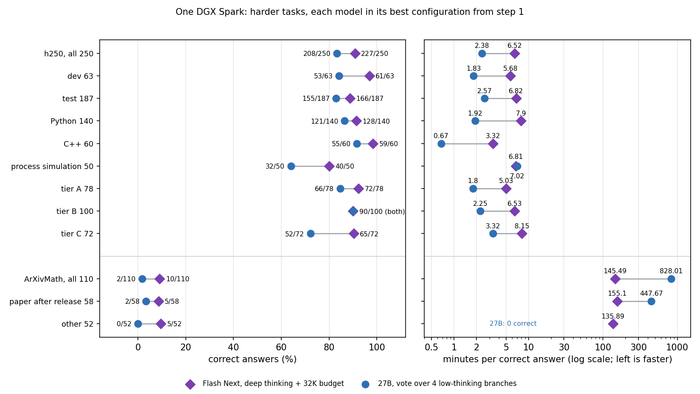
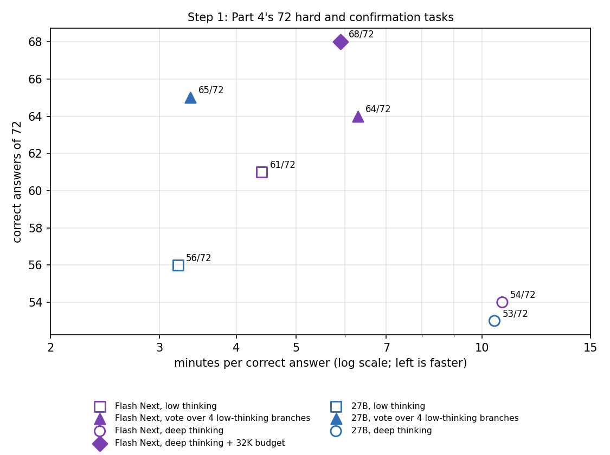

# Part 8: Harder tasks: Flash Next vs 27B on 250 new private tasks and 110 recent arXiv math problems

After Parts 5-7, the 400 private tasks were too easy to separate methods: Qwen3.8-Flash-Next's best configuration answered 393/400, and all configurations together 398/400. This part looks for harder material on one DGX Spark, in two steps, and keeps the measure of the earlier parts: **minutes per correct answer** (all time, including wrong answers, divided by the number of correct answers).

- **Step 1:** Flash Next on the 72 hard and confirmation tasks of [Part 4](https://github.com/NautilusWu/qwen3.8_study/blob/main/qwen38-spark-test-time-strategies/README.md), which the 27B had already done. Its best configuration reached 68/72, so by the rule written down before the run a harder set was needed.
- **Step 2:** each model's best configuration from step 1, on two new sets:
  - **h250:** 250 new private tasks (200 coding, 50 process simulation);
  - **ArXivMath:** 110 public research-level problems from recent arXiv papers (MathArena, 08/2026 and 09/2026).

## Results on the new sets (step 2)

Each model in its best configuration from step 1:

- **Flash Next B:** deep thinking (the chat template's default effort), greedy, with a 32,768-token thinking budget (Part 7's setting).
- **27B CL4:** a vote over 4 low-thinking branches (Parts 4-6's setting).

| Set | Flash Next B | 27B CL4 | Only Flash Next / only 27B correct | p (Holm, 2 tests) | Accuracy difference (pp) | Time ratio Flash Next / 27B |
|---|---|---|---|---|---|---|
| h250 | **227/250**, 6.52 min per correct | 208/250, **2.38** | 27 / 8 | 0.0038 | **+7.6** (+3.2, +12.0) | **2.74** (2.27, 3.34) |
| ArXivMath | **10/110**, 145.49 | 2/110, 828.01 | 10 / 2 | 0.0386 | **+7.3** (+1.8, +13.6) | **0.18** (0.06, 0.64)* |

- **Tests:** exact McNemar test with Holm correction over the two sets; paired bootstrap 95% intervals (10,000 resamples, seed 2026); each task's time capped at 40 minutes.
- **Both comparisons were written down before the run** ([PREREGISTRATION.md](PREREGISTRATION.md)). On both sets both differences are detectable by the plan's rules: an adjusted p below 0.05, and a time interval that excludes 1.
- **\*** With only 2 correct answers for the 27B, 1,346 of the 10,000 resamples contain none of them, and the statistics script leaves those out of the time interval. Counting them as a ratio of 0 instead gives (0.00, 0.61); the reading does not change.

**Per group** (correct, minutes per correct answer):

| Group | Flash Next B | 27B CL4 | Both wrong |
|---|---|---|---|
| h250, all | 227/250, 6.52 | 208/250, 2.38 | 15/250 |
| h250-dev / h250-test | 61/63, 5.68 / 166/187, 6.82 | 53/63, 1.83 / 155/187, 2.57 | 1/63 / 14/187 |
| Python | 128/140, 7.90 | 121/140, 1.92 | 6/140 |
| C++ | 59/60, 3.32 | 55/60, 0.67 | 1/60 |
| Process simulation | 40/50, 6.81 | 32/50, 7.02 | 8/50 |
| Tier A / B / C | 72/78 / 90/100 / 65/72 | 66/78 / 90/100 / 52/72 | 5/78 / 4/100 / 6/72 |
| ArXivMath, all | 10/110, 145.49 | 2/110, 828.01 | 98/110 |
| Paper after both releases / other | 5/58 / 5/52 | 2/58 / 0/52 | 51/58 / 47/52 |

## What this shows

- **On h250, Flash Next B answers more, the 27B vote is faster.**
  - Flash Next B solved 19 more tasks (+7.6 pp) but took 2.74x as long per correct answer.
  - Most of the gap is in the hardest tier (65/72 against 52/72) and in process simulation (40/50 against 32/50). Tier B is a tie (90/100 each).
  - Process simulation is the one group where Flash Next is both more accurate and no slower per correct answer (6.81 against 7.02 minutes). In coding, the 27B vote is 4-5x faster per correct answer.
- **h250 is not hard enough for Flash Next.**
  - The reading written down before the run: if the better configuration answers at least 225/250, the set is still near the ceiling. Flash Next B answered 227/250.
  - The set was designed for the best configuration to get about half to two thirds right; it got 91%.
  - On h250-dev, the tasks meant for developing methods, Flash Next misses only 2 of 63, too few to tell methods apart.
  - The 27B still has room: 53/63 on h250-dev. At least one of its 4 branches was right on 216/250 tasks, against 208/250 for the vote.
- **ArXivMath is too hard for both on this machine.** Both together solved 12/110.
  - Flash Next ran into the 32,768-token thinking budget on 109 of 110 problems. When the budget closes the think block, it answers at once: 99 of those 109 replies ended within 500 tokens of the budget, and 8 of its 10 correct answers were among them ([figures/output_length.png](figures/output_length.png)).
  - The 27B's branches agreed (3 or 4 of 4 with the same answer) on 23 problems, and none of those 23 answers was correct. On h250's process simulation, 25 of 27 agreed answers were correct. Agreement between branches is a useful confidence signal only on problems within the model's reach.
- **Papers published after the models' release** look no harder than the others here: 5/58 against 5/52 for Flash Next, 2/58 against 0/52 for the 27B. With so few correct answers, this says nothing about whether the older problems were seen in training.
- **For everyday use, the advice of Parts 4-7 stands.**
  - For coding, the 27B vote is the faster way to correct answers on this machine.
  - When a task is hard and a wrong answer is expensive, Flash Next with deep thinking and the 32K budget answers more of the hardest tasks, at about 2.7x the time per correct answer.

## Step 1: Part 4's 72 tasks

The 24 hard and 48 confirmation tasks of Part 4 (coding and reasoning, private). The 27B's runs on the confirmation tasks and its deep-thinking run on the hard tasks are Part 4's (the same per-task results as Part 4's data). Its low-thinking and vote runs on the hard tasks were run again here at the confirmation settings; Part 4's hard runs had used a 24,576-token limit, 25 minutes and a 32,768-token context.

| Configuration | Hard | Confirmation | 72 tasks (coding / reasoning) | Minutes per correct | Hit the 65,536 limit | No answer |
|---|---|---|---|---|---|---|
| Flash Next, low thinking (D2) | 20/24 | 41/48 | 61/72 (34 / 27) | 4.40 | 6 | 9 |
| Flash Next, vote over 4 low branches (CL4) | 19/24 | 45/48 | 64/72 (34 / 30) | 6.29 | 6 branches | 3 |
| Flash Next, deep thinking (A65) | 18/24 | 36/48 | 54/72 (23 / 31) | 10.79 | 18 | 18 |
| **Flash Next, deep thinking + 32K budget (B)** | **22/24** | **46/48** | **68/72** (36 / 32) | 5.90 | 0 | 0 |
| 27B, low thinking (D2) | 18/24 | 38/48 | 56/72 (32 / 24) | **3.22** | 0 | 6 |
| **27B, vote over 4 low branches (CL4)** | 21/24 | 44/48 | 65/72 (34 / 31) | 3.37 | 1 branch | 4 |
| 27B, deep thinking (A65) | 18/24 | 35/48 | 53/72 (25 / 28) | 10.48 | 17 | 17 |

**Tests written down before the run:** Flash Next against the 27B with the same method, paired over the 72 tasks, Holm over three tests.

| Method | Only Flash Next / only 27B | p (Holm) | Accuracy difference (pp) | Time ratio Flash Next / 27B |
|---|---|---|---|---|
| Low thinking | 8 / 3 | 0.68 | +6.9 (-1.4, +15.3) | **1.37** (1.06, 1.79) |
| Vote | 2 / 3 | 1.0 | -1.4 (-6.9, +4.2) | **1.87** (1.43, 2.52) |
| Deep thinking | 9 / 8 | 1.0 | +1.4 (-9.7, +12.5) | 1.03 (0.74, 1.42) |

- **Accuracy:** no detectable difference with any method. 72 tasks can only detect differences of about 10-12 points.
- **Time:** Flash Next was slower per correct answer with low thinking and with the vote.
- **Reported only:** Flash Next with the budget against deep thinking without it: 14 / 0 tasks only one side solved, time ratio 0.55 (0.45, 0.65). Against Flash Next's vote: 4 / 0 (p 0.125).
- **Headroom:**
  - All Flash Next configurations together solved 68/72. All 14 of the 27B's runs on these tasks together (including Part 4's other methods) solved 70/72.
  - 2 tasks were never solved by anything.
  - By the rule written before the run (best Flash Next configuration at least 68/72), a harder set was needed. That set is h250, and ArXivMath was added as public material.
- **Configurations for step 2:** each model's most accurate configuration here: Flash Next B (68/72) and the 27B's vote (65/72).

Flash Next B on the 72 tasks was composed in the way described in Part 7. Greedy decoding is deterministic, so B only needed new runs on the 27 tasks where the deep-thinking reply ran past 32,768 tokens; the other 45 replies are the same with and without the budget. Five such tasks were run again with the budget as a check, and 5/5 had identical text and token counts ([data/per_task_72/budget_identity_checks.csv](data/per_task_72/budget_identity_checks.csv)). In step 2, B was run in full on every task.

## The two new sets

**h250** (private):
- **Contents:** 250 tasks written for this study before any model saw them:
  - 140 Python and 60 C++ coding tasks, graded by hidden tests that include large inputs with time limits;
  - 50 process simulations with a numeric answer.
- **Self-test:** every task has a program-computed reference and at least 2 typical wrong answers, including slow but otherwise correct solutions that must fail on time. In a network-isolated sandbox, every reference passes and every wrong answer fails.
- **Build:** built twice, byte for byte the same. No task family overlaps with the earlier sets (checked by program against 544 families).
- **Groups:** three tiers by structural difficulty (A 78, B 100, C 72). Split into h250-dev (63) for developing methods and h250-test (187) for final locked checks, stratified, seed 2026.
- **Time limits:** a reference running on the GB10's slower cores (Cortex-A725) has 20x headroom. Every slow wrong answer is still running at twice the limit on the faster cores (Cortex-X925).
- **Grading cores:** the grader runs pinned to the A725 cores and the model server to the X925 cores. In step 1 the grader was not pinned; all 464 step-1 answers were graded again pinned to each core type, and none changed.

**ArXivMath** (public):
- **Source:** MathArena's ArXivMath 08/2026 (57 problems) and 09/2026 (53), pinned commits in [REPRODUCE.md](REPRODUCE.md), CC BY-SA 4.0. These are research-level questions taken from recent arXiv papers; only the final answer is graded.
- **Prompt:** the problem, followed by "Put your final answer within \boxed{}."
- **Grading:** the last `\boxed{}` is compared with the reference by a local deterministic checker (sets, intervals, tuples, and expressions compared at sample points with sympy), not by a model. MathArena grades with model judges, so a few verdicts may differ from theirs.
- **Newer papers:** 58 problems come from papers whose first arXiv version is dated after 2026-08-25, after both models were released.

**Check before the runs:** all references were graded on the grading path the runs use. They passed 250/250 and 110/110.

## Conditions

- **Machine and engine:**
  - one DGX Spark (GB10, 128 GB), single user;
  - TensorFold 0.6.0 (`qwen38-tensorfold-repro:0.6.0-trace`, the image of Parts 3-7);
  - kernel 7.0.0-1019-nvidia, driver 580.178.04.
- **Flash Next, as in Parts 6-7:**
  - local-inference-lab/Qwen3.8-Flash-Next-NVFP4 @ `7c4f1bc1`;
  - its own MTP drafting (threshold 0.6, up to 6 drafts), bf16 KV cache, 3 GiB memory guard;
  - B: deep thinking, greedy, `"thinking_budget": 32768`.
- **27B, as in Part 5:**
  - nvidia/Qwen3.8-27B-NVFP4 @ `482ca0f3` with z-lab/Qwen3.8-27B-DFlash2 @ `50307d4c`;
  - FP8 KV cache, 40 GiB reserve.
  - CL4 runs 4 low-thinking branches in parallel: temperature 0.6, top_p 0.95, top_k 20, seeds 1000-1003. The answer is chosen this way:
    - coding: the first branch that returns code (the others are cancelled);
    - otherwise the answer of at least 3 of 4 branches, else the most frequent answer, ties to the earliest;
    - on ArXivMath the branches vote on the last `\boxed{}`, with spacing and layout-only commands removed ([code/boxed_vote.py](code/boxed_vote.py)).
- **Every run:** context 81,920, output limit 65,536, 40 minutes per task, the grader sandbox of Parts 4-7.
- **Run state:**
  - Display on throughout both steps (1,727 and 5,105 one-minute records).
  - The daily model service was stopped and nothing else ran on the GPU.
  - Step 1 took 28.9 hours, step 2 85.1 hours.

## Limitations

- **Not a one-variable comparison.** Step 2 compares each model in its own best configuration, so a difference cannot be attributed to the model or to the method alone. Step 1 compares the models with the same method.
- **One run per configuration and task.** Greedy is deterministic; the vote used one set of seeds.
- **ArXivMath rests on few correct answers** (10 and 2). The time comparison there is weak evidence, and the interval leaves out the resamples without a correct 27B answer (see the note under the first table).
- **h250-test is now spent for these two configurations.** Its baselines are known, so methods will be tuned on h250-dev only, and h250-test is kept for final locked checks against these baselines.
- **The vote's coding answers come from the first branch with code;** the other branches are cancelled. So the "at least one branch right" count (216/250) is a lower bound for coding.
- **The thinking budget count** ("ran into the budget") uses output length above 32,768 tokens, which includes the answer.
- **27B branches that stopped inside the think block.** On ArXivMath, 127 of the 27B's 424 finished branches ended inside the think block, without an answer. On h250 it was 29 of 378, and the same happened in step 1.
- **Step 1:**
  - Part 4's 27B runs did not record the display state.
  - While step 1 ran, h250 was being built and self-tested on the other cores (the A725 cores; the model server was on the X925 cores).
- **The local ArXivMath checker is not MathArena's grading** (see above).
- All deviations from the plans are listed in [PREREGISTRATION.md](PREREGISTRATION.md).

## Privacy of the task sets

- **h250:** stays private for comparing future models. It was written for this study with the help of an AI coding assistant; apart from that, its tasks were only given to the two local models tested here. Per-task results use anonymous ids (H001-H250) with category, tier and split.
- **ArXivMath:** the ids are MathArena's problem numbers (`am0826_01` is problem 1 of the 08/2026 set).
- **The 72 tasks of step 1:** they keep the ids Part 4 already published.
- **Reply texts are not published,** since they quote the tasks.

## Files

| Path | Content |
|---|---|
| [PREREGISTRATION.md](PREREGISTRATION.md) | the two locked plans: hashes, rules, results and deviations |
| [REPRODUCE.md](REPRODUCE.md) | recomputing the tables, running the two configurations, the ArXivMath problems |
| [data/summary.csv](data/summary.csv) | every configuration and group: correct, total minutes, minutes per correct, limit hits, replies without an answer |
| [data/per_task_h250/](data/per_task_h250/) | per-task results on h250 (anonymous ids) |
| [data/per_task_arxivmath/](data/per_task_arxivmath/) | per-task results on ArXivMath, with the source paper and its first-version date |
| [data/per_task_72/](data/per_task_72/) | step 1: per-task results of all 7 configurations, and the budget identity checks |
| [data/tests.json](data/tests.json) | the tests as computed for the plans |
| [figures/](figures/) | figures and the script that draws them |
| [code/](code/) | statistics, table recomputation, the boxed-answer vote key |
| [scripts/recheck.sh](scripts/recheck.sh) | recompute the tables and tests from the per-task results |

Code: MIT ([LICENSE](LICENSE)).
