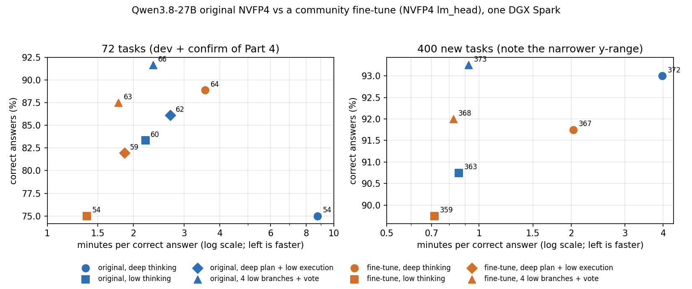

# Part 5: a deeper test — do Part 4's findings hold for a fine-tuned model and on 400 new tasks?

[Part 4](https://github.com/NautilusWu/qwen3.8_study/blob/main/qwen38-spark-test-time-strategies/README.md) found that, for Qwen3.8-27B on one DGX Spark, thinking less (and voting over a few short parallel answers) reaches correct answers about 3x faster than the default deep thinking, without losing accuracy. This part tests that finding twice more, on the same machine and engine:

1. **Another model.** Swap only the target weights for a community fine-tune of Qwen3.8-27B ([nerkyor/Qwen3.8-27B-Coder390-EfficientThink-…-MTP-DFlash2](https://huggingface.co/nerkyor/Qwen3.8-27B-Coder390-EfficientThink-Opus5.5-GPT6Astra-Grok4.7-DSV4Pro-K3-SFT-RLOO-MTP-DFlash2), commit `57c00f89`, folder `NVFP4/W4A4-W8A8`). Its card describes SFT + RLOO training that penalises long wrong answers to cut "re-derivation loops". We compare it with the original on Part 4's 72 tasks (dev 24 + confirm 48), with tests locked before the run.
2. **New tasks.** 400 new private tasks (200 coding with hidden tests, 30 of them C++; 200 reasoning with program-computed answers), run with six configurations (2 models x deep / low / 4-branch vote).

Measure, as in Part 4: **minutes per correct answer** (all time, including wrong answers, divided by the number of correct answers).

## Results

### 400 new tasks

| Model | Usage | Correct (code / reasoning) | Minutes per correct answer | Hit the 65,536-token limit |
|---|---|---|---|---|
| Original | deep thinking (default) | 372 (184 / 188) | 3.97 | 17 |
| Original | low thinking | 363 (187 / 176) | 0.86 | 0 |
| Original | **4 low branches + vote** | **373** (182 / 191) | 0.93 | 0 |
| Fine-tune | deep thinking (default) | 367 (184 / 183) | 2.04 | 13 |
| Fine-tune | low thinking | 359 (179 / 180) | **0.72** | 0 |
| Fine-tune | 4 low branches + vote | 368 (180 / 188) | 0.82 | 0 |

Selected paired comparisons (exact McNemar p; 95% paired bootstrap intervals; a time ratio above 1 means the first is slower):

| Comparison | Only first / only second correct | p | Accuracy difference (pp) | Time ratio |
|---|---|---|---|---|
| Original deep vs fine-tune deep | 20 / 15 | 0.50 | +1.25 (-1.5, +4.0) | 1.95 (1.71, 2.23) |
| Original deep vs original low | 28 / 19 | 0.24 | +2.25 (-1.0, +5.5) | 4.62 (3.84, 5.62) |
| Original vote vs original low | 24 / 14 | 0.14 | +2.5 (-0.5, +5.5) | 1.08 (0.94, 1.24) |
| Original vote vs fine-tune vote | 18 / 13 | 0.47 | +1.25 (-1.5, +4.0) | 1.12 (1.01, 1.24) |
| Fine-tune vote vs fine-tune deep | 24 / 23 | 1.0 | +0.25 (-3.0, +3.5) | 0.41 (0.34, 0.49) |

The three "best" configurations (original vote, fine-tune vote, fine-tune deep) were compared under a locked plan; the other three were added afterwards as reference points and are reported only. No accuracy difference between any two configurations reaches significance (all Holm-adjusted p = 1.0); the time differences do.

### 72 tasks (Part 4's dev + confirm sets), fine-tune vs original

| Usage | Original correct | Fine-tune correct | Only fine-tune / only original | p | Time ratio, fine-tune / original |
|---|---|---|---|---|---|
| Deep thinking (65,536 limit) | 54 | **64** | 11 / 1 | **0.006** | **0.41** (0.30, 0.54) |
| Low thinking | 60 | 54 | 5 / 11 | 0.21 | 0.63 (0.44, 0.92) |
| Deep plan + low execution | 62 | 59 | 4 / 7 | 0.55 | 0.69 (0.57, 0.84) |
| 4 low branches + vote | 66 | 63 | 2 / 5 | 0.45 | 0.76 (0.66, 0.91) |

Deep thinking (accuracy and time) and low thinking (accuracy and time) were tested under a locked plan; the other two rows are reported only. In 9 of the 11 tasks only the fine-tune solved with deep thinking, the original thought until the 65,536-token limit and never answered.

## What this shows

- **Part 4's finding holds for both models and on new tasks.** Low thinking costs 2.6-4.6x less time per correct answer than deep thinking (4.0-4.6x for the original, 2.6-2.9x for the fine-tune, which thinks less to begin with), for at most 2-3 percentage points of accuracy (not significant). Four parallel low branches with a vote recover that gap for 8-15% more time.
- **The fine-tune's main effect is on deep thinking.** It is about 2x faster per correct answer on both task sets. On Part 4's harder 72 tasks it was also clearly more accurate (64 vs 54), mostly by not running into the output limit; on the 400 easier tasks it was not (367 vs 372).
- **The most correct answers came from the original model with four voting branches** in both task sets (66/72, 373/400), but its edge over the next configurations is within noise.
- **Practical choice on this machine:** for questions with a checkable answer, low thinking with a 4-branch vote; if only one deep-thinking answer is possible (for example in an agent that always uses the default effort), the fine-tune is about twice as fast.

## The checkpoint format issue (and what we changed)

In the published `NVFP4/W4A4-W8A8` folder every tensor matches NVIDIA's own NVFP4 checkpoint of the base model in name, dtype and shape, except `lm_head`, which is kept in BF16 (2.5 GB). On TensorFold the BF16 output layer takes a plain BF16 matmul (and the DFlash2 drafter reuses it): a verification step took about **350 ms instead of about 110 ms**, with similar draft acceptance, so the file as published decodes about **3x slower**.

To compare the fine-tune itself, we converted only `lm_head` to NVFP4 with NVIDIA ModelOpt 0.44.0 (block 16, weight-only path, no calibration data), giving exactly NVIDIA's format. Checks before any measured run:

1. Format: all other tensors identical in name, dtype and shape to NVIDIA's checkpoint; only `lm_head.input_scale` (an activation scale TensorFold does not read) is absent.
2. Numerics: relative Frobenius error of the quantized head vs BF16: 0.095. ModelOpt's and TensorFold's dequantisation agree to 1.5e-8 (same packing).
3. Greedy outputs with the BF16 head vs the NVFP4 head on 6 general prompts (thinking off): first differing token at positions 12, 21, 80, 136, none, 41; every divergence was an equivalent wording. (The planned top-5 log-probability check could not be run: TensorFold does not return log-probabilities for this model family.)
4. Speed: 114-118 ms per verification step, like the original.

**All fine-tune results above are for "fine-tune + NVFP4 lm_head", not for the file as published.** The tokenizer and chat template were checked to behave identically to the original on all 72 prompts.

## Conditions

- One DGX Spark (GB10), single user, monitor on. TensorFold 0.6.0 (Part 3/4 image), z-lab DFlash2 drafter for both models, FP8 KV cache and FP8 prefill, `expandable_segments` on. Kernel 7.0.0-1019-nvidia, driver 580.178.04, Docker 29.6.2, NVIDIA Container Toolkit 1.20.1.
- Greedy decoding, except the voting branches (temperature 0.6, top_p 0.95, top_k 20, fixed seeds). Output limit 65,536, context 81,920, 40 minutes per task; on the 24 dev tasks, low thinking and voting used Part 4's exploration settings (24,576 / 32,768 / 25 minutes) for both models.
- Grading in a network-isolated sandbox with hidden tests; no configuration saw graders.

## Limitations

- One run per configuration and task.
- The 400 tasks turned out easier than intended (about 92% correct everywhere), which compresses differences; with 400 tasks, accuracy differences of about 3-4 percentage points or less cannot be told apart.
- The 72 tasks were used in Part 4 to choose methods (never by the models). The 400 tasks were written before any model saw them and their difficulty was not tuned with a model.
- The fine-tune's training data and teacher models are as described by its author; we did not verify them.
- Single user: with several users, parallel branches compete with other requests.

## Privacy of the task sets

The 72 tasks' ids were published in Part 4. The 400 new tasks are kept private for future model comparisons, so their per-task results are published under anonymous ids T001-T400 (same order in every file) with their category; the prompts' sha256 is listed in [PREREGISTRATION.md](PREREGISTRATION.md).

**Next:** [Part 6](https://github.com/NautilusWu/qwen3.8_study/blob/main/qwen38-spark-flash-next/README.md) runs the same 400 tasks and usages with a different model, Qwen3.8-Flash-Next (125B mixture of experts).

## Files

| Path | Content |
|---|---|
| [PREREGISTRATION.md](PREREGISTRATION.md) | the four locked plans, their hashes and rules, results and deviations |
| [REPRODUCE.md](REPRODUCE.md) | converting the checkpoint, checks, running with your own tasks, recomputing the tables |
| [data/summary.csv](data/summary.csv) | every configuration on both task sets |
| [data/per_task_72/](data/per_task_72/), [data/per_task_400/](data/per_task_400/) | per-task results, one file per configuration |
| [data/](data/) `*.json` | the locked tests and the reported-only tables as computed |
| [figures/](figures/) | figure and the script that draws it |
| [code/](code/) | lm_head conversion, checkpoint folder builder, tensor comparison, runner wrapper, statistics |
| [scripts/recheck.sh](scripts/recheck.sh) | recompute all tables from the per-task results |

Code: MIT ([LICENSE](LICENSE)).
