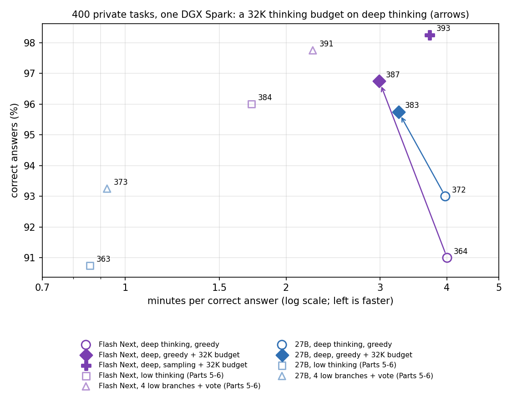
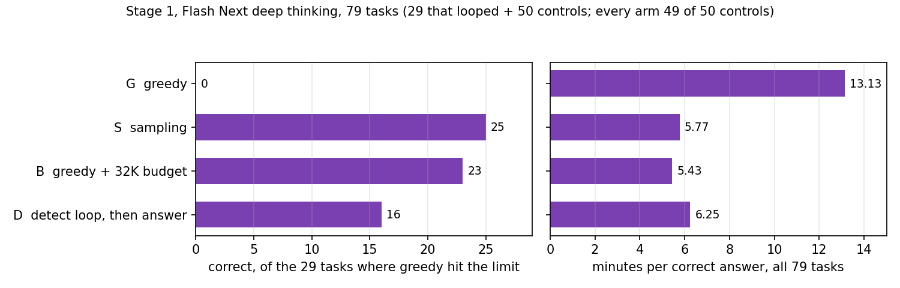
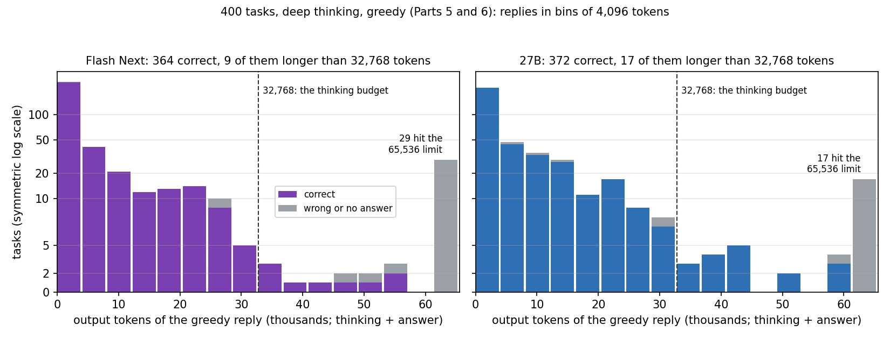

# Part 7: Reasoning loops in deep thinking, and a thinking budget that removes them

In [Part 5](https://github.com/NautilusWu/qwen3.8_study/blob/main/qwen38-spark-model-swap/README.md) and [Part 6](https://github.com/NautilusWu/qwen3.8_study/blob/main/qwen38-spark-flash-next/README.md), deep thinking with greedy decoding sometimes never finished. On the 400 private tasks, Qwen3.8-Flash-Next thought until the 65,536-token output limit on 29 tasks and Qwen3.8-27B on 17, without giving an answer. Most of these replies repeat themselves. This part asks what stops these loops on one DGX Spark, using only what the engine already offers (no retraining, no changes to the engine), and what it costs in **minutes per correct answer** (all time, including wrong answers, divided by the number of correct answers).

Two steps. **Stage 1** compared three fixes on 79 tasks: the model's recommended sampling, a thinking budget, and a loop detector that stops the thinking and asks for the answer. **Stage 2** and two addenda then measured the most useful ones on all 400 tasks, for both models.



## Results on the 400 tasks

All rows are deep thinking (the chat template's default effort), output limit 65,536, 40 minutes per task.

| Model | Decoding | Correct (code / reasoning) | Minutes per correct answer | Hit the 65,536-token limit | No answer |
|---|---|---|---|---|---|
| Flash Next | greedy (Part 6) | 364 (176 / 188) | 4.00 | 29 | 29 |
| Flash Next | **greedy + 32K thinking budget** | 387 (193 / 194) | **2.99** | 0 | 0 |
| Flash Next | sampling + 32K thinking budget | **393** (197 / 196) | 3.71 | 0 | 0 |
| 27B | greedy (Part 5) | 372 (184 / 188) | 3.97 | 17 | 19 |
| 27B | **greedy + 32K thinking budget** | 383 (189 / 194) | 3.25 | 0 | 2 |

"32K thinking budget": the engine closes the think block after 32,768 thinking tokens and the model writes its answer. "Sampling": the models' recommended settings (temperature 1.0, top_p 0.95, top_k 20). For reference, from Parts 5-6 on the same tasks: low thinking and a vote over 4 low-thinking branches reach 384 and 391 correct for Flash Next (1.72 and 2.24 minutes per correct answer), 363 and 373 for the 27B (0.86 and 0.92).

Paired comparisons on the 400 tasks (exact McNemar test; 95% paired bootstrap intervals; a time ratio below 1 means the first is faster):

| Comparison | Only first / only second correct | p | Accuracy difference (pp) | Time ratio |
|---|---|---|---|---|
| Flash Next: sampling + budget vs greedy (**locked test**, stage 2) | 34 / 5 | <0.0001 | **+7.25** (+4.25, +10.25) | 0.93 (0.81, 1.06) |
| Flash Next: greedy + budget vs greedy | 23 / **0** | <0.0001 | **+5.75** (+3.50, +8.25) | **0.75** (0.70, 0.80) |
| Flash Next: greedy + budget vs sampling + budget | 5 / 11 | 0.21 | -1.50 (-3.50, +0.50) | **0.81** (0.73, 0.88) |
| 27B: greedy + budget vs greedy | 11 / **0** | 0.001 | **+2.75** (+1.25, +4.50) | **0.82** (0.76, 0.87) |

Only the first row was a test written down before its run. The greedy + budget results were added after stage 2 and are **reported only**; how they were obtained is described [below](#how-the-greedy--budget-results-were-obtained).

## What this shows

- **A 32,768-token thinking budget with greedy decoding is the practical fix.** For both models it solved more tasks (+23 and +11) and **did not make a single task worse**, and it cut the time per correct answer by 25% (Flash Next) and 18% (27B). No reply hit the output limit any more.
- **It cannot hurt replies that finish in time.** With greedy decoding, a reply that ends its thinking before the budget is token for token the same as without a budget (checked on 57 tasks, [data/identity_checks.csv](data/identity_checks.csv)).
- **When the budget closes the think block, the model answers.** On the tasks where the greedy reply ran past 32,768 tokens (41 for Flash Next, 35 for the 27B), the budget version answered every time: none kept looping after the forced end of thinking, and 32 and 28 of those answers were correct. Even the long greedy replies that were correct (9 and 17) stayed correct when cut at 32,768 tokens: the model had its answer and was checking it again.
- **Sampling plus the budget gave the most correct answers (393), but no time saving.** On the 321 tasks outside stage 1, where greedy never hit the limit, sampling made the thinking about 31% longer than greedy (time ratio 1.36 there). Against greedy + budget it was not detectably more accurate (11 vs 5 tasks).
- **Detecting the loop and stopping it worked less well** (stage 1): the detector catches exact repetition reliably, but not the re-checking kind of loop (in the greedy runs of Parts 5-6 it fired on 28 of the 51 replies that hit the limit; in stage 1, on 20 of 29), and cutting the thinking where the loop began lost the work done before it. On the 29 looping tasks: 16 correct, against 23 with the budget and 25 with sampling.
- **For everyday use the advice of Parts 4-6 stands:** low thinking and the 4-branch vote are still faster per correct answer than deep thinking with the budget: 3.5-3.8x for the 27B (0.86 and 0.92 against 3.25 minutes), 1.3-1.7x for Flash Next (1.72 and 2.24 against 2.99), whose vote is also more accurate (391). When you do use deep thinking, set the budget.

## Setting the budget

In TensorFold 0.6.0, per request:

```json
{"model": "...", "messages": [...], "thinking_budget": 32768}
```

or for every request, as a server flag: `tensorfold serve ... --thinking-budget 32768` (default 0, no limit). The engine counts thinking tokens; when the count reaches the budget it inserts `</think>` and the model continues with its answer. Keep the output limit above the budget so there is room for the answer (here 65,536). Only 32,768 was tested.

## The loops

[data/loop_labels_greedy.csv](data/loop_labels_greedy.csv) labels every greedy reply of Parts 5-6 (deep and low thinking, both models; 1,600 replies) with whether it hit the limit, whether it answered, and where the loop detector (`code/loopdetect.py`) fires when the reply is replayed as a stream.

What the replies that hit the limit were doing:

- **Exact repetition:** the same block of text, sometimes a single short fragment, written over and over until the limit.
- **Re-checking:** the model reaches an answer, then checks the same edge cases again and again in slightly different words.
- **Unbounded enumeration:** in reasoning tasks, writing out long lists of numbers by hand.

The detector has two rules, both on the streamed thinking: the last 2,000 characters repeat with a period of at most 2,000 characters (checked every 512 characters), or more than half of the 8-word phrases in the last 3,000 words occurred before, at 4 checks in a row (every 500 words).

| Greedy replies (400 each) | Hit the limit | Detector fired | Of these, on replies that hit the limit | On replies that answered |
|---|---|---|---|---|
| Flash Next, deep thinking | 29 | 20 (14 exact, 6 phrase) | 20 | 0 |
| Flash Next, low thinking | 5 | 4 | 2 | 1 (correct answer: a false alarm) |
| 27B, deep thinking | 17 | 8 | 6 | 0 |
| 27B, low thinking | 0 | 0 | 0 | 0 |

The other 3 replies it fired on had no answer either: each repeated itself and then ended inside the think block (2 of them are the 27B's 2 replies without an answer under the budget, which ended at 10,899 and 29,214 tokens, before any budget applies). It fired after a median of about 17,000-22,000 tokens. Loops of the re-checking kind usually do not trip it, which is why a fixed budget catches more.

## Stage 1: three fixes on 79 tasks

Flash Next, deep thinking, on the 29 tasks where its greedy reply hit the limit plus 50 control tasks drawn at random from the other 371 (seed 2026). Greedy (G) is Part 6's run; S, B and D were run here, alternating per task on the same server.



| Arm | Correct of 79 | 29 looping tasks | 50 controls | Answered | Hit the limit | Minutes per correct answer |
|---|---|---|---|---|---|---|
| G greedy (Part 6) | 49 | 0 | 49 | 50 | 29 | 13.13 |
| S sampling (temperature 1.0, top_p 0.95, top_k 20) | **74** | **25** | 49 | 75 | 4 | 5.77 |
| B greedy + 32K thinking budget | 72 | 23 | 49 | **79** | **0** | **5.43** |
| D greedy + loop detector, then answer | 65 | 16 | 49 | 70 | 9 | 6.25 |

- **D:** when the detector fires, the request is stopped, the thinking is cut where the loop began, and the model continues as a raw completion after "I keep repeating myself, so I will stop thinking here and give my final answer now." and `</think>`. It fired 20 times, all on looping tasks, none on the controls; all 20 then answered, 16 correctly. The 9 looping tasks it did not catch still hit the limit.
- **B:** the budget was reached 32 times (29 looping tasks, 3 controls), and all 32 replies then answered. On the controls its results equal greedy's.
- **S:** 4 looping tasks still hit the limit; on the controls it lost one task and gained another.
- The 29 tasks were chosen because greedy failed on them, so these numbers show what each fix can rescue, not its effect on a typical task; the 400-task results above are the measure for that. Paired against G on the 79 tasks: S 26 / 1, B 23 / 0, D 16 / 0 tasks only one side solved; time ratios 0.44, 0.41 and 0.48.

By the rule written down before the run, the arm with the most correct answers went to stage 2 (S, 74), provided it lost at most one control task. Because B fixed tasks that S did not, the user chose to combine them: stage 2 ran sampling + budget on all 400 tasks.

## How the greedy + budget results were obtained

Greedy decoding is deterministic: until the budget is reached, greedy + budget writes exactly the tokens greedy writes. So only the tasks where the greedy reply ran past 32,768 tokens needed a new run; for all other tasks, the greedy reply, its result and its time are also the budget's.

| Model | Run with the budget | Taken from the greedy run | Check that the two are identical below the budget |
|---|---|---|---|
| Flash Next | 79 (stage 1) + 9 (addendum 01) | 312 (Part 6) | the 47 stage 1 controls under 32,768 tokens: 47 / 47 identical replies |
| 27B | 35 (addendum 02) | 365 (Part 5) | 10 tasks drawn at random from the 365 and run again: 10 / 10 identical token ids |

Each row of the per-task files says where it came from (column `source`). The composition rule was written down before each addendum's run, and for the 27B the check had to pass (10 / 10) before composing.



## Conditions

- One DGX Spark (GB10, 128 GB), single user. TensorFold 0.6.0 (`qwen38-tensorfold-repro:0.6.0-trace`, the image of Parts 3-6), CUDA backend, FP8 prompt activations, `expandable_segments` on. Kernel 7.0.0-1019-nvidia, driver 580.178.04.
- **Flash Next** exactly as in Part 6: local-inference-lab/Qwen3.8-Flash-Next-NVFP4 @ `7c4f1bc1`, its own MTP drafting (threshold 0.6, up to 6 drafts), bf16 KV cache, default memory reserve, 3 GiB memory guard.
- **27B** exactly as in Part 5: nvidia/Qwen3.8-27B-NVFP4 @ `482ca0f3` with z-lab/Qwen3.8-27B-DFlash2 @ `50307d4c`, FP8 KV cache, 40 GiB reserve, 80 GB container limit.
- Every run: deep thinking (the template's default effort), output limit 65,536, context 81,920, 40 minutes per task, the same grader in a network-isolated sandbox as Parts 4-6. Sampling: temperature 1.0, top_p 0.95, top_k 20 (both checkpoints' `generation_config.json`), seed 1234.
- Display on throughout stage 1 and both addenda; off for part of stage 2 (see Limitations).

## Limitations

- One run per configuration and task; sampling with one seed.
- The greedy + budget results on 400 tasks are reported only (decided after stage 2) and partly composed from the greedy runs (above). The composition rests on greedy determinism, checked on 57 tasks.
- Only a budget of 32,768 tokens was tested. A task that needs more thinking than the budget to be right would be hurt by it; none of these 400 was.
- **Display state.** Switching the display on or off moved decoding speed by up to 18% in Parts 2 and 6. During stage 2 the display was off for part of the run (by the timings, roughly tasks 100-215). With every sampling + budget time multiplied by 1.18 (the worst case), the time ratio against greedy is 1.10 (0.96, 1.26): still no detectable difference. Part 5's 27B greedy run did not record the display state; on the 10 check tasks it was 9% faster than this part's run with the display on. Dividing the 35 new 27B times by 1.09 gives a time ratio of 0.80 (0.74, 0.86) instead of 0.82. Accuracy is not affected.
- The 400 tasks are fairly easy (91-98% correct), which compresses differences. A difference of about 3 percentage points is detectable only when nearly all tasks that change go one way, as with the budget here (11 / 0).
- One engine. How a budget ends the thinking (here: `</think>` inserted, then the model continues) differs between engines; other implementations may behave differently.
- Deviations from the plans, all in [PREREGISTRATION.md](PREREGISTRATION.md): stage 1's compatibility check first failed because of a bug in the check code (the generated tokens were identical); it was fixed in a locked addendum before any task ran. The display during stage 2, as above.

## Privacy of the task set

The 400 tasks stay private for future model comparisons. Per-task results use the same anonymous ids as Parts 5 and 6 (T001-T400). Reply texts are not published, since they quote the tasks; the loop labels and detector positions are.

## Files

| Path | Content |
|---|---|
| [PREREGISTRATION.md](PREREGISTRATION.md) | the locked plans (stage 1 + addendum 00, stage 2, addenda 01 and 02), hashes, rules, results and deviations |
| [REPRODUCE.md](REPRODUCE.md) | recomputing the tables, the check on example tasks, runs on your own tasks, the detector on your own replies |
| [data/summary.csv](data/summary.csv) | every configuration: correct, time, limit hits, replies without an answer, replies over 32,768 tokens |
| [data/per_task_400/](data/per_task_400/) | per-task results on the 400 tasks (greedy files are Parts 5-6's runs; budget files have a `source` column) |
| [data/stage1_pilot79.csv](data/stage1_pilot79.csv) | stage 1, per task and arm |
| [data/loop_labels_greedy.csv](data/loop_labels_greedy.csv) | loop labels of Parts 5-6's 1,600 greedy replies |
| [data/identity_checks.csv](data/identity_checks.csv) | the 57 checks that greedy + budget equals greedy below the budget |
| [figures/](figures/) | figures and the script that draws them |
| [code/](code/) | loop detector, runner for all arms (on Part 4's runner; Part 6's server for Flash Next), detector replay, statistics |
| [scripts/recheck.sh](scripts/recheck.sh) | recompute the tables from the per-task results |

Code: MIT ([LICENSE](LICENSE)).
