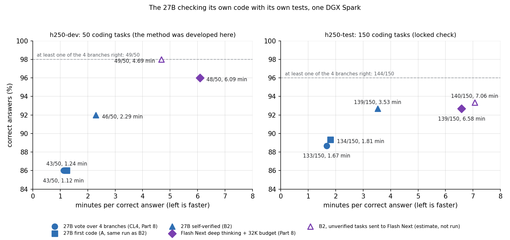
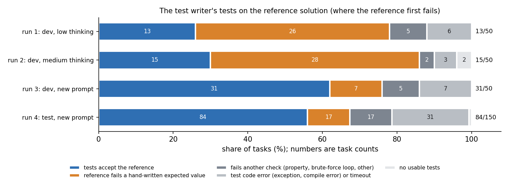

# Part 9: Can the 27B check its own code? Model-written tests on 200 private coding tasks

In Parts 4-8, the 27B's best everyday method for code is a vote over 4 low-thinking branches (CL4), which takes the **first branch that returns code** and cancels the others. Nothing checks whether that code is right. This part asks whether the same local model can check its own code, and what that costs on one DGX Spark. The measure is the same as in the earlier parts: **minutes per correct answer** (all time, including wrong answers, divided by the number of correct answers).

The method:
- A fifth request, the **test writer**, sees only the task and writes tests.
- Each of the 4 code branches is run against those tests in the network-isolated sandbox.
- The first branch that passes is chosen and marked **verified**. If none passes, the method falls back to the first branch with code, marked unverified.

There were four runs, each with a plan written and sha256-locked before it:
- **Runs 1-3:** developing the method on the 50 coding tasks of h250-dev.
- **Run 4:** the **locked check** on the 150 coding tasks of h250-test, the part of [Part 8](https://github.com/NautilusWu/qwen3.8_study/blob/main/qwen38-spark-harder-tasks/README.md)'s h250 set kept for final checks.

## The locked check (run 4: h250-test, 150 coding tasks)

| Configuration | Correct | Total minutes | Minutes per correct | Verified (of those wrong) |
|---|---|---|---|---|
| 27B, first branch with code (A, same run) | 134/150 | 242.0 | 1.81 | — |
| **27B, self-verified (B2)** | **139/150** | 490.9 | 3.53 | **85 (1)** |
| 4 branches, at least one right (not a method) | 144/150 | — | — | — |
| 27B vote, CL4 (Part 8's run) | 133/150 | 221.6 | **1.67** | — |
| Flash Next, deep thinking + 32K budget (Part 8's run) | 139/150 | 915.0 | 6.58 | — |

**Tests written down before the run** ([PREREGISTRATION.md](PREREGISTRATION.md)):

| Test | Result | Reading written before the run |
|---|---|---|
| **M1, accuracy** (main test): B2 against A from the same run, exact two-sided McNemar test, p < 0.05 | 5 / 0 tasks only one side solved, p = 0.0625; +3.3 pp (+0.7, +6.7) | **not confirmed** |
| **M2, is "verified" reliable?** Share of verified answers that are wrong; the upper end of its exact 95% interval must be below CL4's error rate on these tasks, 17/150 = 11.3% | 1/85 = 1.2% (0.03%, 6.38%) | **confirmed**: verified answers are more reliable than unchecked CL4 answers |
| **M3, time cost** (interval only, no pass/fail): ratio of minutes per correct answer, B2 / Part 8's CL4, paired bootstrap 95% interval | **2.12x** (1.77, 2.61) | "about 2x" (the interval contains 2) |

- **Statistics:** paired by task. Bootstrap intervals use 10,000 resamples with seed 2026, and each task's time is capped at 40 minutes. No multiplicity correction: each test answers its own question, and only M1 decides "more accurate".
- **Against A from the same run:** the time ratio is 1.96x (1.65, 2.37), also "about 2x". A is slower than Part 8's real CL4 because the test writer's request shares the GPU (see Limitations).
- **The capacity was stated before the run:** with no task lost, B2 needed 6 tasks that only it solved; one lost task raised that to 8. It got 5 and lost none.
- **Conclusion, by the table written before the run:** no accuracy gain was confirmed, so B2 is not recommended instead of CL4. The "verified" label can be used to decide which tasks to send on to a stronger method.

## What this shows

- **No detectable accuracy gain.**
  - Self-checking solved 5 more tasks than the first branch with code and lost none. That is one short of what the test needed.
  - On the development tasks the result had the same direction (3 / 0). The two runs cannot be pooled into one test, because the method was tuned on the development tasks.
- **"Verified" is a reliable label.**
  - Of 85 verified answers, 1 was wrong. Of the 65 unverified answers, 10 were wrong (15%).
  - All 5 extra correct answers came from verified tasks: on those 85 tasks the first branch with code was wrong 6 times, and the verified choice once.
- **It costs about twice the time per correct answer.**
  - B2 waits for the test writer (a fifth request) and for the test runs.
  - When no branch passes, it waits for everything to finish before falling back.
- **Same accuracy as Flash Next, in about half the time.**
  - B2 and Part 8's Flash Next B both solved 139/150, with 5 / 5 tasks only one side solved.
  - The time ratio is 0.54 (0.42, 0.68), at 3.53 against 6.58 minutes per correct answer.
  - This compares different runs and is reported only.
- **Sending unverified tasks to Flash Next did not pay off on the test tasks.**
  - The estimate is composed from the two runs, not run: B2's 65 unverified tasks take Flash Next B's result and add its time.
  - It gives 140/150 at 7.06 minutes per correct answer, slower than Flash Next alone (6.58).
  - On those 65 tasks Flash Next solved 56 and B2 55: these tasks are hard for both models.
  - On the development tasks the same estimate looked much better (49/50 at 4.69, against 6.09 for Flash Next alone).
- **The development tasks were optimistic about the tests, not about the label.**
  - The test writer's tests accepted the reference solution on 31/50 development tasks (62%), but on only 84/150 test tasks (56%).
  - Test code that fails by itself (an exception or a compile error) rose from 6/50 to 29/150.
  - The verified label held up: 1 wrong of 33 on dev, 1 wrong of 85 on test.
- **Specification-style tasks are rarely verified.** These are parsers, stateful classes and text formats, where a simple brute force does not exist. Only 13 of 42 such tasks were verified, against 72 of 108 others.
- **For everyday use:**
  - For coding on this machine, the 27B vote (CL4) stays the fastest way to correct answers.
  - If a confidence signal is worth about twice the time, B2's "verified" label is trustworthy: 84 of 85 verified answers were right in the locked check.
  - An unverified answer is a reason to check by hand. On these tasks, switching to Flash Next did not help.

**Per group** (correct, and minutes per correct answer in brackets):

| Group | A | B2 | CL4 (Part 8) | B2 verified (wrong) |
|---|---|---|---|---|
| All 150 | 134/150 (1.81) | 139/150 (3.53) | 133/150 (1.67) | 85 (1) |
| Python | 90/103 (2.34) | 93/103 (4.64) | 90/103 (2.15) | 51 (0) |
| C++ | 44/47 (0.72) | 46/47 (1.29) | 43/47 (0.65) | 34 (1) |
| Tier A / B / C | 43/46 / 57/60 / 34/44 | 44/46 / 58/60 / 37/44 | 43/46 / 57/60 / 33/44 | 26 / 37 / 22 (0 / 1 / 0) |
| Specification-style / other | 32/42 / 102/108 | 33/42 / 106/108 | 32/42 / 101/108 | 13 / 72 (0 / 1) |

## How the method got there (runs 1-3: h250-dev, 50 coding tasks)

Each development run changed one thing about the test writer. Before each run, three gates for going on to the locked check were written down:
1. at least as many correct answers as A;
2. at most 2 verified answers wrong;
3. at most twice A's minutes per correct answer.

| Run | What changed | Tests accept the reference | Verified (wrong) | Correct, B / A | Minutes per correct, B / A | Gates |
|---|---|---|---|---|---|---|
| 1 | test writer at low thinking, first prompt; also a critic (below) | 13/50 | 14 (0) | 44 / 43 | 2.99 / 1.23 | time failed |
| 2 | test writer at medium thinking | 15/50 (p = 0.75 vs run 1: not confirmed) | 16 (1) | 45 / 43 | 3.07 / 1.28 | time failed |
| 3 | back to low thinking, new prompt: expected values only from a brute force, a property, or an example in the task | **31/50** (p = 0.0005 vs run 1: confirmed) | 33 (1) | 46 / 43 | 2.29 / 1.24 | **all met** |
| 4 | the method of run 3, unchanged, on h250-test (locked) | 84/150 | 85 (1) | 139 / 134 | 3.53 / 1.81 | — |

- **Run 1: tests that pass are right, but most tests were wrong.**
  - When a branch passed the model's tests, it was right: 14/14 verified answers were correct, and the tests rejected all 16 wrong branches.
  - But the tests rejected the known-correct reference solution on 37 of 50 tasks, so on most tasks no branch could pass.
  - On 26 of those 37, the reference first failed at an expected value written by hand.
  - With no branch passing, B waited for everything and fell back, which took 2.4x A's time per correct answer.
  - A critic that looked for untested requirements and added tests after B's choice (C in the data) added no correct answer. Its tests accepted the reference on 6 of the 14 tasks it ran on, and it took 35 more minutes, so it was dropped.
- **Run 2: more thinking did not help.**
  - Medium thinking raised the reference acceptance only to 15/50 (6 tasks gained, 4 lost).
  - It produced the first test file that checked nothing: its checks sat in functions that were never called.
  - From this came the empty-code rule of B2: tests that pass on an empty code block count as no tests. It never fired in runs 3-4 (0/50 and 0/149).
- **Run 3: forbidding hand-computed expected values worked.**
  - The new prompt allows expected values only from three sources: a brute force written inside the tests, a property checkable without the answer, or an example from the task.
  - Reference failures at a hand-written value fell from 26 to 7, and acceptance rose from 13/50 to 31/50.
  - The test writer's output got shorter, not longer: per task, the median ratio of its tokens to run 1 was 0.91.
  - All three gates were met, so the method went to the locked check unchanged. B2 was chosen as the main rule before run 4 (B2 = B on every task in runs 3 and 4).
- **The same code in runs 1-3.** The 4 code branches were byte-identical in all three development runs (same seeds; same texts, tokens and hidden-test results). So runs 1-3 compare the test writer on the same code.

**Quality of the model's tests** (counts over tasks; "candidates" are the branches with code):

| | Run 1 | Run 2 | Run 3 | Run 4 |
|---|---|---|---|---|
| Tasks with usable tests | 50/50 | 48/50 | 50/50 | 149/150 |
| Tests accept the reference solution | 13 | 15 | 31 | 84 |
| ... reference first fails at a hand-written expected value | 26 | 28 | 7 | 17 |
| ... test code fails by itself (exception, compile error) | 2 | 1 | 6 | 29 |
| Known wrong answers rejected: wrong output | 116/116 | 107/109 | 115/116 | 342/346 |
| Known wrong answers rejected: correct but too slow | 34/37 | 34/37 | 31/37 | 85/95 |
| Correct candidates rejected | 129/182 | 118/177 | 61/182 | 214/518 |
| Wrong candidates accepted | 0/16 | 2/13 | 2/16 | 2/73 |
| Tests that pass on empty code | 0 | 1 | 0 | 0 |

The known wrong answers are the typical wrong answers built with each task, including slow but otherwise correct solutions that must fail on time (see Part 8). The tests catch almost every wrong output, but a test of a few seconds misses about one slow solution in ten.

## The method in detail

- **Five requests per task, sent together:**
  - **4 code branches,** exactly CL4's: low thinking, temperature 0.6, top_p 0.95, top_k 20, seeds 1000-1003, the task as the prompt.
  - **The test writer:** low thinking (medium in run 2), the same sampling, seed 2000. It sees the task without its last sentence about the answer format, and never sees any code.
  - Nothing is cancelled, so that every time can be recorded.
  - The prompts are in [code/prompts.py](code/prompts.py), exactly as they ran.
- **Running the model's tests:**
  - **Sandbox:** the grader's sandbox, with no network, 2 GB, 2 CPUs, and the GB10's Cortex-A725 cores. The model server ran on the Cortex-X925 cores.
  - **One container per branch,** with container start counted in the time.
  - **Limits:** 30 seconds per run, and 60 seconds for compiling C++.
  - Python tests are appended to the candidate and run as a script.
  - C++ tests become the body of a function returning `int`, called from the harness. A stray `return 0;` in the tests therefore cannot hide a failed check.
- **Hidden tests are never used for choosing.** They only grade the chosen answer, after the server has stopped.
  - h250's C++ tasks have a hidden prelude with the input generators, and the model's tests run without it.
  - Checked before the runs, on dev and on test: every reference and every known wrong answer compiles and passes an empty test without the prelude. So a rejection can only come from the model's tests.
- **The rules** (in [code/rules/](code/rules/), byte-identical to the locked files):
  - **A:** the first branch that finishes with code (CL4's rule for code).
  - **B:** the first branch whose test run ends with a pass, marked verified. If none passes, A's choice, unverified.
  - **B2:** B, but the test writer's tests first run once on an empty code block (timed). If they pass there, they count as no tests.
  - **C** (run 1 only): B, then the critic's added tests.
- **Times** are computed from the recorded times as if the rule had run: each test run starts when both the branch and the tests exist. Test runs are assumed not to wait for each other.

## Conditions

- **Model:** nvidia/Qwen3.8-27B-NVFP4 @ `482ca0f3` with z-lab/Qwen3.8-27B-DFlash2 @ `50307d4c`, FP8 KV cache, 40 GiB reserve, as in Parts 5-8.
- **Engine:** TensorFold 0.6.0 (`qwen38-tensorfold-repro:0.6.0-trace`, the image of Parts 3-8), run with `--parallel 5`.
- **Limits:** context 81,920, output limit 65,536, 40 minutes per task.
- **Machine:** one DGX Spark (GB10, 128 GB), single user, kernel 7.0.0-1019-nvidia, driver 580.178.04.
- **Run state:**
  - The display was on throughout: 212, 174, 164 and 642 one-minute records.
  - The daily model service was stopped and nothing else ran on the GPU.
  - Runs 1-4 took 3.5, 2.9, 2.7 and 10.7 hours, including grading.

## Limitations

- **One run, one model, one set of seeds.** Flash Next was not tried as the code writer: on the development tasks it already solved 48/50, which left little room.
- **Times are computed, not measured with a real cancelling implementation.** Test runs are assumed not to wait for each other.
  - The five requests always ran to the end, and the test writer shares the GPU with the branches. So A here is slower than Part 8's real CL4: 1.08x on the test tasks, 1.11x on the development tasks.
  - This is why M3 compares with Part 8's CL4. That is a comparison across runs, which drift by a few percent.
- **The locked check could only detect a large gain.** A missed 16 of the 150 tasks, and B2 could at best win those back.
- **h250-test has now been used for one method check.** Its baselines (Part 8) and this result are known, so later checks on it must say how many times it has been used.
- **The escalation estimate is composed, not run.**
- **Failure kinds are assigned by program.** For example, "the reference first fails at a hand-written expected value" is a syntax-only classification of the failing line, not a reading of the tests. C++ test runs that the first analyses labelled "crash" were in fact compile errors: the sandbox keeps only the last 500 characters of output. The data gives both labels.
- **All deviations from the plans** are listed in [PREREGISTRATION.md](PREREGISTRATION.md).

## Privacy of the task set

- **h250 stays private.** Its prompts, hidden tests, references and known wrong answers are not published.
- **Per-task results use Part 8's anonymous ids** (H001-H250), with language, tier, split and a specification-style flag.
- **The tests and code the model wrote are not published,** since they encode the tasks. The published files hold only ids, times, token counts, pass/fail results and failure kinds assigned by program.

## Files

| Path | Content |
|---|---|
| [PREREGISTRATION.md](PREREGISTRATION.md) | the four locked plans: hashes, questions, tests, gates, results and deviations |
| [REPRODUCE.md](REPRODUCE.md) | recomputing everything from the per-task files; running the method on example tasks and on your own |
| [data/run*/](data/) | per run: `branches.csv` (every branch: end time, tokens, code or not, hidden result, test-run result and time), `tasks.csv` (the test writer per task: time, tokens, test quality, failure kinds), `arm_*.csv` (each rule's choice, time and result) |
| [data/plan10_reference/](data/plan10_reference/) | Part 8's two runs on the same 200 coding tasks, as the locked analysis read them |
| [data/summary.csv](data/summary.csv), [data/tester_summary.csv](data/tester_summary.csv) | every table above, per run and group |
| [data/tests.json](data/tests.json) | the tests as computed for the plans |
| [figures/](figures/) | figures and the script that draws them |
| [code/](code/) | the selection rules and their checks, the prompts, the runner (`selfverify.py`, on top of Part 4's code), statistics, recomputation |
| [scripts/recheck.sh](scripts/recheck.sh) | recompute the rules' checks, the arms, the tables and the tests |

Code: MIT ([LICENSE](LICENSE)).
