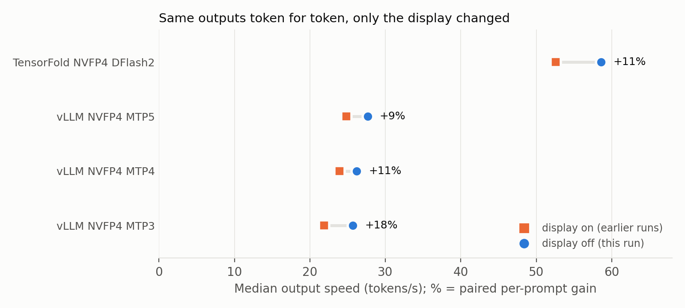
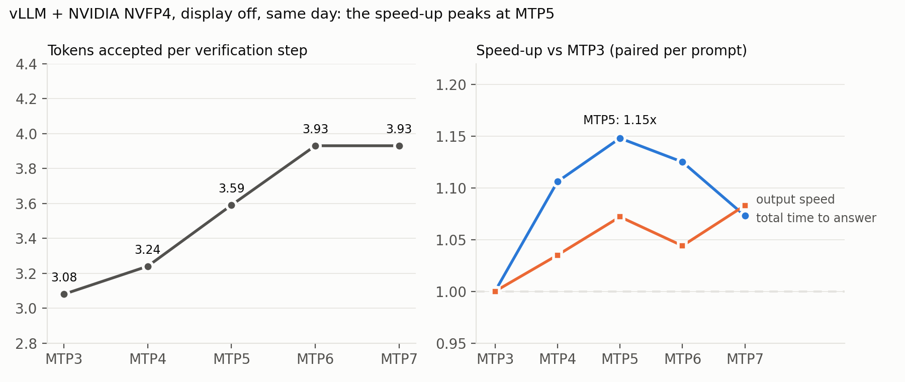

# Part 2: how much the monitor slows decoding, and where vLLM MTP depth stops helping (Qwen3.8-27B, DGX Spark)

The [Part 1](../qwen38-spark-speed-comparison-display-on/README.md) setups rerun with the monitor off, plus vLLM MTP6 and MTP7. Same configuration, same output token for token, so the display effect is measured cleanly.

Same DGX Spark, same 24 prompts, same engines, checkpoints, flags and grading as Part 1. This folder is self-contained: [REPRODUCE.md](REPRODUCE.md) and the scripts here set up and run everything in this experiment.

## Results (display off, one launch each, 2026-10-08)

| Engine | Weights | Speculation | Output tok/s | Median total s | 24 prompts (h) | Total time vs vLLM MTP3 | Tokens/step | Passed (code/reasoning) |
|---|---|---|---|---|---|---|---|---|
| TensorFold 0.6.0 | NVIDIA NVFP4 | DFlash2 | 58.6 | 165 | 1.55 | 2.20x | 5.63 | 18 (7/11) |
| TensorFold 0.6.0 | MLX 4-bit | DFlash2 | 62.9 | 212 | 1.75 | 2.00x | 5.47 | 14 (4/10) |
| vLLM 0.27.1 | NVIDIA NVFP4 | MTP3 | 25.7 | 403 | 3.41 | ref | 3.08 | 18 (7/11) |
| vLLM 0.27.1 | NVIDIA NVFP4 | MTP4 | 26.2 | 353 | 3.19 | 1.11x | 3.24 | 16 (5/11) |
| vLLM 0.27.1 | NVIDIA NVFP4 | MTP5 | 27.6 | 342 | 3.12 | 1.15x | 3.59 | 19 (7/12) |
| vLLM 0.27.1 | NVIDIA NVFP4 | MTP6 | 26.2 | 338 | 3.25 | 1.12x | 3.93 | 17 (7/10) |
| vLLM 0.27.1 | NVIDIA NVFP4 | MTP7 | 27.9 | 372 | 3.29 | 1.07x | 3.93 | 18 (6/12) |

The vLLM no-speculation and both Qwen FP8 rows of Part 1 were not rerun and exist only with the display on.

## Findings

**1. The same configuration gives the same output, token for token.** For the five configurations run in both parts, all 24 answers were token-identical between the Part 1 launch (display on, days earlier) and this launch (display off), and so was every pass/fail. Re-running a configuration therefore does not change its correctness result. The pass/fail differences between configurations are deterministic consequences of different numerics, not run-to-run noise; more prompts, not more launches, are what make a correctness comparison stronger.

**2. The display alone costs 9-18% of decode speed.** Because the outputs are identical, the speed difference comes only from the display:

| Configuration | Display on (Part 1) | Display off | Paired per-prompt gain |
|---|---|---|---|
| TensorFold NVIDIA NVFP4 | 52.6 tok/s | 58.6 tok/s | +11% |
| vLLM NVFP4 MTP3 | 21.9 tok/s | 25.7 tok/s | +18% |
| vLLM NVFP4 MTP4 | 23.9 tok/s | 26.2 tok/s | +11% |
| vLLM NVFP4 MTP5 | 24.8 tok/s | 27.6 tok/s | +9% |

The TensorFold MLX 4-bit run is not in this comparison: its Part 1 run had the display off for 20 of its 24 prompts (reported, not verified). This run was 7% slower than that one, with identical tokens and verification rounds; the cause was not investigated.

**3. With the display on, MTP depth looked more useful than it is.** In Part 1, MTP5 was 16% faster than MTP3 in output speed (1.24x in total time). With the display off it is 7% faster (1.15x), because MTP3 lost more speed to the display. All five depths here ran on the same day under the same conditions.

**4. The speed-up peaks at MTP5.** Tokens accepted per step rise up to MTP6 and stop there (3.93 at both MTP6 and MTP7), while every extra draft still re-reads the MTP layer and the LM head. MTP5 has the best total time; MTP6 is slower than MTP5 in output speed, and MTP7, slightly faster per token, wrote 4% more tokens in total (one more prompt ran out of budget). Pass counts across MTP3-7 range from 16 to 19 with no trend; all differences fall on prompts that flip between configurations.

**5. The fastest single-stream setup is TensorFold + NVIDIA NVFP4 + DFlash2, with the display on or off.** It finished the 24 prompts in 1.73 h (display on) and 1.55 h (display off), about twice as fast as the best vLLM configuration, with the same 18/24 as vLLM MTP3. With the display off it also beats TensorFold MLX 4-bit on total time (1.55 h vs 1.75 h) while passing 4 more prompts.

## Conditions

- Everything not listed here is identical to Part 1 (prompts, prompt token IDs, chat template, thinking on, temperature 0, `max_tokens` 24,576, flags, images, checkpoint revisions, graders). One launch per configuration.
- Order: TensorFold NVFP4, then vLLM in random order (MTP4, MTP7, MTP5, MTP3, MTP6), then TensorFold MLX 4-bit; 20 hours in total.
- Display: turned off with DPMS (`xset dpms force off`) and checked every 15 s by `scripts/display_off.sh`, which turns it off again if anything wakes it. It was on in 2 of 4,801 checks, both in the first two minutes, each time for at most 15 s (`data/display_and_gpu_log.csv`).
- Thermal protection: none automatic, as in Part 1; GPU temperature logged every 15 s. Peaks: 80 °C (TensorFold NVFP4), 72 °C (vLLM), 81 °C (TensorFold MLX 4-bit).
- Driver messages: every vLLM server start logged one or two NVIDIA `NV_ERR_NO_MEMORY` check-failure lines in the kernel log (`nvCheckOkFailedNoLog`, during memory profiling and graph capture). The servers started normally, and nothing was logged while prompts were being measured. Several vLLM starts in Part 1 logged the same kind of lines. TensorFold launches logged none, and there were no Xid errors.
- Display-on numbers come from Part 1 runs on 2026-10-05 to 10-07; the display-off runs were all on 2026-10-08.

## What is in this folder

| Path | Contents |
|---|---|
| `REPRODUCE.md` | Step-by-step setup and the commands that run every configuration of this experiment with the display off. |
| `scripts/download_models.sh` | Downloads the checkpoints at the exact revisions used. |
| `scripts/display_off.sh` | Keeps the monitor off during a run and logs display state, GPU temperature and power every 15 s. |
| `vllm/` | vLLM runtime image, one config per vLLM configuration (including MTP6 and MTP7), launch scripts and the measurement client. Identical to Part 1 plus the two new configs. |
| `tensorfold/` | TensorFold image build (pinned and hash-checked), launch script and measurement client. Identical to Part 1. |
| `data/summary_display_off.csv` | The results table, with medians, paired ratios vs vLLM MTP3, tokens per step and pass counts. |
| `data/display_on_vs_off.csv` | Each configuration run in both parts: token-identical prompts, same pass/fail, speeds and hours with the display on and off. |
| `data/per_request_metrics_display_off.csv` | 168 rows (7 configurations x 24 prompts), same columns as Part 1. |
| `data/display_and_gpu_log.csv` | Every 15 s during the 20-hour run: active monitors, whether it was turned off again, GPU temperature and power. |
| `figures/` | Both figures and the script that draws them from `data/` (`python3 figures/make_figures.py`, needs matplotlib). |

The prompts are not published, as in Part 1; which tests to run is up to you.

## Credits and licenses

Built on vLLM, NVIDIA NGC containers, TensorFold (Ash Hart), MiaAI-Lab's TensorFold recipe, `nvidia/Qwen3.8-27B-NVFP4`, `Qwen/Qwen3.8-27B`, `TensorFold/Qwen3.8-27B-MLX-4bit` and `z-lab/Qwen3.8-27B-DFlash2`, all Apache-2.0 at the revisions used. No model weights or third-party code are redistributed; `tensorfold/fetch_sources.sh` downloads TensorFold and the recipe from their own repositories.

This folder is released under the [MIT License](LICENSE).
