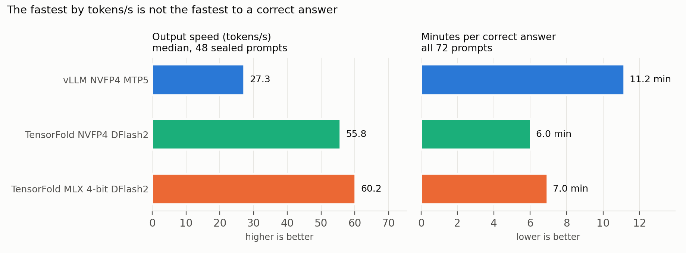

# Part 3 (final test): on 48 unseen prompts, TensorFold + NVIDIA NVFP4 gives correct answers twice as fast as vLLM, and faster than the MLX 4-bit build (Qwen3.8-27B, DGX Spark)

The three strongest single-user setups from [Part 1](../qwen38-spark-speed-comparison-display-on/README.md) and [Part 2](../qwen38-spark-speed-comparison-display-off/README.md), run once more on 48 prompts that had never been used, with the pass/fail rules written down before the run ([PLAN.md](PLAN.md)).

This folder is self-contained: [REPRODUCE.md](REPRODUCE.md) and the scripts here set up and run everything in this test.

**Result.** TensorFold + NVIDIA NVFP4 + DFlash2 passed 49 of 71 prompts, vLLM + NVIDIA NVFP4 + MTP5 passed 51; they disagreed on only 6 prompts (2 vs 4, exact sign test p = 0.69), so no quality loss was observed. On the 48 new prompts TensorFold was 2.03x faster in total time (3.37 h vs 6.38 h). TensorFold + MLX 4-bit has the highest tokens/s, but it writes longer answers and is slower to a correct answer than the NVIDIA NVFP4 build.

## Key result: time to a correct answer, not tokens/s

What a user waits for is a correct answer. Its time is the number of tokens the model needs divided by tokens/s, so a setup that thinks shorter and is still right is faster even at a lower tokens/s.

| Time to a correct answer | vLLM NVFP4 MTP5 | TensorFold NVFP4 | TensorFold MLX 4-bit |
|---|---|---|---|
| Median time on the prompts all three got right (26 sealed) | 180 s | **73 s** | 97 s |
| Minutes per correct answer (72 prompts, including time spent on wrong ones) | 11.2 | **6.0** | 7.0 |
| Output tokens per correct answer (72 prompts) | 17.3K | 18.5K | 23.4K |

On the prompts both TensorFold builds got right, MLX 4-bit was 12% faster per token but wrote 28% more tokens (30% on all 40 such prompts), so it reached the correct answer 15% later (16%). Ranked by tokens/s it is first; ranked by time to a correct answer it is second.

This comparison was added after the run. It describes the results and is not one of the tests written down beforehand.

## Results on the 48 sealed prompts

| Engine | Weights | Speculation | Passed of 48 (code/reasoning) | Passed of 71 | Output tok/s | Median total s | 48 prompts (h) | Total time vs vLLM | Tokens/step | Budget exhausted |
|---|---|---|---|---|---|---|---|---|---|---|
| vLLM 0.27.1 | NVIDIA NVFP4 | MTP5 | 32 (12/20) | 51 | 27.3 | 301 | 6.38 | ref | 3.57 | 14 |
| TensorFold 0.6.0 | NVIDIA NVFP4 | DFlash2 | 31 (10/21) | 49 | 55.8 | 131 | 3.37 | 2.03x | 5.28 | 16 |
| TensorFold 0.6.0 | MLX 4-bit | DFlash2 | 30 (9/21) | 44 | 60.2 | 177 | 3.35 | 1.93x | 4.97 | 17 |

"Passed of 71" adds the 24 dev prompts of Part 2 and leaves out `c_segtree` (see below). "Total time vs vLLM" is a per-prompt paired geometric mean. All three configurations received token-identical prompts.

## Tests written down before the run

| Test | Scope | Passed | Only the first passed | Only the second passed | p (exact sign test) |
|---|---|---|---|---|---|
| Primary: TensorFold NVFP4 vs vLLM MTP5 | 71 prompts | 49 vs 51 | 2 | 4 | 0.69 |
| | 47 sealed | 31 vs 32 | 1 | 2 | 1.00 |
| Secondary: TensorFold MLX 4-bit vs NVFP4 | 71 prompts | 44 vs 49 | 4 | 9 | 0.27 |
| | 47 sealed | 30 vs 31 | 3 | 4 | 1.00 |

- **Primary: no quality loss observed.** The rule was "quality loss" only if vLLM wins more of the disagreements with p < 0.05.
- **Secondary: not confirmed.** MLX 4-bit passed 5 fewer of 71 prompts, the same direction as in Parts 1 and 2, but p = 0.27. The 4-prompt gap on the dev set (14 vs 18) almost vanished on the sealed set (30 vs 31). The earlier statement that the MLX 4-bit drop "looks like a real effect" is not supported by this test. What does hold is that it is slower to a correct answer.
- `c_segtree` was excluded before the run: its 60 s time limit cannot reliably reject the known-wrong brute-force answer (about 61 s). It was still run and graded; no configuration passed it.

## Reading the results

- **The sealed prompts are harder.** Each configuration ran out of the 24,576-token budget before giving an answer on 14 to 17 of the 48 prompts (about a third), compared with 5 of 24 on the dev set. Thinking length, more than answer quality, decides most failures here.
- **The speed advantage holds on new prompts.** TensorFold NVFP4 was 2.03x faster in total time than vLLM MTP5 here and 1.92x on the dev set (display off, Part 2).
- **Same configuration, same output.** As shown in Part 2, each configuration reproduces its output token for token, so one launch per configuration is enough for the correctness comparison; more prompts, not more launches, make it stronger.

## Conditions

- Identical to Part 2: thinking on (template default), temperature 0, `max_tokens` 24,576, context 32,768, one request at a time, same images, checkpoint revisions, flags and graders.
- Order: vLLM MTP5 first (its prompt order and prompt token hashes are what TensorFold is checked against), then TensorFold NVFP4, then TensorFold MLX 4-bit; 13 hours in total, 2026-10-09.
- Display: the monitor was powered off for the whole run (no active output in 3,163 checks every 15 s). Part 2 instead turned it off with DPMS while it stayed connected.
- Thermal protection: no automatic stop, as before; GPU temperature logged every 15 s. Peaks: 71 °C (vLLM), 82 °C (TensorFold NVFP4), 80 °C (TensorFold MLX 4-bit). Average power: 38 W (vLLM), 54 W (TensorFold).
- Driver messages: the vLLM server start logged one NVIDIA `NV_ERR_NO_MEMORY` check-failure line (`nvCheckOkFailedNoLog`), as most vLLM starts did in Parts 1 and 2; nothing was logged while prompts were measured or during the TensorFold runs, and there were no Xid errors.
- The prompts are not published, as in Parts 1 and 2; which tests to run is up to you.

## What is in this folder

| Path | Contents |
|---|---|
| `PLAN.md` | The plan and pass/fail rules as written before the run. |
| `REPRODUCE.md` | Step-by-step setup and the commands that run the three configurations. |
| `scripts/` | `download_models.sh` (checkpoints at the exact revisions), `display_off.sh` (keeps the monitor off and logs display state, GPU temperature and power). |
| `vllm/`, `tensorfold/` | Images, configs, launch scripts and measurement clients, identical to Part 2. |
| `data/summary_final.csv` | The results table and the time-to-correct-answer figures per configuration. |
| `data/preregistered_tests.csv` | The four tests above. |
| `data/mlx4_vs_nvfp4_on_prompts_both_got_right.csv` | Output tokens, tokens/s and time of MLX 4-bit relative to NVFP4 on the prompts both got right. |
| `data/per_request_metrics_final.csv` | 216 rows (3 configurations x 72 prompts, dev and sealed), same columns as Parts 1 and 2 plus the prompt set and whether the prompt counts in the decision set. |
| `data/display_and_gpu_log.csv` | Every 15 s during the 13-hour run: active monitors, GPU temperature and power. |
| `figures/` | The figure and the script that draws it from `data/`. |

## Credits and licenses

Built on vLLM, NVIDIA NGC containers, TensorFold (Ash Hart), MiaAI-Lab's TensorFold recipe, `nvidia/Qwen3.8-27B-NVFP4`, `Qwen/Qwen3.8-27B`, `TensorFold/Qwen3.8-27B-MLX-4bit` and `z-lab/Qwen3.8-27B-DFlash2`, all Apache-2.0 at the revisions used. No model weights or third-party code are redistributed; `tensorfold/fetch_sources.sh` downloads TensorFold and the recipe from their own repositories.

This folder is released under the [MIT License](LICENSE).
