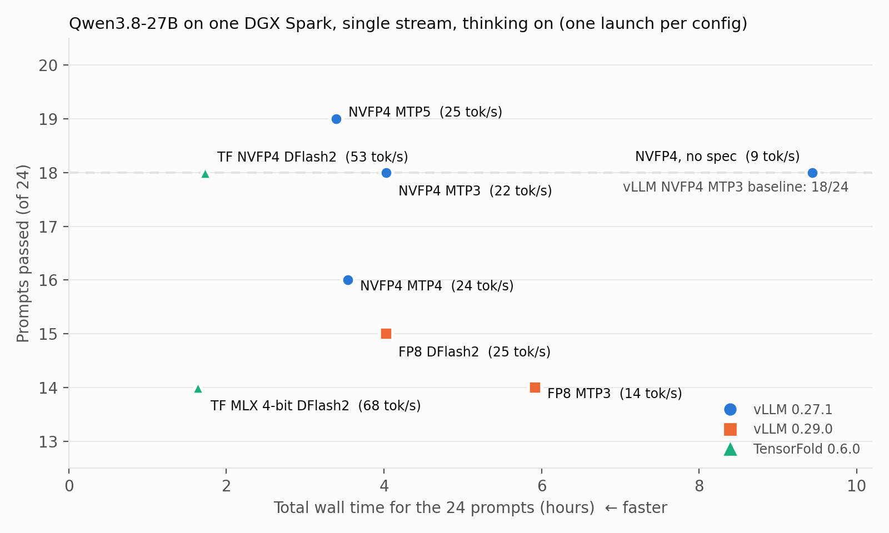

# Qwen3.8-27B single-stream speed vs correctness on one DGX Spark (thinking on)

Eight serving configurations of Qwen3.8-27B on a single NVIDIA DGX Spark (GB10), measured the way one user experiences them: one request at a time, thinking on, ~10K-token answers, every answer graded per question.

This repository contains the results and everything needed to set up the same engines and checkpoints on the same machine ([REPRODUCE.md](REPRODUCE.md)). It does not include the prompts I graded; which tests to run is up to you.

## Results (one launch per configuration, 24 prompts)

| Engine | Weights | Speculation | Output tok/s | Median total s | 24 prompts (h) | Total time vs NVFP4 MTP3 | Passed (code/reasoning) |
|---|---|---|---|---|---|---|---|
| vLLM 0.27.1 | NVIDIA NVFP4 | none | 8.8 | 1233 | 9.44 | 0.42x | 18 (7/11) |
| vLLM 0.27.1 | NVIDIA NVFP4 | MTP3 | 21.9 | 469 | 4.03 | ref | 18 (7/11) |
| vLLM 0.27.1 | NVIDIA NVFP4 | MTP4 | 23.9 | 392 | 3.54 | 1.18x | 16 (5/11) |
| vLLM 0.27.1 | NVIDIA NVFP4 | MTP5 | 24.8 | 379 | 3.39 | 1.24x | 19 (7/12) |
| vLLM 0.29.0 | Qwen FP8 | MTP3 | 14.3 | 615 | 5.92 | 0.70x | 14 (4/10) |
| vLLM 0.29.0 | Qwen FP8 | DFlash2 k=7 | 24.7 | 389 | 4.03 | 1.07x | 15 (4/11) |
| TensorFold 0.6.0 | MLX 4-bit | DFlash2 | 68.3 | 198 | 1.64 | 2.53x | 14 (4/10) |
| TensorFold 0.6.0 | NVIDIA NVFP4 | DFlash2 | 52.6 | 184 | 1.73 | 2.34x | 18 (7/11) |

Short version: TensorFold + NVIDIA NVFP4 + DFlash2 was ~2.3x faster to a complete answer than vLLM NVFP4 MTP3 with the same pass count; within vLLM, MTP5 was the best depth. 11 of the 24 prompts flip between configurations, so differences of 1-4 passes from a single launch are not conclusive (`figures/pass_matrix.png`).

## What is in this repository

| Path | Contents |
|---|---|
| `REPRODUCE.md` | Step-by-step setup: checkpoints, images, launch commands, measurement, thermal settings. |
| `scripts/download_models.sh` | Downloads every checkpoint at the exact revision used. |
| `vllm/` | Runtime image (`Dockerfile`), one config per vLLM row, launch scripts and the measurement client. |
| `tensorfold/` | Image build (TensorFold v0.6.0 + MiaAI-Lab's recipe patches, pinned and hash-checked), launch script and the measurement client. |
| `data/summary_table.csv` | One row per configuration: speed, latency, total time, pass counts, per-question changes vs the reference, tokens per verification step, steps/s, estimated bytes read per step and bandwidth use. |
| `data/pass_matrix.csv` | 24 prompts x 8 configurations, 1 = passed, plus how many configurations passed each prompt. |
| `data/per_request_metrics.csv` | 192 rows: prompt/output tokens, finish reason, whether a final answer was present, output tok/s, time to answer text, total time, tokens per verification step. |
| `figures/` | Both figures and the script that draws them from `data/` (`python3 figures/make_figures.py`, needs matplotlib). |

## How the published results were measured

**Hardware.** One DGX Spark, GB10, 128 GB unified memory (~273 GB/s), DGX OS 7.2.3, driver 580.173.02. The display was on for every run except the second TensorFold MLX 4-bit launch (20 of its 24 prompts), where it was reportedly off but not verified. An active display costs roughly 12-22% decode speed on this machine, so absolute speeds are lower than on a headless box.

**Engines and checkpoints.** Exact images, revisions and launch commands are in [REPRODUCE.md](REPRODUCE.md). In short:

- `nvidia/Qwen3.8-27B-NVFP4` @ `482ca0f`, `Qwen/Qwen3.8-27B-FP8` @ `017b9c7`, `TensorFold/Qwen3.8-27B-MLX-4bit` @ `22d8d53`; DFlash2 drafter `z-lab/Qwen3.8-27B-DFlash2` @ `50307d4`.
- vLLM 0.27.1 (NGC 26.08) for the NVFP4 rows, vLLM 0.29.0 (NGC 26.09) for the FP8 rows. vLLM rows use a BF16 KV cache, no prefix caching, 32K context.
- TensorFold v0.6.0 with MiaAI-Lab's patches: FP8 KV cache, FP8 prefill, one stream, 32K context.

**Requests.** Official Qwen tokenizer and chat template, system prompt "You are a helpful assistant.", thinking on at the template's default effort, temperature 0, `max_tokens` 24,576. Prompt token ids were hashed and identical across engines. One request at a time, after a few warm-up requests per launch.

**Tasks.** 12 coding and 12 reasoning prompts I wrote for this test: algorithms with performance-bound hidden tests, specification edge cases, bug fixing, exact program-output prediction, multi-step calculations, combinatorics, logic puzzles with proven unique answers, derivations from long documents, strict-format instructions. Only the text after `</think>` was graded; no final answer (budget exhausted or missing) counts as a fail. The prompts are not published.

**Metrics.**

- Output tok/s: committed tokens after the first token-carrying stream event divided by the time from that event to the last one; median over prompts. Rejected draft tokens are never counted.
- Total time: request sent to stream finished.
- Total time vs NVFP4 MTP3: per-prompt paired geometric mean.
- Tokens per verification step and steps/s: from server counters.
- Bytes read per step and bandwidth use: estimates from safetensors header sizes (target layers and LM head, MTP layer or drafter, KV at the mean context, linear-attention state) divided by step time and 273 GB/s. Not profiler measurements.

**Thermal protection.**

- vLLM rows: no automatic thermal stop; GPU temperature logged every 0.5 s; peaks 69-77 °C.
- TensorFold MLX 4-bit: the first launch had an automatic stop at 80 °C held for 3 s, which triggered after 4 prompts; the other 20 prompts ran in a second launch with the automatic stop disabled (peak 79 °C).
- TensorFold NVIDIA NVFP4: automatic stop disabled, temperature logged; peak 80 °C.
- A host-memory and driver-error watchdog ran during the TensorFold launches and never triggered. No run logged an NVIDIA out-of-memory or Xid error.

## Caveats

- One launch per configuration and 24 prompts. No reversed-order replication.
- Runs were on different days. The two FP8 rows also changed the vLLM version.
- TensorFold rows use FP8 KV and FP8 prefill; vLLM rows use BF16 KV.
- The TensorFold MLX 4-bit row combines two launches (see Thermal protection), and its display state differed from the other rows.
- At temperature 0, a different kernel, quantization or verification shape changes rounding and the reasoning path. Output length varies about ±25% between configurations even at temperature 0.

## Credits and licenses

Built on vLLM, NVIDIA NGC containers, TensorFold (Ash Hart), MiaAI-Lab's TensorFold recipe, `nvidia/Qwen3.8-27B-NVFP4`, `Qwen/Qwen3.8-27B` and `-FP8`, `TensorFold/Qwen3.8-27B-MLX-4bit` and `z-lab/Qwen3.8-27B-DFlash2`, all Apache-2.0 at the revisions used. No model weights or third-party code are redistributed; `tensorfold/fetch_sources.sh` downloads TensorFold and the recipe from their own repositories.

This repository is released under the [MIT License](LICENSE).
