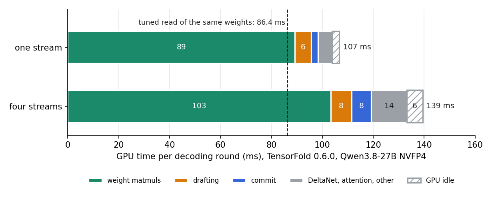
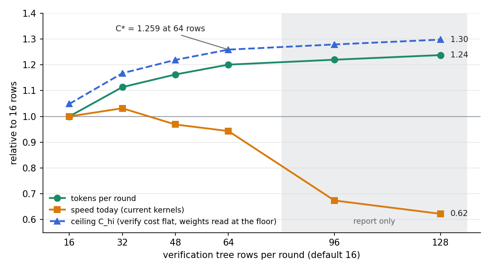
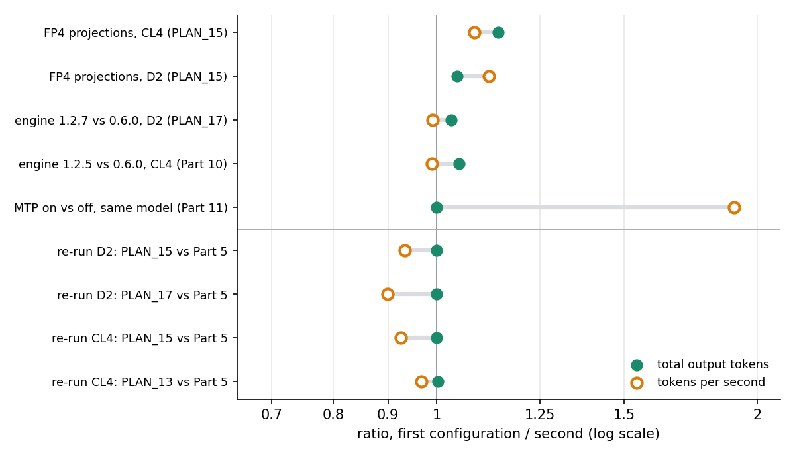

# Part 13: How close is Qwen3.8-27B to the speed limit of one DGX Spark? Four ways to make it faster, and a ceiling measurement

Parts 1-12 chose settings: engine, weights, thinking level, votes, streams. This part asks a lower-level question: with the setup we use every day (TensorFold 0.6.0, NVIDIA's NVFP4 checkpoint, DFlash2 drafts), **how much faster can one stream of the 27B still get, and which change would get there?**

Five locked studies, all on the same machine, model and engine, run between 2026-11-11 and 2026-11-21:

1. **PLAN_14: where one decoding round goes.** A profile with Nsight Systems and a read-bandwidth test. No change to anything.
2. **PLAN_15: read fewer bytes.** The 208 DeltaNet and attention projections that NVIDIA left in FP8 were re-quantized to NVFP4.
3. **PLAN_16: accept more tokens per round.** A wider verification tree (B0) and a drafter fine-tuned on the NVFP4 model (B1).
4. **PLAN_17: a newer engine for one stream.** TensorFold's native 1.2.7 against 0.6.0 at `--parallel 1`, and the new DSpine drafter.
5. **PLAN_22: the ceiling.** A tuned CUDA read kernel, verification trees of 16 to 128 rows, and cuBLAS for comparison.

On top of these, a cross-plan analysis (report only, written after all runs) asks why speed changes rarely show up in **minutes per correct answer**. That measure is all time, including wrong answers, divided by the number of correct answers.

**Main results:**
- **Reading the weights is already at the floor.** One round of one stream reads 17.6 GB of weights. TensorFold's matrix multiplications take 89.2 ms per round. A tuned kernel that only reads the same weights, with nothing else to do, needs 86.4 ms (88.9 ms in a re-run the same evening). A faster kernel could save at most about 5% (up to 3 ms of matmul and 2 ms of idle GPU).
- **None of the four attempts made time per correct answer detectably shorter:**

  | Attempt | Result |
  |---|---|
  | NVFP4 projections (PLAN_15) | decoding 8-12% faster, but more tokens written; time ratio 1.047 (0.952-1.166) with the vote, 0.916 (0.803-1.033) with one request |
  | wider tree, 24 or 32 rows (PLAN_16 B0) | 1.022 and 1.025 times as fast, below the 1.03 bar set in advance |
  | fine-tuned drafter (PLAN_16 B1) | +4.45% on the training proxy, below the 1.05 gate; +1.5% when served |
  | TensorFold 1.2.7 for one stream (PLAN_17) | time ratio 1.025 (0.846-1.255); the DSpine drafter +1.2% on agent turns, below the 5% bar |

- **Accuracy never dropped by more than 2.5 points.** That margin was written into PLAN_15 and PLAN_17 in advance. The lower 95% bounds were −1.75, −1.25 and −1.25 points.
- **One lever is left: a verification kernel that does not slow down as rows grow.**
  - A 64-row tree accepts 20% more tokens per round than the default 16, with replies unchanged.
  - With today's kernels, verifying 64 rows costs 29% more time, so it ends up 6% slower.
  - If verification cost the same at 64 rows, and the weights were read at the floor, one stream could be at most **1.26 times** as fast. That is the ceiling written into the plan.
  - A kernel that grows like cuBLAS (+5% from 16 to 64 rows) at today's speed would give about **1.14 times**. That estimate was made after the results.
- **What decides minutes per correct answer is how many tokens get written, not how fast.**
  - Across the four engine and weight changes here, token speed moved by 0.99-1.12 times, and the total tokens written by 1.03-1.14 times. In three of the four, the token change outweighed the speed change.
  - In Part 11's data, turning llama.cpp's MTP on and off changed the text but not the model. The totals came out at 0.999, but only 181/400 tasks stayed within 10% of their length, and 41 changed by more than 2 times. When the text changes, a few long tasks decide the total.
- **The same configuration run on different days took up to 11% longer with identical text.** The desktop display is the main suspect (Part 2 measured 9-18%). Every locked speed test here alternated arms within one session.

## Setup (all studies)

- **Machine:** one DGX Spark (GB10: 48 SMs, 128 GB unified LPDDR5X, 273 GB/s nominal).
- **Model:** `nvidia/Qwen3.8-27B-NVFP4` @`482ca0f3`, drafts from `z-lab/Qwen3.8-27B-DFlash2` @`50307d4c`.
- **Engine:** TensorFold 0.6.0 in Part 4's image (`qwen38-tensorfold-repro:0.6.0-trace`). Server settings as in Part 4: FP8 KV cache, `--prefill-fp8`, context 81,920, greedy, 40 GiB memory reserve, server on CPU cores 5-9 and 15-19.
- **Tasks (PLAN_15, PLAN_17):** the 400 private tasks of Parts 5-12 (set T, ids T001-T400: 170 Python, 30 C++, 200 reasoning), 40 minutes and 65,536 output tokens per task. Two usages from Parts 4-5:
  - **D2:** one request, low thinking (`reasoning_effort: low`);
  - **CL4:** 4 low-thinking branches at `--parallel 4` with an early-stopping vote.
- **Public prompts (PLAN_14, PLAN_16, PLAN_22):** three fixed prompts (a long thinking reply, a short code reply, a short chat reply; listed in `code/tree/run_tree_width.py`) and Part 4's 5 public example tasks.
- **Speed tests alternate arms within one session.** Accuracy tests use paired statistics: exact McNemar, and a paired bootstrap of the accuracy difference and the time ratio (10,000 resamples, seed 2026), as in all earlier parts.

## PLAN_14: where one decoding round goes

**Question.** Each round, the drafter proposes a tree of tokens and the 27B checks them all in one forward pass. Where does the time go, and how far is it from the hardware?

**Method.** A hook in the server recorded every round (rows checked, tokens accepted, stage times). Nsight Systems traced the GPU. The same three public prompts ran at one stream; four public prompts and the 5 example tasks ran at four streams (CL4's setting). A separate test measured how fast the GPU reads memory with simple PyTorch reads.

**Results.**

| | One stream (long thinking reply) | Four streams |
|---|---|---|
| time per round | 105.9 ms | 139.6 ms |
| tokens per round | 6.86 (5.86 accepted drafts + 1) | 29.9 (4 streams) |
| weight matmuls, GPU time per round | 89.2 ms | 103.3 ms |
| their read speed, FP4 / FP8 weights | 197.9 / 202.6 GB/s | 171.9 / 174.0 GB/s |
| drafting / commit / DeltaNet / attention | 6.4 / 2.8 / 2.1 / 1.9 ms | 8.2 / 7.7 / 5.9 / 3.4 ms |
| GPU idle per round | 2.1 ms (2.9 before removing Nsight's own overhead) | 6.3 ms |

- The weights read per round: 17.61 GB (MLP 9.63, DeltaNet 5.59, attention 1.68, output head 0.72).
- The best simple read reached 219.5 GB/s (8 GB float32 sum), 80% of the nominal 273. At 17.6 GB the best was 192.8.
- **The rule written in advance:** add up what a kernel at 90% of that read speed would save, plus the idle time, as an upper bound S.
  - One stream: S = **1.089**. Four streams: S = **1.191**.
  - At least one path was ≥ 1.10, so the rule said to write a second step aimed at the biggest item: the matmuls at about 60 rows (four streams × 15).
- **We did not write that step.** The room was in four streams only, it was an upper bound, and a bit-exact kernel rewrite is weeks of work. We tried two cheaper ideas first (PLAN_15 and PLAN_16).

## PLAN_15: read fewer bytes (FP8 projections to NVFP4)

**Question.** NVIDIA's checkpoint stores the MLPs and the output head in NVFP4, but 208 projections in FP8: DeltaNet's `in_proj_qkv`, `in_proj_z` and `out_proj` in 48 layers, and `q/k/v/o_proj` in 16 attention layers. Converting them to NVFP4 reads 3.2 GB less per round (17.6 → 14.4 GB). Is it faster per correct answer, without losing accuracy?

**Method.**
- The 208 projections were re-quantized from the original BF16 weights (`Qwen/Qwen3.8-27B` @`1d4bf0f2`). The format is the one NVIDIA's NVFP4 uses: e2m1 values, one e4m3 scale per 16 inputs, one fp32 scale per tensor.
- Block scales were chosen by a small search that minimizes squared error against the BF16 weights, without calibration data. The encoder reproduces NVIDIA's own NVFP4 tensors byte for byte.
- The new projections' error against BF16 is 8.8%, the same level as NVIDIA's MLP layers (8.7-9.3%). FP8 had 2.7%.
- Every other tensor was copied unchanged. The checkpoint shrank from 26.94 to 24.0 GiB.
- The weights change, so the text changes, and accuracy had to be measured again.
- Both usages ran on the 400 tasks: CL4 first, then D2, in 8 alternating blocks of 50 per arm. The plan would have stopped before D2 if the new checkpoint had been worse on CL4 (it was not: 12 against 10, one-sided p = 0.74).

**Results.**

| | CL4, NVFP4 projections | CL4, original | D2, NVFP4 projections | D2, original |
|---|---|---|---|---|
| correct | 375/400 | 373/400 | 370/400 | 363/400 |
| total minutes | 391.7 | 372.0 | 312.2 | 334.2 |
| minutes per correct answer | 1.044 | 0.997 | 0.844 | 0.921 |
| output tokens | 3,186,125 | 2,789,980 | 1,461,130 | 1,397,899 |

| NVFP4 vs original | Only one correct | McNemar p (Holm) | Accuracy difference (95%) | Time per correct ratio (95%) |
|---|---|---|---|---|
| CL4 | 12 / 10 | 0.832 (0.832) | +0.50 points (−1.75, +2.75) | 1.047 (0.952, 1.166) |
| D2 | 24 / 17 | 0.349 (0.698) | +1.75 points (−1.25, +5.00) | 0.916 (0.803, 1.033) |

- **Decision, by the rule written in advance:** no accuracy drop (both lower bounds above −2.5 points), and no speed difference detected (neither upper bound below 1).
- Why: decoding was faster (1.077 times with CL4, 1.121 with D2; 1.188 on short prompts in the check before the run). But the new checkpoint wrote 14% more tokens with CL4 and 4.5% more with D2, which ate most of the gain.
- **Deviation:** the display logger read a file that always says "on". The system log shows the display was off for CL4 groups 0-5 and on afterwards. Results for groups 0-5 only (both arms with the display off): 278/300 each, time ratio 1.085 (0.946, 1.261), same conclusion. The servers' self-test was 18-22% slower in the two original-checkpoint CL4 blocks that ran while the desktop was in use.

## PLAN_16: accept more tokens per round

Verification is exact: whatever the drafter proposes, the reply is the token-for-token the same as without drafts. So anything that changes only the drafting changes speed but not text, and accuracy cannot move.

**B0: a wider tree.** TensorFold 0.6.0 checks at most 16 rows per round for one stream. Widths 16, 24 and 32 ran in the order 16, 24, 32, 32, 24, 16, on the public prompts and examples.

| Rows | Decode speed (two starts) | Tokens per round | ms per round | vs 16 rows |
|---|---|---|---|---|
| 16 | 81.33 / 81.38 tok/s | 8.05 | 98.9 | 1.000 |
| 24 | 82.92 / 83.38 | 8.65 | 104.0 | 1.022 |
| 32 | 82.99 / 83.71 | 8.96 | 107.5 | 1.025 |

- Replies were identical in all six starts.
- The rule asked for ≥ 1.03 and both starts faster than both 16-row starts. 24 and 32 rows were faster in every start, but by 2.2% and 2.5%. **Keep 16.**
- Each round accepted 7.5% and 11% more tokens, but took 5.5% and 9% longer.
- At 32 rows, 39% of rounds (292/758) still ended at the drafter's maximum depth (15). So the next limit was how deep and how well the drafter guesses.

**B1: fine-tune the drafter** on the NVFP4 model's own features, at the 16 positions it is used for (it was trained with 8).
- A trainable copy of the drafter was written and checked against TensorFold's reference path. On synthetic inputs it missed the literal ≥ 99% agreement bar (95.1% and 93.3%). The difference was smaller than between fp32 and bf16 runs of the same implementation, so the bar was ill-posed for synthetic inputs. On real features: 98.85% and 96.67%. Recorded as a deviation; we continued.
- Training data: 895 replies (3.5 million tokens) that the 27B wrote to prompts it generated itself from topic seeds. No private tasks, no downloaded datasets.
- **Gate:** the held-out acceptance proxy had to improve by ≥ 5%. Best: 5.424 against 5.193 for the served drafter, **1.0445**. B1 stopped there.
- Report-only speed test of the fine-tuned drafter (added 2026-11-18): replies identical; one stream 1.015 times as fast, four streams about 3% faster by workload time. Not worth switching.

## PLAN_17: TensorFold 1.2.7 against 0.6.0, one stream

**Question.** Part 10 compared 1.2.5 with 0.6.0 only with the vote at `--parallel 4`. 0.6.0 uses a wider single-stream path only at `--parallel 1`, the daily setting. Is 1.2.7 faster there? Is the new DSpine drafter (`tencent/Qwen3.8-27B-DSpine-b16` @`ea909c0f5f`) worth using?

**Q1: D2 on the 400 tasks, both at `--parallel 1`.**

| | Correct | Total minutes | Minutes per correct answer | Output tokens |
|---|---|---|---|---|
| 1.2.7 | 369/400 | 361.1 | 0.979 | 1,442,237 |
| 0.6.0 | 363/400 | 346.7 | 0.955 | 1,397,899 |

- Only one correct: 19 / 13, p = 0.377. Accuracy +1.5 points (−1.25, +4.25). Time ratio **1.025 (0.846, 1.255)**.
- **Decision:** no accuracy drop, no speed difference detected.
- 1.2.7 was faster on 251/400 tasks, but its 5 slowest tasks cost 62.3 extra minutes. The same pattern as Part 10 (271/400, ratio 1.049).

**Q2: DSpine against DFlash2, both on 1.2.7.** Replies were identical, so only speed counts. Agent turns: 1.012 and 1.009 times as fast in two passes, below the 5% bar set in advance. Chat was 9% slower. **Don't use DSpine.**

**Report only:**
- With 0.6.0, a server started at `--parallel 4` was 10% slower for a single request on the example tasks than one at `--parallel 1`. 1.2.7 showed no difference.
- On recorded agent turns, 1.2.7 took longer to the first token (137.7 against 76.3 s over 32 turns). It seems to reuse less of the previous turn's prompt.
- Without drafts, 1.2.7 decodes 10.0 tok/s. DFlash2 makes it 3.7-7.3 times faster.

## PLAN_22: the ceiling

**Question.** Two numbers decide how much faster one stream could still get. How fast can a tuned kernel read the weights? How many more tokens does a wider tree accept, once verifying more rows is not slower?

**M1: a tuned read kernel** (`code/ceiling/bw_tuned.cu`).
- The kernel reads 16 bytes per load with 1-8 loads in flight. It was swept over 288 settings: load hints, grid-stride or chunked layout, threads, blocks.
- It then read the 401 matmul weight groups of one forward pass in layer order, one launch per group: 17.555 GB, the same weights as PLAN_14's 89.2 ms.
- The best candidate was confirmed in a fresh process (30 repetitions): **F = 86.4 ms (203 GB/s)**.
  - In the candidate round the same setting had measured 82.1 ms. Speed varies by about 5% between processes, so taking the best of many settings is biased; the confirmation step removes that.
  - A re-run of the published code the same evening ([REPRODUCE](REPRODUCE.md) step 2) confirmed 88.9 ms. So the floor is 86-89 ms, and the matmuls' 89.2 ms are within 0-3% of it.
- At 8 and 17.6 GB the best setting confirmed at 195 GB/s.

**M2: tree widths 16 to 128** (the B0 runner, order 16, 32, 48, 64, 96, 128 and back). Replies were identical at every width, and identical to B0's.

| Rows | Tokens per round | vs 16 | Speed today vs 16 | Verify time vs 16 | Ceiling C_hi |
|---|---|---|---|---|---|
| 16 | 8.05 | 1.000 | 1.000 | — | 1.049 |
| 32 | 8.96 | 1.114 | 1.032 | +8% | 1.167 |
| 48 | 9.36 | 1.163 | 0.969 | +21% | 1.219 |
| 64 | 9.66 | 1.201 | 0.943 | +29% | **1.259** |
| 96 (report only) | 9.82 | 1.220 | 0.674 | +88% | 1.279 |
| 128 (report only) | 9.96 | 1.238 | 0.623 | +107% | 1.298 |

- **C_hi** (written in advance) assumes three things:
  - the weight matmuls take F at any width;
  - the GPU idle time is gone;
  - everything else costs what it costs at 16 rows.
  - It uses PLAN_14's round (105.9 ms, 6.86 tokens) and scales the tokens by the measured gain.
- The rule: C\* = the best C_hi at 16-64 rows. Below 1.20, stop. **C\* = 1.259 at 64 rows**, so there is room, and whether to build it is a separate decision.
- **M3: cuBLAS for comparison** (report only). The same 401 matmuls at 16 rows take 99.0 ms, 11% slower than TensorFold. At 64 rows 103.9 ms (+5%), at 128 rows 107.8 ms (+9%). So flat-in-rows verification is possible on this GPU, but cuBLAS is slower at 16 rows and does not give the same bits.
- **A closer estimate** (after the results): TensorFold's matmul speed at 16 rows, growing like cuBLAS to 64 rows, everything else as measured. That gives **1.14 times** (1.12 for the long thinking reply alone).

**This session was 16% slower than B0's** at the same width (115.0 against 98.9 ms per round), in verification and drafting alike. The read test gave the same speeds as PLAN_14's day (195-219 GB/s), so memory bandwidth was not what changed. The display was on; B0's display state was not logged. Tokens per round are exact (identical in both runs of each width), so the acceptance side of the ceiling is unaffected. The 1.049 from reading weights compares F (this session) with PLAN_14's 89.2 ms (another session).

## Across the studies: tokens, not speed (report only)

This analysis was written after all runs. It uses the per-task files of this part, Part 10 and Part 11. Time per correct answer splits exactly into three ratios: **time ratio = token ratio ÷ speed ratio ÷ correct ratio**, where speed is all output tokens over all time.

| Comparison (A vs B) | Time per correct | Tokens | Speed | Correct | A faster on | Same text |
|---|---|---|---|---|---|---|
| NVFP4 projections vs original, CL4 | 1.047 | **1.142** | 1.085 | 1.005 | 249/400 | 0/400 |
| NVFP4 projections vs original, D2 | 0.916 | 1.045 | **1.119** | 1.019 | 241/400 | 0/400 |
| 1.2.7 vs 0.6.0, D2 one stream | 1.025 | 1.032 | 0.991 | 1.017 | 251/400 | 0/400 |
| 1.2.5 vs 0.6.0, CL4 (Part 10) | 1.049 | 1.050 | 0.990 | 1.011 | 271/400 | |
| MTP on vs off, same model (Flash Next, Part 11) | 0.524 | 0.999 | **1.900** | 1.003 | 377/400 | |
| re-run: D2 0.6.0, PLAN_15 vs Part 5 | 1.072 (1.018-1.12) | 1.000 | 0.933 | 1.000 | 26/400 | 400/400 |
| re-run: D2 0.6.0, PLAN_17 vs Part 5 | 1.112 (1.053-1.164) | 1.000 | 0.899 | 1.000 | 16/400 | 400/400 |
| re-run: CL4 0.6.0, PLAN_15 vs Part 5 | 1.078 (1.065-1.092) | 0.999 | 0.926 | 1.000 | 7/400 | 388/400 |
| re-run: CL4 0.6.0, PLAN_13 vs Part 5 | 1.036 (1.032-1.039) | 1.002 | 0.967 | 1.000 | 14/400 | |

- **Engine and weight changes moved speed by 0.99-1.12 times.** Except MTP on llama.cpp (1.9 times), which is a different mechanism.
- **Whenever the text changed, the totals moved too, by up to 14% here**, and a few long tasks decided the total. In the four 27B changes, A was faster on most tasks (241-271/400), yet the total went the other way in three of them. The 10 tasks with the largest gaps made up more than the whole difference.
- **Re-runs with identical text shift as a whole.** The same configuration on another day took 4-11% longer, slower on nearly every task (A faster on only 7-26/400), with the token totals at 0.999-1.002. The display is the main suspect: Part 2 measured 9-18%, and PLAN_15's self-test showed 18-22% when the desktop was in use.
- So: a comparison that does not alternate arms in one session can be off by 10% just from the day. Only changes that keep the text (exact drafting, kernels with identical bits) turn speed into time per correct answer one for one.

## What this shows

- **For one stream of the 27B on a DGX Spark, the engine is close to the hardware.** Reading the weights takes 89 of 106 ms per round, and a tuned read cannot go below 86.
- **The four cheap ideas did not pay:** fewer bytes (NVFP4 projections), a wider tree, a fine-tuned drafter, a newer engine. Each was measured, with the result written down in advance, and none passed.
- **What could still work:** a verification kernel that costs the same at 64 rows as at 16, so that a wider tree's 20% more tokens per round become speed. That is 1.14 times by a closer estimate and 1.26 at most, for one stream only, and the kernel must keep replies bit-identical. We have not built it.
- **For time per correct answer, the bigger lever is how much the model writes.** That is the thinking level and the vote (Parts 4-7), not the engine.

**Practical settings (unchanged):**
- TensorFold 0.6.0 + NVIDIA NVFP4 + DFlash2, `--parallel 1` for one user, the default 16-row tree.
- Keep the display off and the desktop idle when timing anything, and alternate the arms you compare within one session.

## Conditions

- PLAN_14: 2026-11-11 22:00-22:14. PLAN_15: 11-12 08:40 to 11-13 08:37. PLAN_16: B0 11-12 00:09-00:19; B1 on 11-12; B1d 11-18 22:00-22:19. PLAN_17: 11-13 14:09 to 11-14 06:23. PLAN_22: 11-21 15:40-16:13.
- GPU free for at least 5 minutes before each run; no other GPU work during the runs.
- Display: PLAN_14 on; PLAN_15 CL4 off for groups 0-5, on afterwards, D2 on; PLAN_16 B0 not logged, B1d off; PLAN_17 on; PLAN_22 on.
- Every lock was checked at the start and the end of each run, and passed (details in [PREREGISTRATION.md](PREREGISTRATION.md)).

## Limitations

- **One machine, one model, one engine version.** The ceiling is for TensorFold 0.6.0's design on GB10. Other engines or checkpoints may have different room.
- **The ceiling is an upper bound.** It assumes a real matmul (which also has to unpack FP4 and multiply) can run as fast as a pure read. It also assumes attention and DeltaNet do not slow down with a bigger tree. Neither was tested.
- **PLAN_22 compares numbers from two sessions** for the weight-reading part (F today, the matmul time from PLAN_14). The tokens-per-round side is exact.
- **Each accuracy test is one run of 400 tasks.** The time ratio intervals are about ±10-25%, so a difference under about 10-15% cannot be detected end to end.
- **The cross-plan analysis was written after the results** and is not a test. It uses Flash Next data from Part 11 for the only text-only change.
- **The fine-tuning study stopped at its gate.** The drafter was trained once, with one recipe; a different recipe might do better.

## Privacy of the task sets

The 400 task prompts and the graders are private and were never sent to any cloud model. Per-task results are published by public id (T001-T400, the same ids as Parts 5-12). There is no task text, no model output and no hash of either. PLAN_14, PLAN_16 and PLAN_22 used only public prompts and Part 4's example tasks.

## Files

| Path | Content |
|---|---|
| [PREREGISTRATION.md](PREREGISTRATION.md) | the five locked plans: hashes, rules, checks before the runs, results, deviations |
| [REPRODUCE.md](REPRODUCE.md) | what can be rerun (bandwidth, cuBLAS, tree widths on public prompts), what cannot (the private tasks), and recomputing the tables |
| [data/summary.csv](data/summary.csv) | one row per 400-task run (PLAN_15's four, PLAN_17's two, Part 5's D2 re-run reference) |
| [data/per_task_400/](data/per_task_400/) | per-task results by public id: passed, time, output tokens, output-limit and time-limit flags, block |
| [data/same_text.csv](data/same_text.csv) | per task: identical reply text (1) or not (0), for each pair compared |
| [data/profile_round.json](data/profile_round.json) | PLAN_14: per-round times by stage and by kernel group, matmul read speeds, the S estimates |
| [data/bandwidth.csv](data/bandwidth.csv) | PLAN_14's PyTorch reads and PLAN_22's confirmed tuned reads |
| [data/ceiling_sweep.csv](data/ceiling_sweep.csv), [data/ceiling_forward.csv](data/ceiling_forward.csv), [data/ceiling_cublas.csv](data/ceiling_cublas.csv) | PLAN_22 M1 (288 settings at 2 and 8 GB, the forward pattern) and M3 |
| [data/tree_width.csv](data/tree_width.csv) | every start of PLAN_16 B0 and PLAN_22 M2: tokens, rounds, stage times, why rounds ended |
| [data/drafter.json](data/drafter.json) | PLAN_16 B1: the checks, the gate and the report-only speed test |
| [data/engine_speed.csv](data/engine_speed.csv) | PLAN_17's speed passes (DSpine, `--parallel 4` against 1, no drafts) |
| [data/tests_preregistered.json](data/tests_preregistered.json) | the locked tests, recomputed from the data above |
| [data/reported_only.json](data/reported_only.json) | the cross-plan analysis and other report-only numbers |
| [figures/](figures/) | the three figures and the script that draws them |
| [code/](code/) | the read kernel, cuBLAS check, tree-width runner, profile hook, quantizer, drafter code, PLAN_17 runner, tables and statistics |
| [scripts/recheck.sh](scripts/recheck.sh) | recompute every table and compare with the locked results |

Code: MIT ([LICENSE](LICENSE)).
