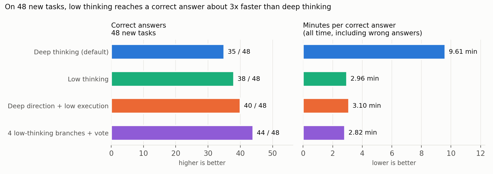

# Part 4: think less, or think in parallel? How to get correct answers fastest from Qwen3.8-27B on one DGX Spark

[Parts 1–3](https://github.com/NautilusWu/qwen3.8_study/blob/main/qwen38-spark-speed-comparison-final/README.md) chose the fastest single-user engine: TensorFold + NVIDIA NVFP4 + DFlash2. This part keeps that engine fixed and asks how to *use* the model: one long deep-thinking answer, less thinking, several short answers in parallel with a vote, a coding agent that runs its own code, or a deep-thinking plan carried out by a fast low-effort pass. The measure is the one that matters to a user: **minutes per correct answer** (all time spent, including on wrong answers, divided by the number of correct answers).

The study had two phases. In the exploration phase, methods were tried on two 24-task sets. The main claims were then checked once on **48 new tasks**, with the methods, tests and pass/fail rules written down and locked before the run ([PREREGISTRATION.md](PREREGISTRATION.md)). The task sets are not published (as in Parts 1–3); per-task results are in [data/](data/) by task id.

## Result (confirmation phase, 48 new tasks)

| Method | Correct (code / reasoning) | Total time | Minutes per correct answer | Hit the output limit |
|---|---|---|---|---|
| Deep thinking (the model's default effort), output limit 65,536 | 35 / 48 (16 / 19) | 336.5 min | 9.61 | 11 |
| Low thinking (`reasoning_effort: low`) | 38 / 48 (21 / 17) | 112.4 min | 2.96 | 0 |
| Deep direction + low execution | 40 / 48 (23 / 17) | 124.0 min | 3.10 | 0 |
| 4 low-thinking branches in parallel + vote | **44 / 48** (22 / 22) | 124.3 min | **2.82** | 0 |

| Claim (locked before the run) | Result | Verdict |
|---|---|---|
| C1 Low thinking reaches a correct answer faster than deep thinking (≤ 50% of the time, CI upper bound < 1) | 0.31x (95% CI 0.17–0.51) | **Confirmed** |
| C2 Low thinking is not clearly less accurate (two-sided p ≥ 0.05 and ≥ deep − 3) | 38 vs 35; 9 vs 6 discordant, p = 0.61 | **Confirmed** |
| C3 Deep direction + low execution is no worse than deep thinking (≥ deep − 2) and much faster (≤ 50%) | 40 vs 35; 0.32x (0.20–0.51) | **Confirmed** |
| C4 Parallel voting is more accurate than single low thinking (one-sided p < 0.05) | 44 vs 38; 8 vs 2 discordant, p = 0.055 | **Not confirmed** (just above 0.05) |
| C5 Parallel voting costs at most 1.5x the time per correct answer of single low thinking | 0.96x (0.66–1.32) | **Confirmed** |

Exact sign tests (McNemar) on the tasks where two methods disagree; intervals are paired bootstrap over tasks (10,000 resamples). The locked files were hash-checked after the run.

What this means in practice:

1. **The default deep thinking mostly overthinks.** Most of its wrong answers come from thinking until the output limit and never writing an answer. Low thinking needed about a third of the time per correct answer and was not less accurate.
2. **Deep thinking is worth more as a direction than as the whole answer.** A ≤300-word plan written with deep thinking (about 1 minute), then carried out with low thinking, matched or beat full deep thinking at a third of the time.
3. **Parallel voting needs short branches.** With low thinking, 4 parallel branches cost the same time per correct answer as one branch, and answered 6 more tasks correctly; the accuracy gain did not quite reach the pre-set significance level (p = 0.055). With deep thinking in each branch (exploration phase, dev set), parallel voting was the slowest method of all.

## Why parallel branches are nearly free on this machine

Generating one token needs one pass over the ~16 GB of weights, so a single stream is limited by memory bandwidth and leaves most of the GPU idle. Several streams share that pass:

| Simultaneous requests | Total tokens/s | vs one stream | Speed of each request |
|---|---|---|---|
| 1 | 41 | 1.0x | 100% |
| 2 | 70 | 1.7x | 92% |
| 4 | 122 | 3.0x | 83% |
| 8 | 186 | 4.5x | 67% |

Each request writes 2,048 tokens with thinking on, 2 rounds × greedy and sampled ([data/concurrency.csv](data/concurrency.csv)). TensorFold's own calibration reports verifying 32 draft rows in 100 ms against 94 ms for one.

## Exploration phase (two 24-task sets)

Minutes per correct answer (correct answers in brackets). The "hard" set is a new set of 24 harder tasks; the dev set is the one from Parts 1–2.

| Method | Dev set | Hard set |
|---|---|---|
| A Deep thinking, output limit 24,576 | 5.15 (18) | 10.16 (12) |
| A65 Deep thinking, output limit 65,536 | 7.20 (19) | 12.16 (18) |
| D1 Medium thinking | 2.12 (19) | — |
| **D2 Low thinking** | **0.89** (22) | 3.07 (17) |
| D3 Deep thinking cut at 8,192 thinking tokens | 2.68 (22) | — |
| C4 / C8 4 / 8 deep-thinking branches + vote | 6.93 (20) / 8.43 (21) | — |
| CL4 4 low-thinking branches + vote | 1.37 (22) | 3.10 (**21**) |
| B Agent that can run Python/C++ in a sandbox | 2.53 (22) | 3.77 (19) |
| P1 Model splits the task into parallel subtasks | 1.25 (23) | **3.01** (18) |
| P2 Fixed parallel roles (implementation, tests, program, checker) + sandbox | 2.24 (**24**) | 3.23 (20) |
| H Deep direction + low execution | 1.94 (22) | 3.54 (20) |

Observations from this phase (not formally tested):
- The output limit hides deep thinking's ability on hard tasks: raising it from 24,576 to 65,536 turned 6 more hard tasks correct, each needing 25–65K tokens. Deep thinking is still the slowest per correct answer.
- Letting the model split a task into parallel subtasks (P1) did not beat voting: it chose not to split on most tasks. The fixed-role version (P2) found that model-written tests are often wrong (two independent implementations failed the same test 9 times).
- The coding agent was the only method to solve some computation-heavy reasoning tasks, by computing the answer with a program. Every hard task was solved by at least one method, which suggests routing by task type as a next step.

## Coding agents on the same model

Four agent programs, each driving the same local Qwen3.8 through the same normalising proxy (deep thinking, 32,768 output limit), on 8 small repository tasks with hidden tests (one run each, server restarted before every run):

| Agent | Solved | Minutes per solved task | Notes |
|---|---|---|---|
| OpenCode 1.18.35 | 7 / 8 | **1.4** | fastest on 5 of 8 tasks |
| Codex CLI 0.162.1 | 7 / 8 | 1.9 | needs three Responses-API adaptations for a local server |
| Qwen Code 0.25.0 | **8 / 8** | 3.2 | the only one to solve the hardest task; about 2x slower otherwise |
| Claude Code 2.1.296 | 7 / 8 (8 with the time-out) | 6.1 | connected through a LiteLLM gateway, which Anthropic does not support; looped on one task until the 30-minute limit |

The same agent on the same task varied by up to 1.7x between two runs, so only the totals are meaningful. Data: [data/coding_agents.csv](data/coding_agents.csv); harness: [code/coding_agents/](code/coding_agents/). The task repositories are not published.

## A practical fix: long conversations exhausting memory

During the agent runs the machine ran out of memory and hung. On the GB10, GPU memory is system memory. PyTorch's caching allocator keeps freed GPU blocks for reuse instead of returning them. Late in a long conversation every decoding step asks for scratch buffers slightly larger than the previous step's, so the cached smaller blocks never fit and new memory is taken each time; the cache grew by gigabytes per minute until the system had nothing left. Container memory limits do not cover this memory.

Setting `PYTORCH_CUDA_ALLOC_CONF=expandable_segments:True` lets freed memory be reused for the larger requests: with a 100K-token prompt and a 4,800-token reply, the server grew by 9.5 GiB with the default allocator and by 0.7 GiB with this setting, with identical output tokens and the same time ([code/memory/leak_probe.py](code/memory/leak_probe.py); [code/memory/memwatch.py](code/memory/memwatch.py) is the guard used during the runs). Keeping a memory reserve for the rest of the system (here 40 GiB) is also advisable.

## Conditions

- One DGX Spark, single user. Model nvidia/Qwen3.8-27B-NVFP4; engine TensorFold 0.6.0 with z-lab DFlash2 drafts, FP8 KV cache and FP8 prefill (Part 3 setup; `scripts/setup.sh` downloads and builds everything, see [REPRODUCE.md](REPRODUCE.md)); `expandable_segments` on.
- Kernel 7.0.0-1019-nvidia, driver 580.178.04 (updated after Part 3) for the strategies and the concurrency test. The deep-thinking outputs on the dev set were token-for-token identical to Part 2, and total time within 1%. The coding-agent comparison and the memory probe ran before the update, on Part 3's system (kernel 6.17.0-1031-nvidia, driver 580.173.02).
- Greedy decoding except the parallel branches (temperature 0.6, top_p 0.95, top_k 20, one seed per branch). Context 32,768 in the exploration phase (81,920 where the output limit was 65,536), 25-minute limit per task (40 minutes for the 65,536 runs and the confirmation phase). Display on throughout. Grading in a network-isolated sandbox with hidden tests; no method saw graders or retried based on them.

## Limitations

- 48 confirmation tasks, one run per method. Differences of a few tasks in accuracy are within noise; the time differences (about 3x) are not.
- The tasks are synthetic coding and reasoning problems with exact answers; results on open-ended work may differ.
- All conclusions are for this model on this machine with a single user. With many users, parallel branches compete with other requests.

## Files

| Path | Content |
|---|---|
| [PREREGISTRATION.md](PREREGISTRATION.md) | every locked plan, its rules and when it was locked |
| [REPRODUCE.md](REPRODUCE.md) | what can and cannot be reproduced, host requirements, setup, acceptance check, runs on your own tasks |
| [scripts/](scripts/) | `setup.sh` (host check, checkpoints, images), `smoke_test.sh` (acceptance check on the examples), `run.sh` (runs on your tasks; `run.sh recheck` recomputes the published tests from the per-task data) |
| [tensorfold/](tensorfold/) | engine build files from Part 3, plus a lock on every Python package version |
| [examples/](examples/) | 5 example tasks with a grader and 1 example agent task, to check the pipeline (not from the study's task sets) |
| [data/summary.csv](data/summary.csv), [data/per_task.csv](data/per_task.csv) | all runs, per method and per task (task ids only) |
| [data/confirmation_tests.json](data/confirmation_tests.json) | the five confirmation tests as computed |
| [data/concurrency.csv](data/concurrency.csv), [data/coding_agents.csv](data/coding_agents.csv) | parallel throughput; agent comparison |
| [figures/](figures/) | figure and the script that draws it |
| [code/strategies/](code/strategies/) | the methods (A, D, C/CL, B, P1, P2, H), the runner and the statistics |
| [code/coding_agents/](code/coding_agents/) | agent harness: pinned image, model server, proxy, LiteLLM gateway, configs, runner |
| [code/memory/](code/memory/) | memory guard and the allocator probe |

Code: MIT ([LICENSE](LICENSE)).
